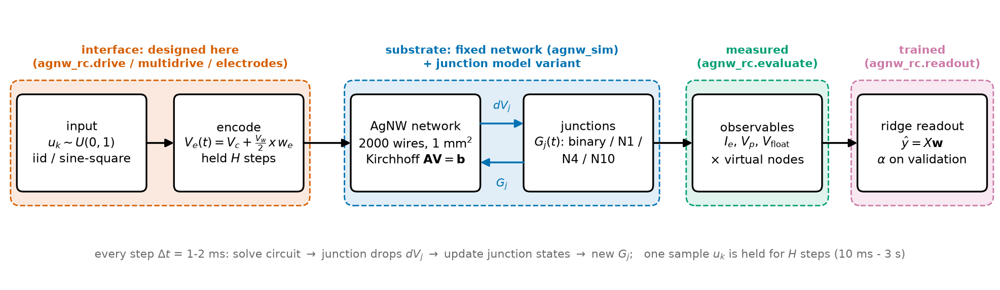
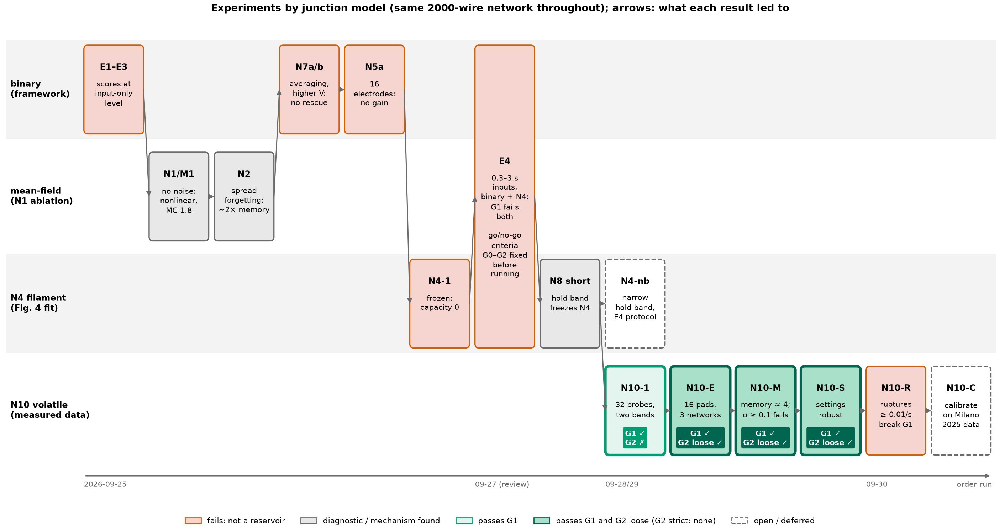
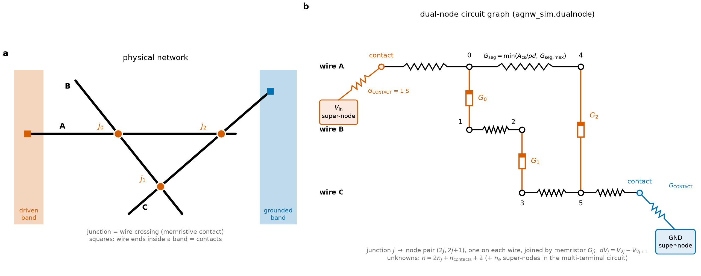
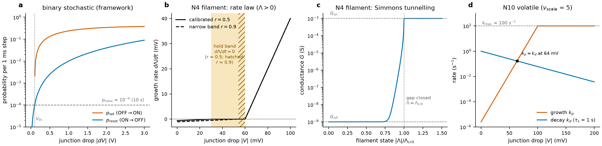
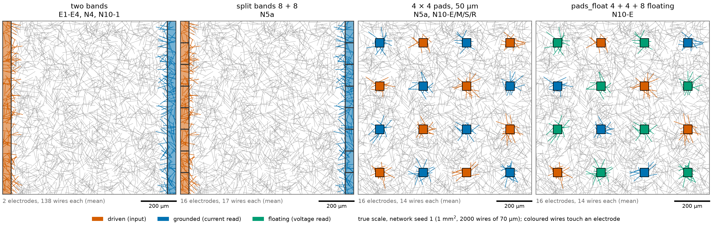

# AgNW Reservoir Computing — Full Manual

Question: **can a silver-nanowire (AgNW) network work as a reservoir computer?**
Answer so far: with framework binary junctions or Fig. 4-calibrated filament: **no**;
with volatile measured-data junction N10 on 16 pads: **yes, weakly**
($\mathrm{MC} \approx 3.5$, degree-2 $\approx 6.7$, NARMA-10 $\mathrm{NMSE} \approx 0.40$),
broken by filament ruptures $\ge 0.01\,\mathrm{s}^{-1}$ per junction.
Details: `docs/RESULTS.md` (results), `docs/NEXT_STEPS.md` (status, open items),
`docs/report_2026-09-29/report.md`, `docs/report_2026-10-06/report.md` and `docs/report_2026-10-07/report.md` (summary reports), `RESUME_FROM_HERE.md` (setup, reading order).

Hard rules:

- Network geometry, wires, Kirchhoff solver and binary junction dynamics come unchanged from
  `AgNW_FDT_Memristor_Framework` (`agnw_sim`, commit `f6b6951`, installed editable). Import, never copy.
  Special cases of new code here must reproduce the framework exactly.
- This repo designs electrodes, input encoding, junction variants, readout, tasks, baselines, criteria.
- Run everything with `.venv/bin/python` (tests `.venv/bin/python -m pytest`).
- One BLAS thread per process (`OMP_NUM_THREADS=1`; scripts set it).
- Math in markdown as LaTeX (`scripts/md_math_to_latex.py` fixes leftovers).
- `legacy/` is superseded; its memory-capacity numbers are invalid.



*Figure 1. Pipeline. Interface (orange) and readout (pink) are designed or trained here; the network (blue) is
the framework's, with a junction model variant (§3). Circuit and junctions are solved in a loop every time step.*



*Figure 2. Experiments by junction model in the order they were run, coloured by outcome (details §7.1). Thick green
borders and badges mark the experiments that pass G1 (N10-1) and G1 + G2 loose (N10-E/M/S); none passes G2 strict.*

## Contents

- [Concepts and glossary](#concepts-and-glossary)
0. [Quickstart](#0-quickstart)
1. [Repository map](#1-repository-map)
2. [Fixed substrate](#2-fixed-substrate-imported-never-copied)
3. [Junction models](#3-junction-models)
4. [Interface](#4-interface)
5. [Learning, tasks, baselines, criteria](#5-learning-tasks-baselines-criteria)
6. [Code reference](#6-code-reference-every-file)
7. [Experiments, outputs, reproduce](#7-experiments-outputs-reproduce)
8. [Limits and next steps](#8-limits-and-next-steps)
9. [Extending: new junction model or experiment](#9-extending-new-junction-model-or-experiment)
10. [Runtimes and troubleshooting](#10-runtimes-and-troubleshooting)
11. [References](#11-references)

## Concepts and glossary

**Reservoir computing in one paragraph.** A fixed dynamical system (the *reservoir*, here the nanowire network) is
driven by an input stream $u_k$. Its state at each step is a nonlinear function of the recent input history. Only a
linear *readout* $\hat y = X\mathbf{w}$ on measured features $X$ is trained, by ridge regression. The reservoir is
useful if (i) the same input history always gives the same state (*echo-state property*, here *consistency*),
(ii) the state remembers past inputs (*memory*), and (iii) it mixes them nonlinearly. Each is measured with the
standard tasks below and compared with software reservoirs (ESNs) of the same size.

| term | meaning |
|---|---|
| MC | linear memory capacity: $\sum_{k\ge 1} C_k$, how well past inputs $u[t-k]$ can be reconstructed (max = number of features) (§5.3) |
| IPC2, degree-2 | information-processing capacity of degree 2: reconstruction of products/squares of past inputs; nonlinearity measure (§5.2) |
| NARMA-10 | standard benchmark mixing memory (10 steps) and nonlinearity; scored as NMSE (1 = useless, 0 = perfect; input-only $\approx 0.8$) |
| NMSE | mean-square error / target variance; capacity $C = 1 - \mathrm{NMSE}$ |
| ESN | echo-state network: random recurrent $\tanh$ network, the software reference reservoir (§5.4) |
| consistency | correlation between two runs with the same input but different noise and initial state; 1 = reproducible (§5.3) |
| G0 / G1 / G2 | go/no-go criteria: reproducible / computes beyond its input / useful vs ESN (§5.5) |
| hold, $H$ | number of 1 ms steps each input sample is held on the electrodes (input duration) |
| stride | circuit + junction update every `stride` ms ($\Delta t = $ `stride` $\times 1$ ms); hold must be a multiple |
| washout | drive before scoring so the network forgets its all-OFF start ($\ge 3\times$ the slowest time scale) |
| virtual nodes | the same current sampled at several times inside one hold; turns transients into extra features (§4.3) |
| onset | network voltage at which conductance jumps in a slow (quasi-static) sweep: the first conducting paths form |
| window | input voltage range $[V_c - V_w/2, V_c + V_w/2]$; set relative to the onset |
| replicate | repeat with the same input and network, different switching noise / initial state; used for consistency |
| network seed | geometry seed (1, 2, 3): three different random networks |
| oracle readout | all junction states as features; not measurable, used only to see what information exists inside |
| probes | 32 internal node voltages; would need micro-contacts, reference only |
| M1 | the mean-field (N1) experiment grid (§7.2) |
| Lamas Fig. 4 | $I$–$V$ loop of the $N = 2000$ network under a 3.6 V sine in Lamas et al. 2026; a *simulation*, used to calibrate N4 |
| E*n* / N*n* | experiment and work-item names (§7.1; E = planned grids, N = follow-ups in `docs/NEXT_STEPS.md`) |

Symbols reused with different meanings: $r$ = N4 hold-band ratio $V_\mathrm{reset}/V_\mathrm{set}$ (rupture rate is
$r_\mathrm{rup}$); $\sigma$ = junction noise amplitude (N4, N10) in §3, feature std in §5.1/§5.3, ESN input scale
$\sigma_\mathrm{in}$ in §5.4.

## 0. Quickstart

```bash
.venv/bin/python -m pytest -q                       # 139 tests, ~7 min; checks framework commit too
.venv/bin/python scripts/pilot.py                   # staircase onset + SET/relax steps -> results/pilot.npz
.venv/bin/python scripts/run_sims.py e1 --procs 14  # one experiment grid -> results/raw/*.npz
.venv/bin/python scripts/evaluate_all.py            # scores -> results/metrics.json, summary.csv
.venv/bin/python scripts/make_figures.py --only fig3
```

One run in Python:

```python
from agnw_rc import config as C
from agnw_rc.multidrive import simulate_multi

wo = C.model_washout_steps("volatile", tau_s=3.0, tau_spread=1.0)   # 66502; grids round up to whole holds (67000)
spec = C.RunSpec(stream="iid", hold=1000, v_center=0.38, v_width=0.16, network_seed=1, replicate=0,
                 n_samples=800, model="volatile", layout="pads", tau_s=3.0, tau_spread=1.0,
                 washout=wo, n_virtual=50, stride=2)
raw = simulate_multi(spec)          # dict of arrays, see section 7.3 (hours: 800 x 1 s holds)

from agnw_rc.evaluate import observables, score_iid, noise_floor
F = observables(raw)["electrodes"]  # headline readout of a pad chip (others: "current", "probes", "junctions")
s = score_iid(F, raw["u"], floor=noise_floor(raw["u"]))
print(s["MC"], s["IPC2"], s["narma10_nmse"])
```

Criteria (G0–G2) need 3 networks x 2 replicates plus a sine/square run; the report scripts
(`n10e_pilot.py report`, `e4_report.py`, ...) do this and write `results/*_criteria.json`.

Read results: `results/summary.csv` (mean/std over nets and replicates) and
`results/*_criteria.json` (G0/G1/G2 verdicts, section 5.5).

## 1. Repository map

```text
agnw_rc/     reservoir layer on top of agnw_sim (section 6.1)
scripts/     pilots, parallel runs, reports, checks, figures (section 6.2)
tests/       139 pytest: framework contract, drive, readout, metrics, tasks, baselines,
             mean-field, filament, volatile, multi-electrode, criteria (section 6.3)
docs/        PLAN, RESULTS, NEXT_STEPS, SWITCHING_MECHANISMS, N4_DESIGN, N10_DESIGN,
             REVIEW_2026-09-27, LITERATURE_NOTES, MEASUREMENT_REQUEST, MANUAL (this file),
             report_2026-09-28/, report_2026-09-29/, report_2026-10-06/
memory/      portable project memory (loaded via CLAUDE.md)
legacy/      superseded prototype (its memory-capacity numbers invalid)
figures/     generated plots; figures/manual/ schematics for this manual
results/     raw/*.npz runs (git-ignored, ~6 GB slim; full files with junction states archived, §7.3) + *.json/csv scores
```

Framework dependency (`../AgNW_FDT_Memristor_Framework/agnw_sim/`):
`geometry.py` sticks + intersections, `circuit.py` two-terminal solve,
`dualnode.py` dual-node graph + wire resistance, `cached_solver.py` refactor-reuse LU,
`dynamics.py` binary SET/RESET, `presets.py` `lamas2026_fig4`,
`simulate.py` `run_simulation`, `io.py`, `waveforms.py`, `analysis.py`.

## 2. Fixed substrate (imported, never copied)

### 2.1 Geometry — `agnw_sim.geometry`, `agnw_rc.config.make_network`

$N = 2000$ sticks of length $L = 70\,\mu\mathrm{m}$ in a square
$A = 1\,\mathrm{mm}^2$ (side $S = \sqrt{A} = 1\,\mathrm{mm}$).
Centers $\mathbf{c}_i \sim U([0,S]^2)$, angles $\theta_i \sim U([0,\pi))$,
endpoints $\mathbf{p}_{i,1/2} = \mathbf{c}_i \mp (L/2)(\cos\theta_i,\sin\theta_i)$.
All pairwise intersections (spatial-hash candidates + segment test) become junctions.
Seeded: `build_network(2000, 1e-6, 70e-6, rng(seed))`, seeds $1,2,3$.
Wire diameter $D = 90\,\mathrm{nm}$ (inferred; reproduces Fig. 4 peak $\approx 8\%$).

### 2.2 Dual-node circuit — `agnw_sim.circuit`, `agnw_sim.dualnode`



*Figure 3. (a) Three wires, three crossings $j_0$–$j_2$, contacts where wire ends lie inside a band.
(b) The same as a circuit: each junction becomes a node pair on its two wires joined by memristor $G_j$; wire
segments between nodes are resistors $G_\mathrm{seg}$; contacts tie to electrode super-nodes through
$G_\mathrm{CONTACT}$.*

Each wire is split at its junctions into resistive segments. Each junction $j$
becomes two graph nodes $(2j, 2j+1)$ on the two wires, joined by the memristor
edge $G_j$. Consecutive nodes on the same wire are joined by a resistive segment
with conductance

$$G_{\mathrm{seg}} = \min\left(\frac{A_{\mathrm{cs}}}{\rho\, d},\, G_{\mathrm{seg,max}}\right),
\qquad A_{\mathrm{cs}} = \pi (D/2)^2,$$

with Ag resistivity $\rho = 1.59\times 10^{-8}\,\Omega\mathrm{m}$ (`RHO_AG`), wire
diameter $D = 90\,\mathrm{nm}$, distance $d$ along the wire, and cap
$G_{\mathrm{seg,max}} = 10^3\,\mathrm{S}$ (`G_SEG_MAX`). Electrode wires get one
extra contact node at the wire end inside the band, tied to the electrode by
$G_{\mathrm{CONTACT}} = 1.0\,\mathrm{S} \gg G_{\mathrm{on}}$.

Full nodal admittance $\mathbf{Y} \in \mathbb{R}^{n \times n}$,
$n = 2n_j + n_{\mathrm{contacts}} + 2$ (last two = $V_{\mathrm{in}}$, GND super-nodes):

$$Y_{pq} = -g_{pq}\quad(p \ne q), \qquad Y_{pp} = \sum_{q \ne p} g_{pq}$$

Dirichlet reduction: fix $V_{\mathrm{in}}$, $V_{\mathrm{gnd}} = 0$,
solve free reachable nodes:

$$\mathbf{Y}_{ff}\,\mathbf{V}_f = -\mathbf{Y}_{f,\mathrm{fix}}\,\mathbf{V}_{\mathrm{fix}}$$

Unreachable components (no path to either electrode) set to $0\,\mathrm{V}$.
Total current $I = \sum_c G_{\mathrm{CONTACT}}(V_{\mathrm{in}}-V_c)$ over the driven contact nodes $c$.
Framework `DualNodeCircuit.solve()` / `cached_solver` (LU refactor only when $G$ changed).
`agnw_rc.config`: `DT = 1e-3` ($\Delta t = 10^{-3}$ s), `P_RELAX = 1e-4` (per step),
`SOLVER = "cached"`, `RHO_AG = 1.59e-8`, `G_SEG_MAX = 1e3`.

### 2.3 Multi-terminal extension — `agnw_rc.multicircuit`

Same graph, but $n_e$ electrode super-nodes (`MultiTerminalCircuit`).
$n = 2n_j + n_{\mathrm{contacts}} + n_e$.
System $\mathbf{A}\mathbf{x} = \mathbf{b}$ with
$\mathbf{A} = \mathbf{L}_{ff} + \mathbf{J}^T \mathrm{diag}(\mathbf{G})\mathbf{J}$,
$\mathbf{b} = \mathbf{B}\mathbf{V}_{\mathrm{fixed}}$,
$\mathbf{B} = -\mathbf{L}_{\mathrm{fixed}}[\mathrm{free},\mathrm{fixed}]$.
`fixed` = driven + grounded super-nodes; floating pads are free unknowns.
Methods `reuse` (refactor iff $G$ changed, `splu`), `direct`, `pcg`
(`cg` with LU preconditioner, `rtol = 1e-13`, `max_iter = 30`,
refactor if `info != 0` or iterations exceed `max_iter / 2`).
Tested to match framework matrix to round-off.
Junction drops $dV_j = V_{2j}-V_{2j+1}$.
Electrode currents, with $s_e$ the super-node of electrode $e$ and $\mathcal{C}_e$ its contact nodes:

$$I_e = \sum_{c \in \mathcal{C}_e} G_{\mathrm{CONTACT}}\,(V_{s_e}-V_c), \qquad \sum_e I_e = 0.$$

## 3. Junction models



*Figure 4. Switching laws, computed with the project code at the parameters used. (a) Binary: per-step SET and
RESET probabilities vs junction drop; relaxation $10^{-4}$ per step. (b) N4: $d\Lambda/dt$ is zero in the hold
band $[V_\mathrm{reset}, V_\mathrm{set}]$ (calibrated $r = 0.5$; hatched: $r = 0.9$), which freezes the network.
(c) N4 conductance rises over 6 decades just before the gap closes. (d) N10: growth and decay rates cross at
$\approx 64$ mV per junction; no hold band.*

### 3.1 Framework binary stochastic (E1–E4, N5a, N7) — `agnw_sim.dynamics`

**Verdict: not a reservoir.** Switching noise makes junctions irreproducible; forgetting too slow.

State $G_j \in \{G_{\mathrm{off}},G_{\mathrm{on}}\}$,
$G_{\mathrm{off}} = 10^{-9}\,\mathrm{S}$, $G_{\mathrm{on}} = 10^{-3}\,\mathrm{S}$.
Lamas 2026 preset (`presets.lamas2026_fig4`, `SimParams.from_step_probs(0.4,0.01)`):

$$P_0 = 400\,\mathrm{s}^{-1}, \quad P_{\mathrm{decay}} = 10\,\mathrm{s}^{-1}\mathrm{unit}^{-2},
\quad \alpha = 1.0\,\mathrm{V}^{-1}, \quad V_{\mathrm{th}} = 0.1\,\mathrm{V},
\quad I_{\mathrm{unit}} = 10^{-3}\,\mathrm{A}$$

($V_{\mathrm{th}} = 0.1\,\mathrm{V}$ inferred from Fig. 4; the paper prints $0.01\,\mathrm{V}$,
which moves the network onset to $\approx 0.35\,\mathrm{V}$, far below the Fig. 4 loop.)
Per step $\Delta t = 10^{-3}\,\mathrm{s}$:

$$p_{\mathrm{set}}(|dV|) = \Delta t\,P_0\,\max\left(0,\,1-e^{-\alpha(|dV|-V_{\mathrm{th}})}\right)$$

$$p_{\mathrm{reset}}(I) = \min\left(1,\,\Delta t\,P_{\mathrm{decay}}\,(I/I_{\mathrm{unit}})^2\right),
\quad I = G_{\mathrm{on}}\,dV$$

$$p_{\mathrm{off}} = 1-(1-p_{\mathrm{reset}})(1-p_{\mathrm{relax}}),
\quad p_{\mathrm{relax}} = 10^{-4}/\mathrm{step}$$

`update_dynamics`: OFF $\to$ ON w.p. $p_{\mathrm{set}}(|dV|)$;
ON $\to$ OFF w.p. $p_{\mathrm{off}}$. Synchronous from start-of-step state,
non-polar ($|dV|$, $I^2$ only). Mean ON lifetime at zero current $10^4$ steps $= 10\,\mathrm{s}$.
At E1 drive: ON fraction $0.21$–$0.32$, $\approx 5$–$7$ flips/sample.

Onset values (all $N = 2000$, two bands, different protocols):

| protocol | onset |
|---|---|
| quasi-static staircase from all-OFF (`pilot.py`, RESULTS §1) | $\approx 1.5\,\mathrm{V}$ |
| Fig. 4 sine loop, $3.6\,\mathrm{V}$ (`fig4.py`) | $1.58\,\mathrm{V}$ |
| Lamas Fig. 4 (paper target) | $1.92\,\mathrm{V}$ |

Why it fails: one noisy slow integrator. Which junction switches is
noise-decided (junction consistency $0.00$); $10\,\mathrm{s}$ forgetting vs
$10$–$100\,\mathrm{ms}$ inputs. Scores: $\mathrm{MC} \le 0.26$
($0.76$ at $1\,\mathrm{s}$ holds; $0.94$ at $3\,\mathrm{s}$ in E4), degree-2 $\le 0.13$, NARMA $\ge 0.73$.
Averaging 8 noise replicates (N7a) does not rescue junction/probe features; higher voltages (N7b) do not help.

### 3.2 Mean-field ablation N1/N2 — `agnw_rc.meanfield`

**Verdict: diagnostic only.** Removing noise gives reproducibility and nonlinearity, not memory.

State $P_j \in [0,1]$, ON probability:

$$P_j \leftarrow P_j(1-p_{\mathrm{off}}) + (1-P_j)\,p_{\mathrm{set}}$$

exact expectation of §3.1 given voltages, with
$p_{\mathrm{reset}}$ evaluated at $I_{\mathrm{on}} = G_{\mathrm{on}}|dV|$.
Circuit uses $G_j = G_{\mathrm{off}}+P_j(G_{\mathrm{on}}-G_{\mathrm{off}})$.
N2 heterogeneous: per-junction $p_{\mathrm{relax},j} \sim$
log-uniform $[p_{\mathrm{relax}},p_{\mathrm{relax,max}}]$, quenched,
seed $50000+$ network seed. Own PCG solver (`MeanFieldSolver`,
`rtol = 1e-13`, `max_iter = 30`) since all $G$ change each step.
Onset $\approx 3$–$4\,\mathrm{V}$ (no fluctuations to pin at $V_{\mathrm{th}}$;
M1 windows $3.5$–$5.5\,\mathrm{V}$).
Result: reproducible (consistency $1.00$), degree-2 $2.2$, sine/square $1.00$,
but $\mathrm{MC} \approx 1.8$ ($\to 2.6$ with spread) vs ESN-32 $13.8$.
Noise blocks nonlinearity; single slow rate blocks memory.

### 3.3 Continuous filament N4 — `agnw_rc.filament`, `agnw_rc.fig4`

**Verdict: reproducible but frozen.** The hold band parks almost every junction.

Physical graded junction (Hochstetter 2021 Eqs. 5–7 + 2024 correction).
State $\Lambda$ [V s], $|\Lambda| \le \Lambda_{\max}$:

$$
\frac{d\Lambda}{dt} =
\begin{cases}
(|V|-V_{\mathrm{set}})\,\mathrm{sgn}(V) & |V| > V_{\mathrm{set}} \\
0 & V_{\mathrm{reset}} \le |V| \le V_{\mathrm{set}} \\
b\,(|V|-V_{\mathrm{reset}})\,\mathrm{sgn}(\Lambda) & |V| < V_{\mathrm{reset}}
\end{cases}
$$

`unipolar=True`: growth always toward $\Lambda \ge 0$ (survives polarity flip).
Gap $s = \max(\Lambda_{\mathrm{crit}}-|\Lambda|,0)\,s_{\max}/\Lambda_{\mathrm{crit}}$;
Simmons low-bias conductance:

$$G_t(s) = A\,\frac{3\sqrt{2m^*}e^2\sqrt{e\phi}}{2h^2 s}\,
\exp\left(-4\pi s\sqrt{2m^*e\phi}/h\right)$$

($\phi$ in eV value, $m^* = m_{\mathrm{eff}}m_e$; $s = 0 \Rightarrow G_t = \infty$).
Total:

$$G(\Lambda) = \frac{1}{R_t+R_f} + G_{\mathrm{off}}, \quad
R_t = 1/G_t,\; R_f = 1/G_{\mathrm{on}}$$

rising $G_{\mathrm{off}} \to G_{\mathrm{on}}$ at $|\Lambda| \ge \Lambda_{\mathrm{crit}}$.
Noise (Euler–Maruyama):
$\Lambda_{n+1} = \mathrm{clip}(\Lambda_n+\Delta t\,f + \sigma\sqrt{\Delta t}\,\xi_n)$,
$\xi \sim \mathcal{N}(0,1)$; deterministic dissolution never crosses $0$.

Defaults (`FilamentParams`; code names `lambda_crit`, `lambda_max`):
$V_{\mathrm{set}} = 0.01\,\mathrm{V}$, $V_{\mathrm{reset}} = 0.005\,\mathrm{V}$,
$b = 10$, $\Lambda_{\mathrm{crit}} = 0.01\,\mathrm{V\,s}$, $\Lambda_{\max} = 0.015\,\mathrm{V\,s}$,
$s_{\max} = 5\,\mathrm{nm}$, $\phi = 0.82\,\mathrm{eV}$,
$A = 0.17\times 10^{-18}\,\mathrm{m}^2$, $m_{\mathrm{eff}} = 0.99$.
Calibrated `N4_PARAMS`: $V_{\mathrm{set}} = 0.06\,\mathrm{V}$, $b = 0.02$,
$\Lambda_{\mathrm{crit}} = 0.01\,\mathrm{V\,s}$, `unipolar=False`,
$V_{\mathrm{reset}} = r\,V_{\mathrm{set}} = 0.03\,\mathrm{V}$ (hold-band ratio $r = 0.5$),
$\Lambda_{\max} = 1.5\,\Lambda_{\mathrm{crit}}$.
Growth time $\Lambda_{\mathrm{crit}}/(|V|-V_{\mathrm{set}}) \sim 0.1\,\mathrm{s}$;
dissolution $\Lambda_{\max}/(bV_{\mathrm{reset}})$, washout tens of s.
Step $2\,\mathrm{ms}$ validated within $1\%$ of $1\,\mathrm{ms}$
($5$/$10\,\mathrm{ms}$ fail $5$–$12\%$).

Calibration (`fig4.py`): $3.6\,\mathrm{V}$ sine, $50000 \times 1\,\mathrm{ms}$,
fresh net, two bands. Loss over $(I_{\max},V_{\mathrm{onset}},A_+,A_-/A_+)$:

$$\mathrm{loss} = \sum_k \left(\frac{m_k-t_k}{t_k}\right)^2$$

Paper $N = 2000$ targets: $I_{\max} = 3.24\,\mathrm{mA}$, $V_{\mathrm{onset}} = 1.92\,\mathrm{V}$,
$A_+ = 2.96\,\mathrm{mA\,V}$, ratio $0.44$. Fit loss $0.0085$
(fitted onset $1.96 \pm 0.05\,\mathrm{V}$ over 4 seeds).
Fast dissolution ($b \ge 1$) gives mirror loops (ratio $1.00$); fit needs $b \sim 0.005$–$0.02$.
Caveat: Lamas Fig. 4 is itself a simulation, not measured ground truth.

Why it fails: frozen. Wide hold band $[V_{\mathrm{reset}},V_{\mathrm{set}}]$ with ratio
$r = 0.5$ parks most junctions where $d\Lambda/dt = 0$ (only $\sim 20/5953$ move);
filaments saturate in $\sim 0.1\,\mathrm{s}$ or persist $30\,\mathrm{s}$.
$\mathrm{MC} = 0$, degree-2 $\le 0.02$. Narrow band $r = 0.9$ unfreezes
($700$–$1700$ move/sample, $\mathrm{MC} \approx 1$) but still far from G2;
full check N4-nb (E4 protocol at $r = 0.9$, see §7.1) not yet run (`n8_short.py` pilot only).

### 3.4 Volatile measured-data junction N10 — `agnw_rc.volatile`

**Verdict: first positive result.** Meets G1 on 16 pads; fragile to filament ruptures.

Built from Milano 2022 rate law (+ Diaz Schneider 2024 rupture,
Milano 2023 consolidation). States per junction $x,y \in [0,1]$:
$x$ volatile thin filament, $y$ consolidated thick filament.
Three rates act on $x$: growth $k_p$, decay $k_d$, and Joule melting $k_\mathrm{melt}$
(code name `k_P0`; keep distinct from $k_p$).

$$\frac{dx}{dt} = k_p(V)\,\Theta(P_c-P)\,(1-x) - [k_d(V)+k_\mathrm{melt}(P)]\,x$$

$$k_p(V) = \min\left(k_{p0}\,e^{\eta_p s_V|V|},\,k_{\max}\right), \qquad
k_{d,j}(V) = \frac{e^{-\eta_d s_V|V|}}{\tau_{s,j}}, \qquad
k_\mathrm{melt}(P) = k_{\mathrm{melt},0}\,\Theta(P-P_c), \quad P = GV^2$$

Growth halts while $P > P_c$ (Joule melting). Zero-bias relaxation
$\tau_{s,j} = 1/k_{d0,j}$, log-normal median $\tau_s$, spread `tau_spread`
(ln units), quenched seed $70000+$ net seed. No hold band: relaxes at any
sub-activation voltage. Non-polar ($|V|$ only).

$$\frac{dy}{dt} = k_c\,x^{n_c}(1-y)\,\Theta(P-P_{c2}) - \frac{y}{\tau_l}$$

power-gated (formed junctions self-regulate $\approx 0.07$–$0.1\,\mathrm{V}$;
power separates $\le 4\times 10^{-8}\,\mathrm{W}$ at $2\,\mathrm{V}$
vs median $2\times 10^{-6}\,\mathrm{W}$ at $3.5\,\mathrm{V}$).

$$G = G_{\mathrm{off}}(G_{\mathrm{on}}/G_{\mathrm{off}})^{\min(1,x+y)}
\quad (\mathrm{log}); \qquad
G = G_{\mathrm{off}}+(G_{\mathrm{on}}-G_{\mathrm{off}})\min(1,x+y)
\quad (\mathrm{linear})$$

Exact step at fixed $V$ (linear in own state):

$$x(t+\Delta t) = x_\infty + (x-x_\infty)e^{-(k_p+k_d+k_\mathrm{melt})\Delta t},
\quad x_\infty = \frac{k_p}{k_p+k_d+k_\mathrm{melt}}$$

$$y(t+\Delta t) = y_\infty + (y-y_\infty)e^{-(u_p+1/\tau_l)\Delta t},
\quad u_p = k_c x^{n_c}\Theta(P-P_{c2})$$

unconditionally stable at any $\Delta t$.
Noise options: additive $x \mathrel{+}= \sigma\sqrt{\Delta t}\,\mathcal{N}(0,1)$
clipped $[0,1]$; Poisson rupture $P(\mathrm{hit}) = r_\mathrm{rup}\,\Delta t$,
$x \to x(1-f)$ with `rupture_frac` $f$ (default $1$ = full rupture).

Defaults (`VolatileParams`): $k_{p0} = 2.56\times 10^{-6}\,\mathrm{s}^{-1}$,
$\eta_p = 34.9\,\mathrm{V}^{-1}$, $k_{d0} = 64.9\,\mathrm{s}^{-1}$
($\tau_s = 1/64.9\,\mathrm{s}$; second-hand values from Cipollini 2024, not supported by the Milano 2022 code, which
fits $k_{d0} = 0.0487\,\mathrm{s}^{-1}$: see docs/LITERATURE_NOTES.md), $\eta_d = 5.59\,\mathrm{V}^{-1}$,
$v_{\mathrm{scale}} = s_V = 1$, $k_{\max} = \infty$,
$P_c = 10^{-3}\,\mathrm{W}$, $k_{\mathrm{melt},0} = 10^3\,\mathrm{s}^{-1}$,
$k_c = 0$, $n_c = 2$, $P_{c2} = 10^{-6}\,\mathrm{W}$,
$\tau_l = 10^3\,\mathrm{s}$, `conductance="log"`, $\sigma = 0$, $r_\mathrm{rup} = 0$ (`rupture_rate`).
Project overrides (`config`): $v_{\mathrm{scale}} = 5$, $k_{\max} = 100\,\mathrm{s}^{-1}$
($\ge 10\,\mathrm{ms}$ switching; $2\,\mathrm{ms}$ agrees with $1\,\mathrm{ms}$ to
$0.2\%$ in current and $1.6\%$ in states), $k_c = 0.1\,\mathrm{s}^{-1}$ iff consolidation
else $0$. Milano numbers: $k_p = k_{d0}$ at $0.49\,\mathrm{V}$;
$k_p = 3\,\mathrm{s}^{-1}$ at $0.4\,\mathrm{V}$, $97\,\mathrm{s}^{-1}$ at $0.5\,\mathrm{V}$.
$v_{\mathrm{scale}} = 5$ maps to per-junction threshold $\approx 0.1\,\mathrm{V}$;
network onset $\approx 2.1\,\mathrm{V}$ (two bands; $2.08$–$2.2\,\mathrm{V}$ across $\tau_s$),
$0.36\,\mathrm{V}$ (pads).
Best hold $\approx \tau_s/3$. Washout $\max(3\tau_s e^{2\,\mathrm{spread}},3\,\mathrm{s})$.

Why it works: many reproducible diverse fading variables ($\tau_s$ matched to input,
no hold band, consistency $1.00$); 16 electrodes expose them.
N10-1 probes $\tau_s = 0.3$–$3\,\mathrm{s}$: $\mathrm{MC} \approx 2.0$–$2.4$,
degree-2 $\approx 3.4$–$4.1$, NARMA $\approx 0.48$–$0.51$, first G1 pass.
N10-E pads: $\mathrm{MC} = 3.48$, degree-2 $= 6.74$, NARMA $= 0.40$.

## 4. Interface



*Figure 5. Electrode layouts at true scale on network seed 1; coloured wires touch an electrode.*

### 4.1 Drive — `agnw_rc.drive`, `agnw_rc.multidrive`

Scalar $u_k \sim U(0,1)$, piecewise-constant voltage held `hold` steps
($1\,\mathrm{step} = 1\,\mathrm{ms}$; N4/N10 stride $2\,\mathrm{ms}$):

$$V_k = V_{\mathrm{lo}} + (V_{\mathrm{hi}}-V_{\mathrm{lo}})\,u_k,
\quad V_{\mathrm{lo/hi}} = V_c \mp V_{\mathrm{width}}/2$$

Multi-electrode encodings ($x = 2u-1$, `half` $= V_{\mathrm{width}}/2$,
weights $w_e \sim U(-1,1)$, seed $60000+$ net seed):

- direct: $V_e = V_c + \mathrm{half}\cdot x$ all $e$;
- weights: $V_e = V_c + \mathrm{half}\cdot x\cdot w_e$;
- delays: $V_e(t) = V_c + \mathrm{half}\cdot(2u(t-d_e)-1)$,
  $d_e = 0,\dots,n_{\mathrm{in}}-1$ (predrive fills history).

`simulate_multi` requires `spec.layout`; `hold % stride == 0`.
Per step: solve circuit $\to$ $dV$ $\to$ junction update
(`update_dynamics` / `meanfield_step` / `step_lambda` / `step_state`).
`drive.simulate` instead builds full $V(t)$ waveform and calls framework
`run_simulation` unchanged, then recomputes probes/current from flags.

### 4.2 Electrode layouts — `agnw_rc.electrodes`

- `two_bands(band_frac=0.05)`: framework `assign_electrodes`, left 5% driven,
  right 5% grounded. Onset: binary $\approx 1.5\,\mathrm{V}$, N10 $\approx 2.1\,\mathrm{V}$.
- `split_bands(n_in=8, n_out=8)`: bands cut into equal-$y$ segments `L0..R7`.
- `pad_grid(n_side=4, pad_size=50e-6)` ($50\,\mu\mathrm{m}$ pads): centers
  $((i+0.5)S/n,(j+0.5)S/n)$; default checkerboard in/gnd (8+8);
  `pads_float` 4 in + 4 gnd + 8 floating read pads; `pads_large` $100\,\mu\mathrm{m}$.
  N10 onsets: pads $0.36\,\mathrm{V}$, `pads_float` $0.73\,\mathrm{V}$,
  $100\,\mu\mathrm{m}$ pads $0.19\,\mathrm{V}$.
  Windows re-centered per layout from quasi-static onset sweep,
  width $0.45 \times$ onset, positions $1.05\times$ and $1.25\times$ onset.

### 4.3 Observables and virtual nodes

- `current`: total $I$ sampled at `virtual_offsets(hold, n_virtual)` =
  `unique(round(linspace(0, hold-1, min(n_virtual, hold))))`
  ($10$ default, $50$ in E4/N10) — transients visible.
- `electrodes`: all $16$ electrode currents (scaled $\times 10^3$, i.e. mA),
  tiled with virtual nodes + floating-pad voltages where present.
- `probes`: $32$ internal node voltages, last step of block
  (needs micro-contacts; reference only).
- `junctions`: all states as oracle (stochastic packed bits; mean-field $P$
  float16; filament $\Lambda/\Lambda_{\mathrm{crit}}$ float32;
  volatile $(x,y)$ float32).
- `on_fraction`: stochastic mean flags; mean-field mean $P$;
  filament $|\Lambda|/\Lambda_{\mathrm{crit}} \ge 1$; volatile $\min(1,x+y) \ge 0.5$.
- Headline readout (what a real chip measures): two bands $\to$ `current` with virtual nodes;
  pads $\to$ `electrodes`. `probes` and `junctions` show what information exists inside, not what is usable.
- Resolution floor `MEAS_RES = 1e-5` ($10\,\mathrm{nA}$ / $10\,\mu\mathrm{V}$);
  features below dropped. `v_in` recorded (mean driven $V_e$).

## 5. Learning, tasks, baselines, criteria

### 5.1 Ridge readout — `agnw_rc.readout`

Z-scored SVD ridge, unpenalized intercept. Keep features with $\sigma > 10^{-9}$,
$Z = (X-\mu)/\sigma = USV^T$, weights
$\mathbf{w}(\alpha) = \mathbf{V}\,\mathrm{diag}(s/(s^2+\alpha))\,\mathbf{U}^T\mathbf{y}_c$.
`ALPHAS = logspace(-6, 4, 11)`. `fit_predict`: fit train, pick $\alpha$ per target
(min MSE / max sign-accuracy on validation), refit train+val, predict test.
Splits `SPLIT = (0.6, 0.2, 0.2)` time-ordered after washout, `start = 30`.
Standardization uses training statistics only.

### 5.2 Tasks — `agnw_rc.tasks`

Row $t$ state follows $u[t]$; targets use $u[0..t]$.
Streams: `iid_stream` $U(0,1)$; `sinesquare_stream(period=8)` random whole
periods of $\sin(2\pi k/8)$ vs $\pm 1$ square, labels $0/1$.
`delayed(u, k)` returns $u[t-k]$ (NaN if $t < k$); Legendre input $x = 2u-1$,
$P_1 = \sqrt{3}x$, $P_2 = \sqrt{5}(3x^2-1)/2$.

- Linear memory: targets $u[t-k]$, $k = 0,\dots,30$ (`MAX_LAG`).
- Degree-2 IPC: $P_2(x[t-k])$, $k < 11$, plus $P_1[t-k]P_1[t-l]$,
  $0 \le k < l \le 5$ (orthonormal under $U(-1,1)$).
- EMA integration: $z \leftarrow \lambda z+(1-\lambda)u_t$, $z_0 = 0.5$,
  $\lambda \in (0.5,0.8,0.9,0.95,0.98,0.99,0.995)$, $\tau = 1/(1-\lambda)$.
- NARMA-10: $y[t+1] = 0.3y[t]+0.05y[t]\sum_{i=0}^{9}y[t-i]+1.5s[t-9]s[t]+0.1$,
  $s = 0.5u$, $y = 0$ before $t = 10$.
- Sine/square: per-sample classification from same stream.

### 5.3 Metrics — `agnw_rc.metrics`, `agnw_rc.evaluate`

$$\mathrm{NMSE} = \frac{\langle(\hat y-y)^2\rangle}{\mathrm{Var}(y)}, \qquad
C = \max(0,\,1-\mathrm{NMSE}), \qquad
\mathrm{acc} = \langle \mathbb{1}[\hat c = c]\rangle$$

$$\mathrm{MC} = \sum_{k\ge 1,\,C_k > \mathrm{floor}} C_k, \qquad
\mathrm{IPC}_2 = \sum_{C > \mathrm{floor}} C$$

floor from Gaussian-noise features (max over dims $(32,1000)$, seeds $0,1,2$).

Consistency between two replicates $a,b$ (same input, different noise and initial state):
mean Pearson correlation over the $F$ features with std $> 10^{-9}$ in both,

$$\mathrm{cons} = \frac{1}{F}\sum_{f=1}^{F}\frac{1}{T}\sum_{t=1}^{T} z^a_{tf}\,z^b_{tf},
\qquad z_{tf} = \frac{X_{tf}-\bar X_f}{\sigma_f},$$

NaN if no feature qualifies. Measured on state part
($I/V_{\mathrm{in}}$, $V_p/V_{\mathrm{in}}$; multi-electrode residual after
`lstsq([V_electrodes, 1])`) and on its sample-to-sample increments
(keys `*_state_inc`, from `np.diff`), so shared drift and $V_{\mathrm{in}}$ echo do not count.
Why: raw consistency is inflated by two things that carry no computation: the input echo (current
$\propto V_\mathrm{in}$ through a fixed conductance) and slow drift common to both replicates. Dividing by
$V_\mathrm{in}$ (or regressing on the electrode voltages) removes the echo; differencing removes the drift. G0 uses the
increment version.
`evaluate.score_iid` / `score_sinesquare` return test + validation scores;
observables scaled (current $\times 10^3$, i.e. mA).

### 5.4 Baselines — `agnw_rc.baselines`

Input-only $u$; delay line $32$ taps (perfect linear memory, no nonlinearity);
quadratic delay ($8$ taps + triu products); ESN
$\mathbf{x} \leftarrow \tanh(\mathbf{W}\mathbf{x}+\mathbf{w}_{\mathrm{in}}(2u-1)+\mathbf{b})$,
$\mathbf{W} \sim \mathcal{N}(0,1)$ scaled $\rho/\max|\mathrm{eig}|$,
$\mathbf{w}_{\mathrm{in}} = \sigma_\mathrm{in} U(-1,1)$, $\mathbf{b} = 0.2U(-1,1)$,
grid $\rho \in (0.5,0.9,1.1) \times \sigma_\mathrm{in} \in (0.1,0.5,1.5)$,
hyper picked per task on validation; sizes $16/32/200$.

Reference scores depend on stream length:

| baseline | 2000 samples (E1–E3, M1, N2) | 800 samples (E4, N10) |
|---|---|---|
| ESN-32: MC / IPC2 / NARMA | $13.8$ / $14.4$ / $0.24$ | $13.5$ / $14.2$ / $0.23$ |
| ESN-200: MC + IPC2 | $51.5$ | $50.1$ |
| delay-32: MC / IPC2 / NARMA | $30$ / $0$ / $0.16$ | $30$ / $0$ / $0.15$ |
| input-only NARMA | $0.80$ | $0.84$ |

ESN-16 (loose G2 reference) MC + IPC2 $= 15.4$.

### 5.5 Criteria — `agnw_rc.criteria`

Fixed 2026-09-27, before E4 and N10 were run. Operating point (`hold`, `v_center`) = max mean
`val_MC + val_IPC2` over iid runs. Choosing on validation, not test, was a review fix (REVIEW M5 / P0.2):
earlier tables picked the best setting on test scores, which flatters the network; ESNs were already tuned on
validation. Verdicts use test scores only, $3$ nets $\times 2$ replicates, $2$-sd margin:

- **G0** reproducible: mean increment consistency $\ge 0.8$.
- **G1** computes beyond input: G0 and mean$-2$sd MC $\ge 1$ (with $\ge 2$ lags
  above floor) and IPC2 $\ge 1$ and mean$+2$sd NARMA $\le 0.70$
  (input-only $\approx 0.80$–$0.84$).
- **G2** useful: G1 and mean MC+IPC2 $\ge 50\%$ of ESN same size and
  mean sine/square $\ge 0.95$. Multi-electrode: **strict** (headline;
  ESN as large as feature count incl. virtual nodes) and **loose**
  (one ESN unit per physical electrode; ESN-16 total $15.4 \to \ge 7.7$).
  Strict uses the closest ESN size $\ge$ the feature count, else the largest computed (ESN-200, MC + IPC2 $= 50.1$,
  threshold $25$; 16 electrodes $\times$ 50 virtual nodes = 800 features).
  Why two: strict compares equal readout sizes, the fair software comparison. Loose compares per physical contact, the hardware question (what 16 wires
  into a chip give vs 16 software units).
- Drift: $(\langle\mathrm{ON}\rangle_{\mathrm{last}\,20\%}-
  \langle\mathrm{ON}\rangle_{\mathrm{first}\,20\%})/\langle\mathrm{ON}\rangle$,
  $|\mathrm{drift}| > 2\%$ not stationary.
- Washout $\ge 3\times$ slowest $\tau$ precedes scoring
  (`model_washout_steps`: binary/mean-field $\max(30000,3/p_{\mathrm{relax}})$;
  filament $3\Lambda_{\max}/(bV_{\mathrm{reset}})/\Delta t$;
  volatile $\max(3\tau_s e^{2\,\mathrm{spread}},3\,\mathrm{s})/\Delta t$).

## 6. Code reference (every file)

### 6.1 `agnw_rc/` — reservoir layer

| file | does | key API |
|---|---|---|
| `config.py` | canonical working model + `RunSpec` + all grids (E1–E4, M1, N2, N5a, N7a/b, N4, N10-1/E/M/S/R); `VOLATILE_V_SCALE=5`, `VOLATILE_K_MAX=100`, `VOLATILE_K_C=0.1` | `network_params()`, `make_network(seed)`, `RunSpec`, `model_washout_steps()`, `volatile_params()`, `filament_params()`, `*_specs()` |
| `drive.py` | two-electrode pipeline through `run_simulation` unchanged; streams, waveform, snapshots, probe pick `rng(40000+seed)`, save/load `.npz` + `framework_commit` | `input_stream()`, `to_voltage()`, `virtual_offsets()`, `simulate()`, `raw_path()`, `save_raw/load_raw` |
| `multidrive.py` | multi-electrode time loop, encodings `weights/direct/delays`, per-model step, readouts incl. `v_float`, `probe_v`, junction states, `on_fraction` | `input_weights()`, `electrode_voltages()`, `simulate_multi()` |
| `multicircuit.py` | multi-terminal Kirchhoff on framework graph; reuse/direct/pcg solves; stats | `MultiTerminalCircuit.solve()`, `junction_voltage_drops()`, `electrode_currents()` |
| `electrodes.py` | layouts + contact geometry (`_band_contact_t`, Liang–Barsky clip, pad crossings at $t=0.5(u_0+u_1)L$) | `two_bands()`, `split_bands()`, `pad_grid()`, `make_layout()`, `LAYOUTS` |
| `meanfield.py` | N1/N2 expectation dynamics + `MeanFieldSolver` PCG | `meanfield_step()`, `simulate_meanfield()` (draws the N2 $p_{\mathrm{relax},j}$ spread), `MeanFieldSolver` |
| `filament.py` | N4 rate law + Simmons + Euler–Maruyama noise + conductance | `FilamentParams`, `lambda_rate()`, `step_lambda()`, `gap()`, `tunnel_conductance()`, `conductance()` |
| `fig4.py` | Fig. 4 sine protocol + framework envelope metrics + calibration loss | `sine_protocol()`, `metrics_fn()`, `paper_targets()`, `loss()`, `LOSS_KEYS` |
| `volatile.py` | N10 $x$/$y$ exact steps + log/linear $G$ + additive/rupture noise + quenched $\tau_s$ | `VolatileParams`, `junction_kd0()` (quenched $1/\tau_{s,j}$), `rates()`, `step_state()`, `conductance()` |
| `tasks.py` | streams, delays, Legendre, memory/IPC/EMA/NARMA/sinesquare, splits | `iid_stream()`, `memory_targets()`, `ipc2_targets()`, `ema_targets()`, `narma10_target()`, `split_indices()` |
| `readout.py` | SVD ridge, per-target alpha | `Ridge.fit_svd()`, `fit_predict()`, `ALPHAS` |
| `metrics.py` | NMSE/capacity/floor-sum/accuracy/consistency | `nmse()`, `capacity()`, `thresholded_sum()`, `consistency()` |
| `baselines.py` | no-nanowire references + ESN grid | `delay_line()`, `quadratic_delay_line()`, `esn_states()`, `noise_features()` |
| `evaluate.py` | observables (current $\times 10^3$), scoring, state/inc consistency, noise floor, `MEAS_RES` | `observables()`, `score_iid()`, `score_sinesquare()`, `noise_floor()`, `iid_baselines()`, `state_observables()`, `evaluate_consistency()` |
| `criteria.py` | G0/G1/G2 + operating point + drift | `select_operating_point()`, `evaluate()`, `drift()` |
| `strip.py` | N11 rectangular strip at the working density, band electrodes on the short ends; square = framework network bit for bit | `make_strip(seed, length_mm, width_mm)` -> `Strip(network, length, width, electrodes)` |
| `series_stats.py` | N11 estimators for conductance time series (0.6 s grid, sigma-clipped sd, jump events with false-positive correction, onset at $10^{-3}\,G_\mathrm{sat}$, $\theta$ fit, relaxation one vs two exponentials), validated on synthetic series | `jump_stats()`, `fit_theta()`, `fit_relaxation()`, `onset()`, `synthetic_series()` |
| `n11sim.py` | N11 measured protocols on the strip: constant bias from a relaxed device, $G = I/V$ every 0.6 s; mean rupture rate and median power of formed junctions | `strip_circuit()`, `run_constant()` |
| `n11loss.py` | N11 stage-1 loss and calibration verdict, stage-2 loss (Poisson deviance + log-sd + 10 KS), AIC, rupture-law choice, $r_0$ interval | `stage1_terms()`, `calibration_verdict()`, `stage2_terms()`, `choose_law()`, `r0_interval()` |
| `substrate.py` | N12 non-uniform wire placement: fixed Gaussian clusters of wire centres + uniform background, Gaussian wire angles modulo $\pi$, N fixed; `GeometrySpec()` = framework network bit for bit; connectivity diagnostics (docs/N12_GEOMETRY.md) | `Cluster`, `GeometrySpec`, `generate_sticks()`, `build_network()`, `network_stats()`, `GEOMETRIES` (via `RunSpec.geometry`) |

### 6.2 `scripts/` — pilots, runs, reports, checks

| script | does |
|---|---|
| `pilot.py`, `meanfield_pilot.py`, `multi_pilot.py` | operating-point pilots $\to$ `results/*.npz` |
| `run_sims.py` | parallel resumable runs (`e1 e2 e3 m1 n2 n7a n7b n5a n4_1 e4 n10_1 n10m`; `--holds/--reverse/--limit` split across machines; `--blocks` for n10m) $\to$ `results/raw/*.npz` |
| `e4_report.py`, `n10_report.py`, `n10m_report.py` | go/no-go reports $\to$ `results/*_criteria.json`, figures |
| `n10e_pilot.py` | `sweep/run/report/full/full_report` for N10-E pads |
| `n10s_sensitivity.py`, `n10r_noise.py` | N10-S $v_{\mathrm{scale}}\times k_{\max}$; N10-R rupture sweep/run/report/twins (each low-rate run vs its rupture-free twin) |
| `n10l_size.py` | N10-L: larger networks (`RunSpec.side`, layout `pads_scaled`), sweep/run (`--share i/n` splits runs between machines)/report |
| `n10l_seeds.py` | N10-LS: networks 4-10 per size, combined noise, 4 mm; run (atomic `.running` claims, safe on a shared cluster filesystem; `--only SIZE:RATE[:SIGMA]`)/report (pooled G1, networks passing, spread, $\rho$) -> `results/n10l_seeds.json`, fig31; cluster job `cluster/run_seeds.sh` |
| `n10sb_layout.py` | N10-SB: split-band edge layout (b) vs pads (a); sweep (onset per size) / run (`--only SIDE:RATE,...`, `bias`, `win15`) / report (as n10l_seeds + (b) $-$ (a) bootstrap, $\rho$, $r_{75}$, spread ratio) -> `results/n10sb.json`, fig32; report_bias -> `results/n10sb_bias.json`; report_win15 -> `results/n10sb_win15.json`; cluster job `cluster/run_n10sb.sh` |
| `n11_data.py` | N11 stage 0: measured statistics of Milano 2025 (onset, shape, $\theta(V)$, relaxation, jumps and noise per voltage, 3.6 V anchor, estimator validation) -> `results/n11_data.json`, fig33 |
| `n11_fit.py` | N11 stages 1-2 on the 15.6 mm strip: `stage1 vscale / grid / refine [--recenter] / checks / report` -> `results/n11_fit_stage1.json`, fig34; `stage2 plan / run [--refine] / refine / report / clean-markers` -> `results/n11_fit_stage2.json`, fig35; `bench` -> `results/n11_budget.json`; `--mini` smoke mode; atomic claims; cluster jobs `cluster/run_n11.sh`, `cluster/time_n11.sh` |
| `n12_geometry.py` | N12: `stats` (junctions, degree, largest cluster, percolation bands/pads per geometry and seed) -> `results/n12_geometry_stats.json`; `figure` -> fig36 |
| `n10r_retrain.py`, `n10b_bias.py`, `n10v_vscale.py` | N10-OR causal retraining of the readout (no simulations); N10-B bias + small input (run/report); N10-V `v_scale` 40 (sweep/check/run/csweep/crun/report) |
| `n10e_readout_noise.py`, `n10k_consolidation.py` | N10-RN: measured network-level noise on the electrode currents of N10-E (no simulations); N10-K: forming + consolidated backbone, pilot/run/report |
| `n10c_data.py`, `n10c_sim.py` | N10-C: measured statistics of the Milano 2025 open data (`data/milano2025/`); their stationary protocol on N10 two-band networks (sweep/run/report; `.running` markers prevent duplicate runs) |
| `evaluate_all.py` | all scores $\to$ `results/metrics.json`, `summary.csv` |
| `n4_stride_check.py`, `n4_substep_check.py`, `n10_kmax_check.py`, `n10_stride_check.py` | step validation ($2\,\mathrm{ms}$ OK, $5$–$10\,\mathrm{ms}$ fail; $k_{\max}>100$ needs $1\,\mathrm{ms}$) |
| `n8_short.py` | N4 hold-band vs forgetting scan $\to$ `results/n8_short.json` |
| `switching_rates.py`, `noise_averaging.py`, `leaky_bank_reference.py`, `effective_dimension.py` | mechanism rates, $R=1$–$8$ averaging, ideal leaky bank, dimensionality |
| `n4_calibrate.py`, `n4_model_figures.py`, `n4_bipolar_check.py` | Fig. 4 fit, model plots, polarity check |
| `n4_refine_validate.sh` | chains `n4_calibrate.py refine` then `validate` on the best point (runs from the project root) |
| `n10_phenomenology.py`, `n10_power_gate.py`, `n10e_channels.py`, `esn16_baseline.py` | M1–M8 checks, consolidation gate, per-channel info, ESN-16 reference |
| `make_figures.py` | all result figures (`--only`, `--mode paper\|presentation`) |
| `manual_figures.py` | the five figures of this manual $\to$ `figures/manual/` (PNG + SVG; `--only`, `--mode paper\|presentation`); physics panels drawn from `agnw_rc` model code, layouts from network seed 1 |
| `review_checks.py`, `md_math_to_latex.py` | review evidence table; LaTeX math fixer (dry run default) |

### 6.3 `tests/`, `docs/`, rest

`test_core.py` framework contract (preset values, solver, commit), ridge, capacity/NMSE, consistency,
delay-line and quadratic baselines; `test_drive.py` waveform/snapshot alignment;
`test_phase0.py` washout, virtual nodes, stride, drift, operating point, G0–G2;
`test_meanfield.py`, `test_filament.py`, `test_filament_network.py`,
`test_volatile.py`, `test_multicircuit.py`, `test_multidrive.py`
(model math, solver match, encodings).

`docs/PLAN.md` design; `docs/RESULTS.md` full results (§30 reproduce);
`docs/NEXT_STEPS.md` status/log (update every change);
`docs/SWITCHING_MECHANISMS.md` junction physics + framework audit;
`docs/N4_DESIGN.md`, `docs/N10_DESIGN.md` model derivations;
`docs/REVIEW_2026-09-27.md` bug corrections; `docs/LITERATURE_NOTES.md`,
`docs/MEASUREMENT_REQUEST.md` (rupture rate = priority 1);
`docs/report_2026-09-28/`, `docs/report_2026-09-29/` (md/html/pdf), `docs/report_2026-10-06/` (md/pdf) summary reports;
`docs/MANUAL.pdf` built from this file by `docs/md_to_pdf.sh MANUAL.md`; `docs/md_to_html.sh <report.md>` builds a self-contained HTML report
(pandoc + headless Chromium).
`legacy/` superseded prototype — do not cite its capacities.

## 7. Experiments, outputs, reproduce

### 7.1 Experiment glossary

The wire network never changes; experiments vary junction model and interface.
Section numbers refer to `docs/RESULTS.md`.

| name | question | junction | layout / readout | outcome | RESULTS § |
|---|---|---|---|---|---|
| E1–E3 | baseline sweep: hold, voltage, $p_{\mathrm{relax}}$ | binary | two bands; current, probes | input-only level | 1–5 |
| N1 / M1 | is noise the problem? | mean-field | two bands | reproducible, nonlinear, MC $\approx 1.8$ | 7 |
| N2 | heterogeneous forgetting | mean-field, spread $p_{\mathrm{relax}}$ | two bands | $\approx 2\times$ memory, still noise-limited | 8 |
| N7a | average noise away? | binary, 8 replicates | two bands | no rescue | 9 |
| N7b | is M1 gain just higher voltage? | binary at M1 windows | two bands | no; gain is noise removal | 10 |
| N5a | multi-electrode input | binary | split bands, pads; weights | no gain | 11 |
| N4-1 | physical graded junction | N4 filament | two bands | frozen, capacity 0 | 12 |
| E4 | inputs at network time scale (0.3–3 s) | binary, N4 | two bands; 50 virtual nodes | G1 fails both | 13 |
| N8 (short) | hold band vs forgetting | N4 variants | two bands | hold band freezes; $r = 0.9$ weak | 14 |
| N4-nb | E4 protocol at $r = 0.9$ | N4 narrow band | two bands | **open** | — |
| N10-1 | measured-data volatile junction | N10 | two bands; 32 probes | G1 pass, G2 no | 15 |
| N10-E | N10 read via 16 electrodes | N10 | pads; electrode currents | G1; G2 loose yes, strict no | 16–17 |
| N10-M | memory limit, noise tolerance | N10 + spread/delays/$\sigma$ | pads | memory $\approx 4$ inputs; $\sigma \ge 0.1$ breaks G1 | 18 |
| N10-S | sensitivity to chosen settings | N10, $v_{\mathrm{scale}}$, $k_{\max}$ | pads | robust | 19 |
| N10-R | filament ruptures + mitigation | N10 + rupture | pads | tolerance $\approx 10^{-4}\,\mathrm{s}^{-1}$ per junction; above it G1 breaks | 20 |
| N10-C | calibrate N10 on Milano 2025 data | N10 + rupture / $\sigma$ | two bands, 1–2.83 mm, sampled every 0.6 s | $r^\ast \approx 0.005$–$0.03\,\mathrm{s}^{-1}$ ($50$–$300\times$ tolerance) | 21 |
| N10-RN | measured noise on the readout | N10 (existing runs) | pads | harmless at 1x; G1 to 3x | 22 |
| N10-K | consolidated backbone vs ruptures | N10 + $y$, forming | pads | collapses gone, capacity halved; no G1 | 23 |
| N10-OR | online retraining of the readout | N10-R runs | pads | no help | 24 |
| N10-B | bias + small input | N10 (+ ruptures) | pads | best noise-free (MC 5.8); most fragile | 25 |
| N10-V | `v_scale` 40 (matched) | N10 (+ ruptures) | pads; two bands | unchanged; calibration unchanged | 26 |
| N10-L | rupture tolerance vs network size | N10 + ruptures | pads_scaled, 1.41 / 2 / 2.83 mm | G1 at $10^{-2}$ /s for 2.83 mm (real-junction range); size buys reliability, ~half capacity lost | 27 |
| N10-LS | N10-L with 10 networks per size | N10 + ruptures (+ $\sigma$, readout noise) | pads_scaled, 1 / 2 / 2.83 / 4 mm (10 networks) | 8/8/9/6 of 10 networks pass G1, pooled G1 fails everywhere (NARMA margin); 4 mm claim withdrawn | 27 (addendum) |
| N10-SB | split-band edge layout vs pads | N10 + ruptures | split_bands, 1 / 2 / 2.83 mm (10 networks); bias, 1.5 x onset window (3) | less capacity than pads, more robust from 2 mm; bias no help | 28 |
| N11 | junction calibration on Milano 2025 records | N10 + rupture laws (constant / power / thermal) | strip 15.6 $\times$ 0.5 mm (seeds 1-2) | stage 0 done (onset 2.48 V, flat jump rate, relaxation about 27 s); stage 1 running | 29 |
| N3 / N9 | input masks / dense virtual nodes | any | interface | N9 used in E4/N10; N3 open | — |

### 7.2 Grids — `agnw_rc.config.*_specs()`

`RunSpec` fields: `stream, hold, v_center, network_seed, replicate, v_width=1.0, p_relax=1e-4, n_samples=0,
model="stochastic", p_relax_max=0.0, layout="", encoding="weights", sigma=0.0, washout=0, n_virtual=0, stride=1,
tau_s=0.0, tau_spread=0.0, consolidation=False, v_scale=0.0, k_max=0.0, rupture=0.0, k_c=0.0, tau_l=0.0,
forming=0.0, forming_v=0.0, p_c2=0.0, side=0.0` (k_c ... p_c2: N10-K; side: N10-L network side in mm; names unchanged when 0).
Properties: `washout_steps = washout or 10000`, `n_virtual_eff = n_virtual or 10`,
`length = n_samples or 2000 (iid) / 1200 (sinesquare)`, `v_lo`, `v_hi` (§4.1).

- E1: holds $(10,30,100)\,\mathrm{ms}$, centers $(1.25,1.75,2.25)\,\mathrm{V}$.
- E2: $p_{\mathrm{relax}} \in (0,10^{-4},10^{-3},10^{-2})$.
- E3: holds $(300,1000)\,\mathrm{ms}$, $800$ samples.
- M1/N2: mean-field, centers $(3.5,4.5,5.5)\,\mathrm{V}$; N2 $p_{\mathrm{relax,max}} \in (10^{-3},10^{-2},10^{-1})$.
- N7a: 8 replicates at hold $30\,\mathrm{ms}$, $1.25$–$2.25\,\mathrm{V}$ (binary).
- N7b: binary at M1 windows $(3.5,4.5,5.5)\,\mathrm{V}$, holds $(10,30)\,\mathrm{ms}$.
- N5a: `split_bands`/`pads`, weights encoding, holds $(10,30)\,\mathrm{ms}$.
- N4-1: filament, two bands, centers $(1.75,2.25,2.75)\,\mathrm{V}$.
- E4 decisive: holds $(300,1000,3000)\,\mathrm{ms}$, $800$ samples, $50$ virtual nodes, stride $2$.
- N10-1: $\tau_s \in (0.03,0.3,3.0)\,\mathrm{s}$, holds $(\tau_s/3,\tau_s)$,
  spreads $(0,1)$, centers $(2.25,2.75)\,\mathrm{V}$, stride $2$.
- N10-E/M/S/R: $4\times 4$ pads, windows (center, width) $(0.38,0.16)$ and $(0.45,0.16)\,\mathrm{V}$,
  $\tau_s$ $1$–$3\,\mathrm{s}$, spreads, delays, $\sigma = 0.03/0.1/0.3$,
  $v_{\mathrm{scale}} \in 3$–$8$, $k_{\max} \in 30$–$300\,\mathrm{s}^{-1}$,
  ruptures $10^{-5}$–$3\,\mathrm{s}^{-1}$.
- N10-C (`scripts/n10c_sim.py`, own grid): two bands, $n L^2 = 9.8$ (sides $1, 1.41, 2, 2.83\,\mathrm{mm}$) and $5.8$ ($1\,\mathrm{mm}$),
  bias $1.5\times$ onset, $300\,\mathrm{s}$ sampled every $0.6\,\mathrm{s}$; ruptures $0$–$1\,\mathrm{s}^{-1}$, $\sigma$ $0.01$–$0.1$ (above $1\,\mathrm{mm}$ only $r = 0, 10^{-4}, 10^{-3}$, $\sigma = 0.01$).
  Raw output `results/raw/n10c/*.npz` (keys `t`, `G`, `bias_V`, `onset_V`, `n_junctions`, `x_final`).

### 7.3 Outputs

**Raw runs** `results/raw/<RunSpec.name>.npz` (`drive.raw_path`; written atomically via `.tmp.npz`).
The name encodes the spec, e.g.
`iid_h1000_v0.38_w0.16_pr1e-04_n1_r0_s800_pads_weights_vol_ts3_sp1_wo67000_nv50_st2`:
stream, `h` hold, `v` center, `w` width, `pr` $p_{\mathrm{relax}}$, `n` net seed, `r` replicate, then
optional `s` samples, `mf`, `prmax`, `<layout>_<encoding>`, `fil[_sig]`,
`vol_ts<tau_s>_sp<spread>[_con][_vs][_km][_rup][_sig]`, `wo` washout, `nv` virtual nodes, `st` stride.

Keys (all runs): `u`, `labels`, `v_in`, `current`, `virtual_offsets`, `probe_v`, `probe_nodes`,
`n_junctions`, `on_fraction`, `solver_stats`, `seconds`, `framework_commit`, and `spec_<field>` for every
`RunSpec` field. Junction state by model: `flags_packed` (binary, `np.packbits`; unpack with `n_junctions`),
`junction_p` (mean-field), `junction_lambda` ($\Lambda/\Lambda_{\mathrm{crit}}$), `junction_x`, `junction_y` (volatile).
Junction states are stored only with `simulate_multi(..., save_states=True)` (default `config.SAVE_JUNCTION_STATES = False`
since 2026-10-08). Runs before that date were slimmed locally (`scripts/slim_raw.py`: `junction_x/y`, `junction_p` removed,
key `junction_states_archived` added); the full files are on the external drive TOSHIBA_ntfs,
`AgNW_Reservoir_Computing_archive/raw_simulation_runs_with_junction_states_2026-10-08/raw/`. Without states,
`agnw_rc.evaluate` simply has no "junctions" readout.
Two-electrode only: `i_recomputed`, `i_simulated`, `i_total_scored`, `i_total_predrive`.
Multi-electrode only: `v_electrodes`, `stride`, `n_electrodes`, `electrode_roles`, `electrode_n_wires`,
`v_float` (if floating pads); `current` holds all electrode currents.

**Scores**: `results/metrics.json` (per run), `results/summary.csv` (mean/std over nets and replicates),
`results/*_criteria.json` (operating point + G0/G1/G2 per readout), other `results/*.json` from checks.

### 7.4 Reproduce

```bash
.venv/bin/python scripts/pilot.py
.venv/bin/python scripts/run_sims.py e1 --procs 14
.venv/bin/python scripts/run_sims.py e4 --model stochastic --procs 12
.venv/bin/python scripts/run_sims.py n10_1 --procs 16
.venv/bin/python scripts/n10_report.py
.venv/bin/python scripts/n10e_pilot.py sweep
.venv/bin/python scripts/n10e_pilot.py full --procs 18
.venv/bin/python scripts/run_sims.py n10m --procs 18
.venv/bin/python scripts/evaluate_all.py
.venv/bin/python scripts/make_figures.py
.venv/bin/python -m pytest -q   # 139 tests, ~7 min
```

Full list with outputs: `docs/RESULTS.md` §30.

Second machine `ssh ultron`: rsync code excluding `results/raw`,
`metrics.json`; launch via `/tmp` script with `setsid nohup`;
split `--reverse/--limit`; pull with
`rsync -a --ignore-existing --exclude '*.tmp.npz'`. Its project copy is still in the old location
(`~/Desktop/...`, as of 2026-09-30): re-rsync the current code before using it; ask Juan for availability.

## 8. Limits and next steps

**Bottom line:** N10 computes beyond its input (best: bias + small input, MC 5.8, above an ESN-16) but
realistic filament ruptures erase the gain. Real networks imply rupture rates 50–300$\times$ the tolerance (N10-C),
and no remedy tried so far restores G1 at that level.

- Memory capped at $\approx 4$ inputs for any $\tau_s$; delays add only interface
  memory ($\mathrm{MC} = 7.6 =$ delay line $7 + 0.6$).
- Junction noise: $\approx 1\%$ of filament range tolerated, $\approx 4\%$ ($\sigma \ge 0.1$) breaks G0/G1.
- Ruptures: tolerance $r_\mathrm{rup} \approx 10^{-4}\,\mathrm{s}^{-1}$ per junction; single runs collapse from $10^{-4}$,
  every run loses about half from $10^{-3}$ (consistency down to $0.36$ at $3\,\mathrm{s}^{-1}$);
  no mitigation (bigger pads, longer holds, double presentation) restores G1.
- Measured-size fluctuations on the readout are harmless near onset (N10-RN, §22): the damage is ruptures rerouting
  current inside a small network.
- Remedies that fail at realistic noise (RESULTS §23–26): consolidated backbone (collapses gone, capacity halved),
  online retraining of the readout (never better than static), bias + small input (best noise-free, most fragile),
  $v_\mathrm{scale}$ matched to Milano (unchanged).

Decisive unknown: real per-junction rupture rate — N10-C (RESULTS §21) maps the Milano 2025
open data (Zenodo `10.5281/zenodo.15050217`) onto it: $\approx 0.005$–$0.03\,\mathrm{s}^{-1}$, $50$–$300\times$ above the
tolerance. N10 junctions switch at $\sim 10\times$ their voltage, but matching it ($v_\mathrm{scale}$ 40, N10-V) changes neither
the reservoir nor this estimate;
small-network / single-junction measurements (`docs/MEASUREMENT_REQUEST.md`).
Network size works, mostly (N10-L / N10-LS, §27): at $10^{-2}\,\mathrm{s}^{-1}$, inside the real-junction range, 8 / 8 / 9 / 6
of 10 networks of 1 / 2 / 2.83 / 4 mm meet G1 (pooled G1 fails at every size on the NARMA-10 margin; no size trend);
noise still costs about half the capacity at every size (size reduces the spread between networks).
Split-band edge electrodes (N10-SB, §28): 15-30 % less capacity than pads, more robust to ruptures from 2 mm.
Next (chosen 2026-10-13): N11, the junction fitted to the measured Milano 2025 records with the rupture law chosen by
AIC (docs/PLAN_N11_CALIBRATION.md, §29), then the reservoir re-test.
Next: size + bias / small input, more electrodes on larger networks, N10-K with re-tuned
windows / partial backbones, N4-nb, Mackey-Glass / spoken digits. Current status: `docs/NEXT_STEPS.md`.

## 9. Extending: new junction model or experiment

Rule: the framework is only imported; new physics lives here, and a special case of it must reproduce the
framework exactly (test it).

New junction model (pattern of N4 / N10):

1. `agnw_rc/<model>.py`: a frozen params dataclass and pure functions `rates`/`step`/`conductance` on arrays of
   junction drops (vectorized, exact or validated step at `dt = stride` ms). Unit tests on the model math.
2. `config.py`: `<model>_params(spec)` building the params from a `RunSpec` (framework $G_\mathrm{on}$,
   $G_\mathrm{off}$; `dt = spec.stride * DT`); washout rule in `model_washout_steps` ($\ge 3\times$ slowest time).
3. `RunSpec`: new fields with defaults that leave existing run names unchanged; a name suffix in `RunSpec.name`
   (otherwise runs overwrite each other in `results/raw/`).
4. `multidrive.simulate_multi`: dispatch on `spec.model` (initial state, per-step update, oracle state
   `junction_*` key, `on_fraction` rule). Add the key to `evaluate.observables`.
5. Tests: a limit where the model equals an existing one (e.g. framework binary or N10 at default settings) gives the
   same currents to round-off; step-size check script like `n10_stride_check.py`.

New experiment:

1. `config.<name>_specs()` returning the grid of `RunSpec`s (3 network seeds $\times$ 2 replicates + sinesquare runs
   if criteria are needed); voltage windows from an onset sweep for each new layout or model.
2. Add the name to `run_sims.py` choices (or a dedicated script with `sweep/run/report`, like `n10e_pilot.py`).
3. Report: `criteria.select_operating_point` + `criteria.evaluate` $\to$ `results/<name>_criteria.json`.
4. Document: status + log in `docs/NEXT_STEPS.md`, a section in `docs/RESULTS.md`, a row in §7.1 here,
   a box in Figure 2 (`scripts/manual_figures.py`, `fig2_taxonomy`).

## 10. Runtimes and troubleshooting

Typical cost on the main machine (one process per run, `OMP_NUM_THREADS=1`):

| job | time |
|---|---|
| test suite (139 tests) | ~7 min (with other jobs running) |
| N10 run, 800 samples, 1 s holds | ~2 h |
| N10 run, 800 samples, 3 s holds | ~4–6 h (ultron ~1.5$\times$ slower) |
| `manual_figures.py` (all five) | < 1 min |

| symptom | cause / fix |
|---|---|
| `test_framework_commit` fails | wrong framework checkout; check out commit `f6b6951` in `../AgNW_FDT_Memristor_Framework` |
| `ModuleNotFoundError: agnw_sim` or paths to an old location | `.venv` holds absolute paths: after moving the project, delete it and reinstall (`RESUME_FROM_HERE.md` §3) |
| machine load far above the number of processes | BLAS threads not limited: run scripts as given (they set `OMP_NUM_THREADS=1`) or export it |
| run restarts from zero after a crash | expected for that run only: finished runs are skipped (resumable), `*.tmp.npz` are partial writes |
| runs silently overwrite each other | new `RunSpec` field without a name suffix (§9) |
| `pkill -f` kills your own shell/ssh | never use a pattern contained in the running command line |

## 11. References

- Lamas, Medina, Arlego, Matera (2026), *Modelado Estocástico de Redes de Nanohilos de Plata para Computación
  Neuromórfica* (JAIIO): binary junction model and Fig. 4 (framework preset; PDF in the framework's `biblio/`).
- Hochstetter et al. (2021), *Nat. Commun.* 12, 4008, doi:10.1038/s41467-021-24260-z, and Author Correction (2024),
  doi:10.1038/s41467-024-54027-1: N4 filament model.
- Milano et al. (2022), *Nat. Mater.* 21, 195: N10 rate law (parameters via Cipollini et al. 2024, arXiv:2411.19353).
- Milano et al. (2023), *Nat. Commun.* 14, 5723: consolidation (long-term memory).
- Milano, Michieletti, Pilati, Ricciardi, Miranda (2025), *Nat. Commun.*, doi:10.1038/s41467-025-58741-2: open
  dataset for N10-C (Zenodo `10.5281/zenodo.15050217`).
- Diaz Schneider, Quinteros, Levy, Martínez (2024), arXiv:2409.01318: power-driven filament rupture.
- Diaz-Alvarez et al. (2019), *Sci. Rep.* 9, 14920: random relaxation times and abrupt drops.

Notes on each, and what was and was not verified: `docs/LITERATURE_NOTES.md`, `docs/N4_DESIGN.md`,
`docs/N10_DESIGN.md`.
