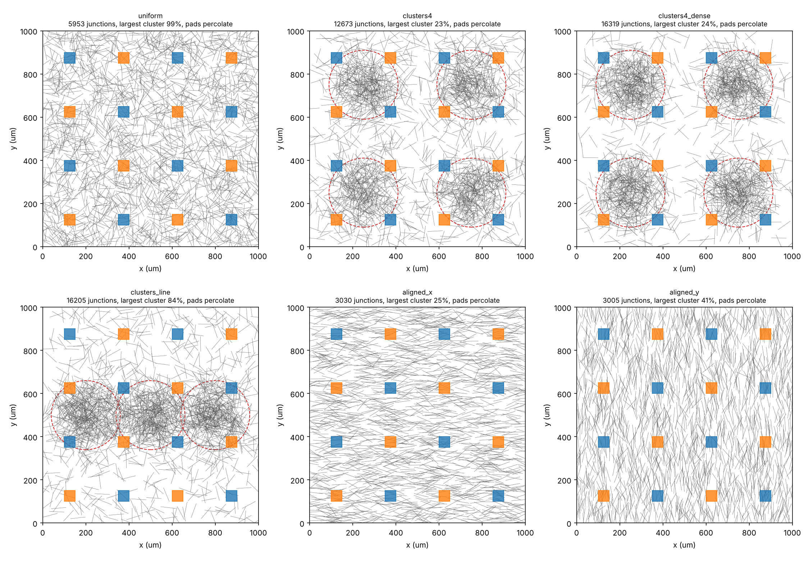
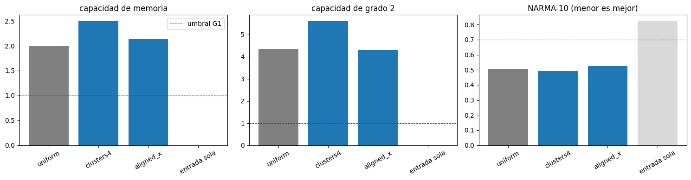
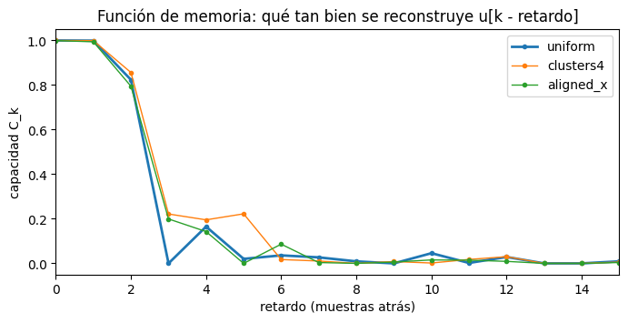

# N12: geometría del sustrato — clusters de nanohilos y orientación preferencial

*Creado el 19/10/2026. Código: `agnw_rc/substrate.py`. Tests: `tests/test_substrate.py`. Script: `scripts/n12_geometry.py`.*

**Pregunta.** ¿La forma en que se depositan los nanohilos cambia la capacidad de la red como reservoir computer?
Dos variantes respecto del framework:

1. **Clusters:** los centros de los hilos se sortean con una mezcla de gaussianas en posiciones fijas del sustrato,
   más un fondo uniforme. Así hay regiones densas conectadas por zonas más ralas.
2. **Orientación:** los ángulos de los hilos se sortean con una normal de media μ y desviación σ, en lugar de
   uniformes.

En los dos casos el **número de hilos es fijo** (N = 2000 en la red de 1 mm): cambia solo cómo se distribuyen. El
resto de la cadena (electrodos, circuito, modelos de juntura, readout, criterios) no cambia.

---

## 1. El modelo

### 1.1 El caso de referencia (framework)

`agnw_sim.geometry.generate_sticks` sortea, para cada hilo i = 1…N, de largo ℓ = 70 µm en un cuadrado de lado L:

- centro **c**ᵢ ~ Uniforme([0, L]²)
- ángulo θᵢ ~ Uniforme([0, π))
- extremos **c**ᵢ ± (ℓ/2)(cos θᵢ, sin θᵢ)

Los extremos pueden salirse un poco del cuadrado cerca de los bordes, como en el framework.

### 1.2 Centros: mezcla de gaussianas + fondo

Una geometría con K clusters tiene, para cada cluster k, un centro (x_k, y_k), un ancho σ_k y un peso w_k, y una
fracción de fondo b. **Posiciones y anchos se dan en unidades del lado L** (0 a 1). Así la misma geometría conserva
su forma en redes más grandes (`RunSpec.side`).

**Reparto de hilos (fijo, no sorteado).** El fondo recibe b·N hilos y el cluster k recibe (1 − b)·N·w_k / Σw.
Se redondea por mayor resto para que la suma dé exactamente N (`cluster_counts`). Por ejemplo, con b = 0,3 y 4
clusters de igual peso: 600 hilos de fondo y 350 por cluster.

**Sorteo.**
- Fondo: **c** ~ Uniforme([0, L]²), igual que el framework.
- Cluster k: **c** ~ N((x_k L, y_k L), (σ_k L)² I), **truncada al cuadrado**. Un centro que cae afuera se vuelve a
  sortear, para no apilar hilos en el borde.

**Clusters fijos.** Las posiciones de los clusters son parte de la geometría, no de la semilla. Con otra
`network_seed` cambian los hilos dentro de cada cluster, pero los clusters quedan en el mismo lugar. Eso permite
estudiar cómo quedan los clusters respecto de los electrodos.

### 1.3 Orientación: normal módulo π

Con `angle_sigma` = σ > 0: θ = (μ + σ·z) mod π, con z ~ N(0, 1). El módulo π se debe a que un hilo a θ y a θ + π es
el mismo hilo. Es una normal "envuelta" sobre [0, π), y σ es la desviación de la normal original.

- **μ = 0** es la dirección x, el eje entre la banda de entrada (izquierda) y la de tierra (derecha).
- **μ = π/2** es la dirección y, perpendicular a ese eje.
- Con σ ≳ 1 rad la distribución ya es casi uniforme. Con σ = 0 se usa la uniforme del framework.

**Efecto esperado sobre las junturas.** Dos palitos de largo ℓ se cruzan con probabilidad proporcional a
|sin(θᵢ − θⱼ)|. Con ángulos uniformes, ⟨|sin Δθ|⟩ = 2/π ≈ 0,64. Con dos ángulos normales de desviación σ, Δθ tiene
desviación σ√2 y, para σ chico, ⟨|sin Δθ|⟩ ≈ σ√2·√(2/π) = 2σ/√π. Para σ = 0,3 rad eso da 0,34, o sea **≈ 53 % de las
junturas** de la red uniforme. La simulación da 51 % (3030 de 5953 junturas, semilla 1), ver §4.

### 1.4 El resto de la red

Una vez sorteados los extremos, `substrate.build_network` usa **sin cambios** las funciones del framework:
`find_intersections` (junturas), `assign_electrodes` (bandas del 5 % del ancho) y `_find_isolated_wires`. Devuelve un
`agnw_sim.geometry.Network` común, que aceptan todos los layouts (`pads`, `split_bands`, …), el circuito
multi-terminal y los modelos de juntura (`volatile`, `filament`, `meanfield`, `stochastic`).

---

## 2. Uso

### 2.1 En una corrida

Se agrega el campo `geometry` a `RunSpec`, con el nombre de una geometría del catálogo:

```python
from agnw_rc import config as C
from agnw_rc.multidrive import simulate_multi

spec = C.RunSpec(stream="iid", model="volatile", layout="pads", network_seed=1,
                 hold=1000, v_center=0.38, v_width=0.16, n_samples=800,
                 tau_s=3.0, tau_spread=1.0, washout=67000, n_virtual=50, stride=2,
                 geometry="clusters4")            # ← la única línea nueva
raw = simulate_multi(spec)
```

`drive.simulate` (dos electrodos), `meanfield.simulate_meanfield` y `multidrive.simulate_multi` respetan
`spec.geometry`. Para construir solo la red: `C.make_network(seed, geometry="clusters4")`; también funciona con
`side=` para redes más grandes.

### 2.2 Catálogo (`substrate.GEOMETRIES`)

| nombre | centros | ángulos | idea |
|---|---|---|---|
| `uniform` | uniformes | uniformes | la red del framework (referencia) |
| `clusters4` | 4 clusters en (¼, ¼), (¾, ¼), (¼, ¾), (¾, ¾), σ = 0,08 L; fondo 30 % | uniformes | regiones densas separadas |
| `clusters4_dense` | igual, fondo 10 % | uniformes | clusters casi aislados |
| `clusters_line` | 3 clusters en y = ½, x = 0,2 / 0,5 / 0,8, σ = 0,08 L; fondo 30 % | uniformes | una "cadena" densa entre las bandas |
| `aligned_x` | uniformes | μ = 0, σ = 0,3 rad (±17°) | hilos a lo largo del eje entre bandas |
| `aligned_y` | uniformes | μ = π/2, σ = 0,3 rad | hilos perpendiculares a ese eje |

### 2.3 Número de hilos (`n_wires`)

Por defecto la red tiene la densidad del modelo de trabajo: 2000 hilos en 1 mm² (`N_WIRES`). `RunSpec(n_wires=...)` y
`make_network(seed, n_wires=...)` fijan otro número de hilos **en el mismo sustrato**, así que cambian la densidad. Los
clusters se reparten en proporción (`cluster_counts`): con 30 % de fondo y 3000 hilos, 900 uniformes y 4 × 525. El
nombre de la corrida suma `_N<n>` solo si se usa, y `n_wires=0` reproduce exactamente las redes anteriores (test).

Con más hilos hay más junturas, que crecen como N², y el tiempo de simulación crece con ellas. La red conduce más fácil
y el onset baja, así que hay que recalcularlo:

```bash
python scripts/n12_geometry.py sweep --n-wires 3000 --only uniform,clusters4      # -> results/n12_sweep_N3000.json
```

`run` y `report` siguen usando 2000 hilos; el barrido completo en N todavía no está armado.

### 2.4 Agregar una geometría nueva

```python
from agnw_rc.substrate import GEOMETRIES, GeometrySpec, Cluster
import numpy as np

GEOMETRIES["dos_clusters_alineados"] = GeometrySpec(
    clusters=(Cluster(0.3, 0.5, 0.1), Cluster(0.7, 0.5, 0.1, weight=2.0)),   # el segundo con el doble de hilos
    background=0.2,
    angle_mu=np.pi / 4, angle_sigma=0.5,                                    # se pueden combinar las dos variantes
)
```

Para que quede disponible en todos los scripts y en el cluster de cómputo, conviene agregarla en el diccionario
`GEOMETRIES` al final de `agnw_rc/substrate.py`. Al registrarla en tiempo de ejecución, solo existe en ese proceso.
`GeometrySpec` valida los parámetros: centros entre 0 y 1, σ > 0, pesos > 0, fondo en [0, 1) si hay clusters.

---

## 3. Garantías de compatibilidad

- **La red uniforme no cambia.** `GeometrySpec()` llama al generador de números aleatorios en el mismo orden que el
  framework (primero N×2 centros uniformes, después N ángulos uniformes). La red sale idéntica bit a bit:
  extremos, junturas, electrodos e hilos aislados, para las semillas 1 y 2 y para una red de 2 mm.
  Lo verifica `test_default_spec_is_the_framework_network_bit_for_bit`.
- **Los nombres de corrida no cambian.** `RunSpec.name` agrega `_g<geometría>` solo si `geometry` no está vacío.
  Los archivos de resultados existentes y las semillas que se derivan del nombre (`zlib_seed(spec.name)`) siguen
  siendo los mismos.
- **El framework no se modificó.** Todo está en `agnw_rc`, igual que la tira de N11 (`agnw_rc/strip.py`).

Tests (`tests/test_substrate.py`, 9 tests, unos 25 s):

| test | qué comprueba |
|---|---|
| `test_default_spec_is_the_framework_network_bit_for_bit` | caso uniforme idéntico al framework |
| `test_run_names_unchanged_without_geometry` | nombres sin `_g` por defecto, con `_g<nombre>` si se usa |
| `test_cluster_counts_keep_the_number_of_wires` | el reparto suma N, con el redondeo correcto |
| `test_clustered_centres_are_inside_and_concentrated_at_the_fixed_positions` | centros dentro del cuadrado y concentrados en los clusters; mismas posiciones y distintos hilos entre semillas |
| `test_gaussian_orientation_has_the_requested_mean_and_spread` | media y desviación de los ángulos (μ = 0, π/2, 2,5) |
| `test_alignment_changes_the_number_of_junctions` | alinear reduce las junturas |
| `test_invalid_specs_are_rejected` | validación de parámetros |
| `test_network_stats_on_the_working_network` | diagnósticos sobre la red de trabajo |
| `test_simulate_multi_runs_on_a_clustered_network` | una simulación corta de punta a punta con `clusters4` |

---

## 4. Diagnósticos de conectividad (sin simulación)

`network_stats(network, electrodes=None)` calcula, en segundos:

- número de junturas y grado medio (junturas por hilo × 2 / N),
- fracción de hilos aislados,
- tamaño del mayor componente conexo de hilos,
- **percolación**: si hay al menos un componente conexo que toca un electrodo de entrada y uno de tierra. Sin
  electrodos se usan las dos bandas del framework.
- con una lista de electrodos, cuántos de entrada y cuántos de tierra tocan ese componente (`in_linked`,
  `gnd_linked`).

`python scripts/n12_geometry.py stats` lo corre para todas las geometrías y las semillas 1–3, y guarda
`results/n12_geometry_stats.json`. Resultados al 19/10/2026 (rango sobre las 3 semillas):

| geometría | junturas | grado medio | mayor componente | percolan las bandas | pads conectados (entrada / tierra) |
|---|---|---|---|---|---|
| `uniform` | 5953–5996 | 6,0 | 99 % | 3/3 | 8/8 / 8/8 |
| `clusters4` | 11840–12673 | 12,3 | 23–91 % | 2/3 | 8/8 / 8/8 |
| `clusters4_dense` | 15930–16319 | 16,1 | 24 % | 0/3 | 8/8 / 8/8 |
| `clusters_line` | 15963–16303 | 16,2 | 84–85 % | 3/3 | 4–5/8 / 4–5/8 |
| `aligned_x` | 2899–3073 | 3,0 | 14–25 % | 3/3 | 5–7/8 / 5–8/8 |
| `aligned_y` | 2948–3052 | 3,0 | 21–41 % | 0/3 | 4–7/8 / 5–8/8 |



*Figura 36 (`python scripts/n12_geometry.py figure`): redes de semilla 1. Pads naranjas = entrada, azules = tierra;
los círculos rojos marcan 2σ de cada cluster.*

**Lectura.**

1. **Los clusters duplican o triplican las junturas** (de 6000 a 12000–16000), porque la densidad local sube. Pero
   la red se **fragmenta**: con 4 clusters y 10 % de fondo, el mayor componente tiene solo 24 % de los hilos y las
   bandas no percolan en ninguna semilla.
2. **Con pads, la percolación de `clusters4` es local.** Cada cluster toca 2 pads de entrada y 2 de tierra (por el
   tablero de ajedrez), así que la corriente circula *dentro* de cada cluster aunque los clusters no estén unidos
   entre sí. El dispositivo se comporta como 4 sub-reservoirs casi independientes. Es un caso interesante, pero
   distinto de "una red densa conectada".
3. **`clusters_line` sí forma una red conectada** (85 % en un componente) que une las bandas, pero deja fuera la
   mitad de los pads (los de las filas y = 125 y 875 µm). Con pads, esos electrodos solo aportan ruido.
4. **Alinear los hilos reduce las junturas a la mitad**, como predice §1.3. Con hilos a lo largo de x las bandas
   siguen conectadas. Con hilos a lo largo de y, ninguna de las 3 semillas conecta las bandas. La orientación
   relativa al eje de los electrodos decide si hay conducción.
5. **Consecuencia práctica:** antes de comparar puntajes de reservoir computing, hay que confirmar que la geometría
   percola con el layout elegido. Un puntaje bajo en una red que no conduce no dice nada de su capacidad de cómputo.

---

## 5. Próximos pasos

1. **Onset por geometría.** El voltaje de onset depende de cuántos caminos conductores haya, así que la ventana de
   entrada (`v_center`, `v_width`) tiene que reajustarse para cada geometría, como se hizo con el tamaño en N10-L
   (`scripts/n10l_size.py sweep`).
2. **Reservoir computing completo**, igual que N10-E/N10-L: 3 redes × 2 réplicas + seno/cuadrada por geometría, con
   puntajes MC, IPC2 y NARMA-10, y criterios G0/G1/G2 (`criteria.py`), comparados contra `uniform`. Se haría en
   un subcomando `run` / `report` de `scripts/n12_geometry.py`. Cada corrida con el protocolo del informe (800 holds
   de 1 s) tarda horas, así que conviene el cluster (`cluster/`).
3. **Diseño de geometrías con sentido físico.** Por ejemplo: clusters ubicados bajo los pads; una cadena de
   clusters entre cada par entrada–tierra; o variar σ_k y b de forma continua para encontrar el umbral de
   percolación.
4. **Combinar** clusters y orientación (por ejemplo, filas de clusters con hilos alineados) y probar el efecto de
   las rupturas (`rupture`) sobre redes con menos caminos redundantes.

---

## 6. Dónde correr el experimento completo

**Costo.** Casi todo el tiempo de una corrida (98–99 %) se va en resolver el sistema de Kirchhoff de cada paso.
El tamaño del sistema crece con las junturas: 12 146 incógnitas en la red uniforme y 32 802 en `clusters4_dense`, es
decir 17,5 y 53 ms por paso en un núcleo. Cada corrida usa un solo núcleo; el paralelismo es entre corridas.

**En una PC con Ubuntu:** `cluster/run_n12_local.sh` clona o actualiza el repo, arma el entorno, corre las geometrías
pedidas con todos los núcleos menos uno, hace el `report` y sube `results/n12_criteria.json` y la figura a la rama.
`report` conserva las filas de las geometrías que reportó otra máquina, así que se pueden repartir las geometrías y
juntar los resultados con git:

```bash
nohup bash cluster/run_n12_local.sh clusters4,clusters4_dense,clusters_line > n12.log 2>&1 &
tail -f n12.log
```

**¿GPU?** No conviene con el solver actual. `scripts/gpu_benchmark.py` mide un paso típico de cada forma:

- En la CPU, el solver del proyecto (gradiente conjugado con precondicionador LU y arranque desde el paso anterior)
  converge en pocas iteraciones, con error ~10⁻¹³.
- El precondicionador LU necesita resolver sistemas triangulares ralos, algo que las GPU hacen mal. El candidato
  natural en GPU es el gradiente conjugado con precondicionador de Jacobi. En la red uniforme (19/10/2026, en CPU) ese
  método necesitó **1353 iteraciones por paso** para llegar a un residuo relativo de 10⁻¹⁰, y el error siguió en
  **3·10⁻⁴**: las conductancias van de 10⁻⁹ a 10⁻³ S y el sistema está muy mal condicionado.
- En float32 el método no avanza nada: se detiene en 1 iteración con el mismo error de 3·10⁻⁴. Además, las Titan X
  (Maxwell y Pascal) calculan en float64 a 1/32 de su velocidad en float32.

Para que una GPU ayude haría falta otro solver: multigrilla algebraica, o resolver muchas corridas a la vez en lotes.
Es un desarrollo aparte, sin garantía de ganancia. `python scripts/gpu_benchmark.py` (con CuPy instalado) mide lo que
daría la GPU de una máquina concreta antes de invertir en eso.

---

## 7. Resultados preliminares (Colab, 19/10/2026)

**Resumen.** En una corrida corta, `clusters4` superó a la red uniforme en las tres métricas (MC +25 %, IPC2 +29 %),
y `aligned_x` dio prácticamente lo mismo que la uniforme. Es **una sola red y una sola corrida** por geometría: es una
tendencia, no un resultado firme.

**Protocolo** (notebook `resComp_geometrias.ipynb`, versión reducida del de §5): el reservoir de N10-E (16 pads, pesos
de entrada al azar, unión volátil τ_s = 0,3 s, dispersión 1, holds de 100 ms, `stride` 2). Lo que cambia respecto del
experimento completo:

- **300 entradas** (en vez de 800) y **10 nodos virtuales** (en vez de 50);
- washout de 7000 pasos;
- **red de semilla 1, réplica 0**, sin repeticiones;
- **una sola ventana:** centro 1,25 × onset, ancho 0,45 × onset (onsets de `results/n12_sweep.json`), en lugar de
  elegir entre dos ventanas con datos de validación;
- sin rupturas.

| geometría | junturas | MC | IPC2 | NARMA-10 | tiempo en Colab |
|---|---|---|---|---|---|
| `uniform` (referencia) | 5953 | 1,99 | 4,35 | 0,507 | 871 s |
| `clusters4` | 12 673 | **2,49** (+25 %) | **5,60** (+29 %) | **0,491** | 2153 s |
| `aligned_x` | 3030 | 2,13 (+7 %) | 4,31 (−1 %) | 0,524 | 199 s |
| entrada sola | — | 0,00 | 0,00 | 0,823 | — |

MC e IPC2: más alto es mejor. NARMA-10: más bajo es mejor; los umbrales de G1 son MC ≥ 1, IPC2 ≥ 1 y NARMA-10 ≤ 0,70.





*Figuras 38 y 39 (salidas de la notebook en Colab): puntajes por geometría (gris = uniforme, gris claro = entrada
sola, línea roja = umbral de G1) y función de memoria C_k, la capacidad de reconstruir u[k − retardo].*

**Lectura.**

1. **Las tres geometrías superan los umbrales de G1** en esta corrida y le ganan con claridad a la entrada sola.
2. **`clusters4` es la mejor en las tres métricas**, aunque está partida en 4 grupos densos casi aislados (§4: el mayor
   componente tiene el 23 % de los hilos). Cada cluster toca 2 pads de entrada y 2 de tierra, así que el dispositivo
   funciona como 4 sub-reservoirs en paralelo. Probablemente pesa más tener el doble de junturas, con respuestas más
   diversas, que la conectividad global.
3. **La memoria de `clusters4` dura más.** Todavía reconstruye ~20 % de la entrada de 3 a 5 pasos atrás, cuando la
   uniforme ya está en ~0. En los retardos 0–2 las tres geometrías son iguales.
4. **Alinear los hilos casi no cambia nada.** `aligned_x` tiene la mitad de junturas y puntajes iguales a los de la
   uniforme, con una simulación 4 veces más rápida.
5. **Reproducibilidad.** Los números de Colab coinciden exactamente con los de la misma configuración corrida en otra
   máquina (Linux, Python 3.13): la simulación es determinista entre máquinas.

**Cuidado al interpretarlo.** En N10-E, la variación entre 3 redes × 2 réplicas fue de ±0,66 en MC y ±1,2 en IPC2.
La ventaja de `clusters4` (+0,50 en MC, +1,25 en IPC2) es del orden de esa dispersión. Para confirmarla hacen falta
las corridas completas de §5 (3 redes × 2 réplicas, dos ventanas, criterios G0/G1/G2).

**Estado de las corridas completas (19/10/2026, 19:20 UTC).**
- `uniform`: 14 de 18 terminadas.
- `aligned_x` y `aligned_y`: en curso en una máquina en la nube, que se reinició una vez y obligó a relanzarlas.
- `clusters4`, `clusters4_dense` y `clusters_line`: pendientes; conviene correrlas en una máquina estable (§6).

**Tiempos.** Las 3 geometrías tardaron ~54 minutos en total en Colab. Comparado con la misma corrida en un núcleo de
Xeon a 2,1 GHz (que estaba compartido con otras corridas), Colab fue 3,6 veces más lento en `uniform` y `clusters4`, y
1,9 veces en `aligned_x`. El costo crece con la cantidad de junturas: `clusters4` tardó 2,5 veces lo que la uniforme y
`aligned_x`, 0,23 veces.

---

## 8. `clusters4` con electrodos en bandas (`split_bands`): fondo uniforme y percolación

**Resumen.** Con los 8 + 8 electrodos de borde, `clusters4` con 30 % de fondo uniforme no conecta las bandas en 2 de
5 redes. Con **50 % o más de fondo conecta en todas**. Para comparar con la red uniforme se agregaron
`clusters4_b50`, `clusters4_b60` y `clusters4_b70` a `GEOMETRIES`.

**El parámetro.** `GeometrySpec.background` es la fracción de los N hilos con centro uniforme; el resto,
(1 − background)·N, se reparte entre los clusters según su `weight`. Una variante de una geometría existente:

```python
import dataclasses
GEOMETRIES["clusters4_b55"] = dataclasses.replace(GEOMETRIES["clusters4"], background=0.55)
```

**Barrido de fondo con `split_bands`** (semillas 1–5; `network_stats` con el layout de bandas; 20/10/2026):

| fondo | hilos fondo / por cluster | junturas (media) | conduce | electrodos de entrada conectados | de tierra |
|---|---|---|---|---|---|
| 30 % (`clusters4`) | 600 / 350 | 12 290 | 3/5 | 0, 3, 3, 0, 5 | 0, 5, 7, 0, 7 |
| 40 % | 800 / 300 | 10 504 | 3/5 | 5, 0, 7, 0, 6 | 4, 0, 2, 0, 8 |
| 50 % | 1000 / 250 | 9 026 | 5/5 | 8, 8, 8, 8, 5 | 6, 8, 8, 5, 7 |
| 60 % | 1200 / 200 | 8 056 | 5/5 | 8, 7, 8, 8, 8 | 7, 7, 8, 8, 8 |
| 70 % | 1400 / 150 | 7 154 | 5/5 | todos | todos |
| 80 % | 1600 / 100 | 6 540 | 5/5 | todos | todos |
| uniforme | 2000 / — | 5 953 | 5/5 | todos | todos |

El umbral de percolación de banda a banda está entre 40 y 50 % de fondo.

**Onset con bandas** (`python scripts/n12_geometry.py sweep --layout split_bands`, red de semilla 1, rampa de 0 a 3 V
en 10 s; `results/n12_sweep_split_bands.json`):

| geometría | onset (V) |
|---|---|
| `uniform` | 2,016 (N10-E, con otro método: 2,08) |
| `clusters4_b50` | 1,908 |
| `clusters4_b60` | 1,746 |
| `clusters4_b70` | 1,923 |

Con bandas, el onset es unas 6 veces mayor que con pads (~0,34 V), porque la corriente cruza todo el sustrato.

**Notebook.** `resComp_clusters_bandas.ipynb` compara `uniform` con las tres variantes usando el protocolo reducido de §7
(300 entradas, 1 red, ventana 1,25 × onset). Con este layout las corridas son más lentas que con pads: en un Xeon a
2,1 GHz tardaron entre 437 s (`uniform`) y 741 s (`clusters4_b50`), con 4 corridas en paralelo.

Primeros puntajes en esa máquina, 1 red y 300 entradas:

| geometría | MC | IPC2 | NARMA-10 |
|---|---|---|---|
| `uniform` | 1,66 | 4,63 | 0,671 |
| `clusters4_b50` | 1,22 | 2,83 | 0,703 |
| `clusters4_b60` | 1,90 | 3,12 | 0,536 |
| `clusters4_b70` | 1,50 | 3,69 | 0,625 |

Es una sola corrida por geometría: sirve como referencia para comparar con lo que dé Colab, no como resultado.
