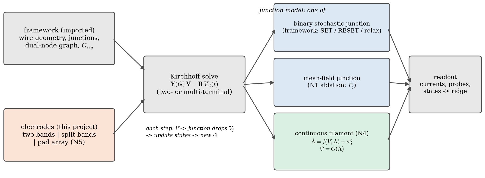
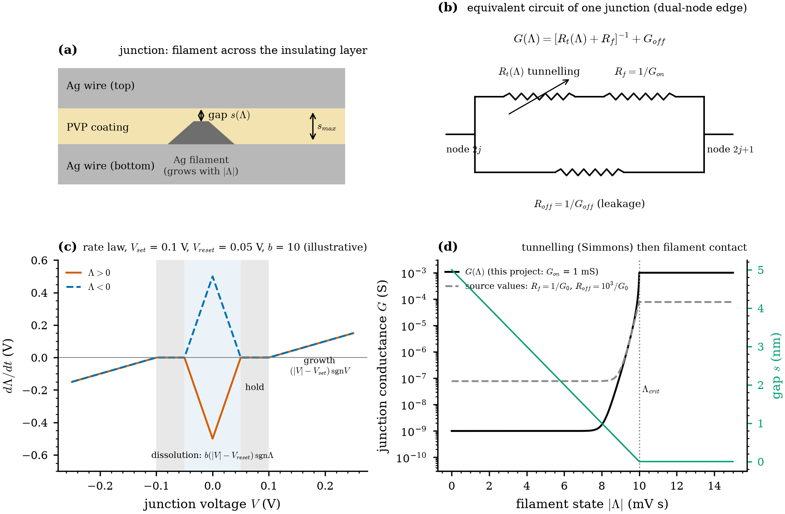
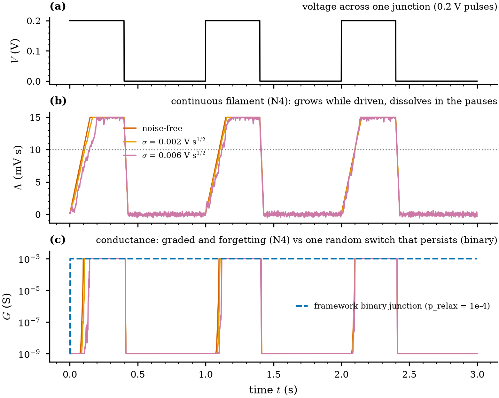
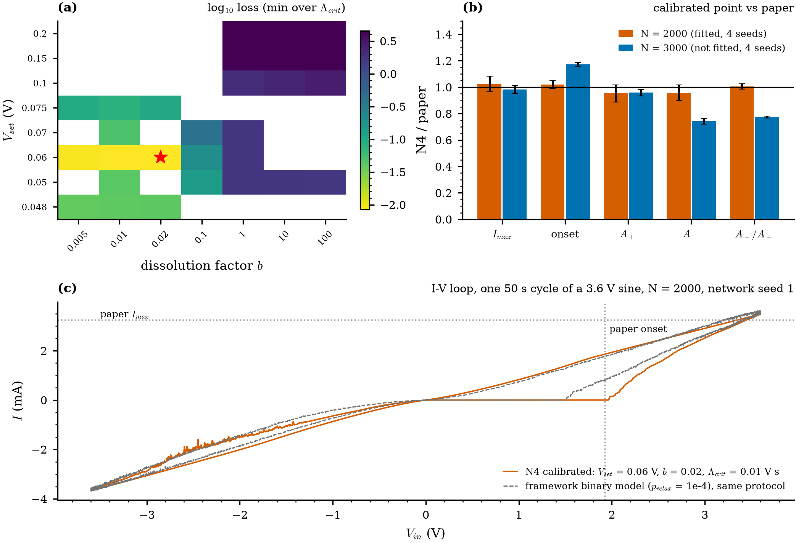

# N4 design: continuous-filament junction model

Status: design approved by Juan 2026-09-27; core model and network integration implemented and tested; calibration
running (section 7). Written 2026-09-25.
Context: [RESULTS.md](RESULTS.md) (why the binary model fails), [SWITCHING_MECHANISMS.md](SWITCHING_MECHANISMS.md)
(the framework's junction model), [NEXT_STEPS.md](NEXT_STEPS.md) (item N4).

## 1. Why a new junction model

Every experiment on the framework's binary stochastic junctions (E1-E3, N5a, N7) scored at the input-only level,
and the diagnosis is the junction representation:

* Each junction is a $10^{6}$ conductance jump decided by a Bernoulli draw every step. Only ~5 junctions flip per input
  sample, and half of those flips are input-independent relaxation events. The junction state is noise
  (consistency $\le 0.01$), and neither averaging (N7a) nor a richer electrode interface (N5a) recovers it.
* Removing the noise (mean-field, N1) restores a reproducible state and nonlinear processing, so the network
  structure is not the problem. The mean-field model is only an ablation, not a device model (its onset contradicts
  the Fig. 4 calibration).
* Real Ag nanowire junctions switch by growing and dissolving a filament through the polymer coating: graded
  (tunnelling, then contact), thresholded, volatile, and history-dependent. Networks with such junctions have been
  used experimentally as reservoirs.

N4 replaces the junction model by the continuous-filament model standard in nanowire-network simulations, keeping
the framework's network (geometry, dual-node circuit) and this project's electrode layouts and readout. It adds a
tunable noise term so the noise tolerance of the reservoir can be measured.

*Figure N4-3. Where the junction model sits. Geometry and circuit come from the framework, electrodes and readout
from this project. The junction model is one of three: binary stochastic (framework), mean-field (N1 ablation) or
continuous filament (N4).*

## 2. The model

*Figure N4-1. (a) A junction: an Ag filament grows through the PVP coating from one wire towards the other,
leaving a tunnelling gap s. (b) Equivalent circuit of the junction edge of the dual-node graph. (c) Rate law for
positive and negative filament states (illustrative thresholds; see section 4). (d) Conductance and gap vs the
filament state: tunnelling makes G rise by orders of magnitude as the gap closes, then the filament contact
saturates it at $G_{\mathrm{on}}$. Dashed: the source's conductance scale.*

**State.** Each junction j carries a signed filament state $\Lambda_j$ (V s), initially 0. Its sign records the polarity
that grew it, and the conductance depends on |$\Lambda_j$| only.

**Rate law** (Hochstetter et al. 2021, Methods Eq. 5), with V the voltage drop across the junction (the memristor
edge of the dual-node graph):

$$
\frac{d\Lambda}{dt} =
\begin{cases}
(|V| - V_{set})\,\mathrm{sgn}(V) & |V| > V_{set} \quad\text{(growth)}\\
0 & V_{reset} \le |V| \le V_{set} \quad\text{(hold)}\\
b\,(|V| - V_{reset})\,\mathrm{sgn}(\Lambda) & |V| < V_{reset} \quad\text{(dissolution)}
\end{cases}
\qquad |\Lambda| \le \Lambda_{max}
$$

Growth is polarity-driven, so reversing the voltage first dissolves the filament and then grows one of the other
sign. Dissolution is spontaneous (no drive needed) and stops at $\Lambda = 0$. The model is volatile, and its memory time
depends on the state and the voltage, not on a single constant.

**Gap and tunnelling** (Eq. 7, the Simmons low-bias formula, as corrected in the 2024 Author Correction):

$$
s = \frac{\max(\Lambda_{crit} - |\Lambda|,\,0)}{\Lambda_{crit}}\,s_{max},\qquad
G_t(s) = A\,\frac{3\sqrt{2m^*}\,e^{2}\sqrt{e\,\phi}}{2h^{2}s}\,\exp\!\left(-\frac{4\pi s\sqrt{2m^*e\,\phi}}{h}\right)
$$

with $\phi$ in volts (barrier height in eV), A the tunnelling area and m* the effective mass. This form equals
$A\,J/V$ of Simmons' low-bias current density; `tests/test_filament.py` checks it against an independent evaluation.

**Junction conductance** (Eq. 6):

$$
G(\Lambda) = \frac{1}{R_t(\Lambda) + R_f} + G_{off},\qquad R_t = 1/G_t
$$

G rises from $G_{\mathrm{off}}$ (gap $s_{\mathrm{max}}$) by tunnelling as the gap closes and saturates at $1/R_f$ + $G_{\mathrm{off}}$ once |$\Lambda$| $\ge \Lambda_{\mathrm{crit}}$.

**Noise (added in this project).** Euler-Maruyama step with additive Gaussian noise of amplitude $\sigma$ ($\mathrm{V\,s^{1/2}}$):

$$
\Lambda_{n+1} = \mathrm{clip}\big(\Lambda_n + \Delta t\,f(V_n, \Lambda_n) + \sigma\sqrt{\Delta t}\,\xi_n,\ \pm\Lambda_{max}\big),
\qquad \xi_n \sim \mathcal N(0,1)
$$

$\sigma = 0$ is the source model (deterministic). $\sigma > 0$ represents the stochasticity of filament growth and dissolution
(few atoms, thermal fluctuations) without the $10^{6}$ jumps of the binary model. The dissolution step is clipped so the
deterministic part never crosses $\Lambda = 0$.

*Figure N4-2. One junction under 0.2 V pulses (illustrative thresholds $V_{\mathrm{set}} = 0.1$ V, $V_{\mathrm{reset}} = 0.05$ V). The
continuous filament grows during each pulse, saturates, and dissolves within ~0.1 s of the pause, so it forgets
between pulses. Noise perturbs the state without destroying the response. The framework's binary junction instead
switches once, at a random time, and stays ON for ~10 s (mean lifetime $1/p_{\mathrm{relax}}$), so it cannot follow the pulses.*

## 3. Per-step algorithm in the network

For each time step (dt = 1 ms, the framework's and the source's step):

1. $G_j$ = G($\Lambda_j$) for all junctions.
2. Solve the circuit (two-band or multi-terminal, `agnw_rc/multicircuit.py`) for the current electrode voltages.
   Every junction's G changes a little each step, so use conjugate gradients preconditioned by a recent LU
   factorization (`method="pcg"`, as in the mean-field runs; accurate to < $10^{-5}$ V, tested).
3. Junction drops $V_j$ = V(2j) - V(2j+1). Record the readout (electrode currents, probes, $\Lambda_j$ or $G_j$).
4. $\Lambda_j$ <- `step_lambda(Λ_j, V_j)`.

Expected cost: ~6-10 ms per step, as for the mean-field runs.

## 4. Parameters

| Symbol | Meaning | Source value (Hochstetter 2021) | N4 value | Provenance / status |
|---|---|---|---|---|
| $V_{\mathrm{set}}$ | growth threshold | 0.01 V | **calibrated** (start 0.1 V) | source value is for 10 µm wires on a 30 µm grid; the framework's junction threshold $V_{\mathrm{th}} = 0.1$ V (inferred from Fig. 4) is the natural start |
| $V_{\mathrm{reset}}$ | dissolution threshold | $V_{\mathrm{set}}$ / 2 | $V_{\mathrm{set}}$ / 2 | ratio kept from the source |
| b | dissolution rate factor | 10 | **calibrated** (start 10) | sets the forgetting time |
| $\Lambda_{\mathrm{crit}}$ | state at gap closure | 0.01 V s | **calibrated** (start 0.01 V s) | with $V_{\mathrm{set}}$ it sets the growth time |
| $\Lambda_{\mathrm{max}}$ | cap on \|$\Lambda$\| | 0.015 V s | $1.5 \Lambda_{\mathrm{crit}}$ | ratio kept from the source |
| $s_{\mathrm{max}}$ | gap at $\Lambda = 0$ | 5 nm | 5 nm | source |
| $\phi$ | barrier height | 0.82 eV | 0.82 eV | source |
| A | tunnelling area | 0.17 nm$^{2}$ | 0.17 nm$^{2}$ | source |
| m* | effective mass | $0.99 m_e$ | $0.99 m_e$ | source |
| $R_f$ | filament resistance | $1/G_0 = 12.9$ k$\Omega$ | **$1/G_{\mathrm{on}} = 1$ k$\Omega$** | framework $G_{\mathrm{on}}$ (see note) |
| $R_{\mathrm{off}}$ | leakage | $10^{3}$/$G_0 = 12.9$ M$\Omega$ | **$1/G_{\mathrm{off}} = 1$ G$\Omega$** | framework $G_{\mathrm{off}}$ (see note) |
| $\sigma$ | noise amplitude | 0 (not in source) | swept: 0, $10^{-3}$, $3 \times 10^{-3}$, $10^{-2}$, $3 \times 10^{-2}$ $\mathrm{V\,s^{1/2}}$ | this project |
| dt | time step | 1 ms | 1 ms | framework and source |
| network | wires, circuit | 10 µm wires, $30 \times 30$ µm, ideal wires | framework: N = 2000, 70 µm, 1 mm$^{2}$, dual-node D = 90 nm | framework (imported) |

*Note on $R_f$ and $R_{\mathrm{off}}$.* The framework's current scale (Fig. 4 peak currents within ~8 %) was calibrated with
$G_{\mathrm{on}} = 1$ mS, $G_{\mathrm{off}} = 1$ nS and 90 nm wires. Keeping these values keeps N4 on the same current scale, so that the
calibration only has to fix the dynamics. The source's quantum-conductance values are the alternative; switching
to them would require recalibrating the wire diameter. Fig. N4-1d shows both.

**Time scales implied by the start values.** At |V| - $V_{\mathrm{set}} = 0.1$ V, a filament closes in $\Lambda_{\mathrm{crit}}$/0.1 V $\approx 0.1$ s.
With no drive it dissolves from $\Lambda_{\mathrm{crit}}$ in $\Lambda_{\mathrm{crit}}$/(b $V_{\mathrm{reset}}$) $\approx 0.02\text{–}0.2$ s ($V_{\mathrm{set}} = 0.1$ or 0.01 V). This is close
to the input time scale (10-100 ms per sample), unlike the binary model's 10 s relaxation.

## 5. Calibration (N4-C)

Target: the same macroscopic data the framework was calibrated on, so N4 and the framework describe the same
device.

* **Protocol**: framework Fig. 4 protocol (`scripts/replicate_lamas_fig4.py`): one cycle of a 3.6 V sine,
  50 000 steps (50 s), two-band layout, fresh network ($\Lambda = 0$), N = 2000 (network seed 1).
* **Metrics**: the framework's Fig. 4 envelope metrics (`docs/theory_audit/digitize_lamas_fig4.metrics`, imported
  from the framework checkout). Paper values for N = 2000: $I_{\mathrm{max}} = 3.24$ mA, onset 1.92 V, positive loop area
  A₊ = 2.96 mA V, A₋/A₊ = 0.44 (from `fig4_metrics.json`).
* **Free parameters**: $V_{\mathrm{set}}$ ($V_{\mathrm{reset}}$ = $V_{\mathrm{set}}$/2), b, $\Lambda_{\mathrm{crit}}$ ($\Lambda_{\mathrm{max}} = 1.5$ $\Lambda_{\mathrm{crit}}$), all at $\sigma = 0$.
* **Loss**: sum of squared relative errors on $I_{\mathrm{max}}$, onset, A₊ and A₋/A₊.
* **Search**: coarse grid ($V_{\mathrm{set}}$ $\in$ {0.05, 0.1, 0.15, 0.2} V, b $\in$ {1, 10, 100}, $\Lambda_{\mathrm{crit}}$ $\in$ {0.003, 0.01, 0.03} V s;
  36 runs x ~7 min, in parallel), then a local refinement around the best point.
* **Validation, not fitted**: N = 3000 with the same parameters vs the paper's N = 3000 metrics (the framework
  used the same test for $p_{\mathrm{relax}}$).
* **Noise**: Fig. 4 metrics are re-measured at each $\sigma$ of the sweep to report how much noise the calibration
  tolerates.

If no grid point reproduces the negative-loop ratio A₋/A₊, that is itself a finding: the continuous model lacks a
mechanism the paper's data need. It would be reported, not hidden by forcing the fit.

### 5.1 Calibration result (2026-09-27)

`scripts/n4_calibrate.py` stages: `grid` (36 points, the design grid), `grid2` (36 points: slow dissolution
b $\in$ {0.01, 0.1, 1}, $V_{\mathrm{set}}$ $\in$ {0.05, 0.06, 0.07}, $\Lambda_{\mathrm{crit}}$ $\in$ {0.01, 0.03}, bipolar and unipolar), `refine` (27 points
around the best), and `validate` (the best point on N = 2000 and 3000, 4 network seeds each). Results are in
`results/n4_calibration.json`, traces in `results/n4_calib/`.

*Figure N4-4. (a) Loss over $V_{\mathrm{set}}$ x b (bipolar model, N = 2000, network seed 1, minimum over $\Lambda_{\mathrm{crit}}$; blank =
not simulated; star = calibrated point). (b) Calibrated point relative to the paper, mean $\pm$ sd over 4 network
seeds, for N = 2000 (fitted) and N = 3000 (not fitted). (c) I-V loop of the calibrated model and of the framework
binary model under the same protocol.*

**Calibrated parameters** (`config.N4_PARAMS`): $V_{\mathrm{set}} = 0.06$ V ($V_{\mathrm{reset}} = 0.03$ V), b = 0.02, $\Lambda_{\mathrm{crit}} = 0.01$ V s
($\Lambda_{\mathrm{max}} = 0.015$ V s), bipolar (source model).

| metric | N4, N = 2000 (4 seeds) | paper | N4, N = 3000 (4 seeds, not fitted) | paper | framework binary, N = 3000 |
|---|---|---|---|---|---|
| $I_{\mathrm{max}}$ (mA) | $3.32 \pm 0.19$ | 3.24 | $10.45 \pm 0.31$ | 10.66 | not listed |
| onset (V) | $1.96 \pm 0.05$ | 1.92 | $1.79 \pm 0.02$ | 1.53 | 1.37 |
| A₊ (mA V) | $2.82 \pm 0.19$ | 2.96 | $8.02 \pm 0.21$ | 8.37 | 6.34 |
| A₋ (mA V) | $1.24 \pm 0.08$ | 1.29 | $3.07 \pm 0.09$ | 4.14 | 3.55 |
| A₋/A₊ | $0.44 \pm 0.01$ | 0.44 | $0.38 \pm 0.00$ | 0.50 | 0.56 |

### Conclusions

* **The source model reproduces Fig. 4 once dissolution is slow.** With the bipolar model of Hochstetter et al.
  and three re-fitted dynamic parameters, all four fitted metrics are within ~5 % of the paper for N = 2000, which
  is better than the framework's binary model (onset 1.58 V, A₊ 2.31, ratio 0.53). A unipolar variant is not
  needed.
* **The paper's negative-loop asymmetry requires slow forgetting.** With fast dissolution (grid 1, b $\ge 1$), both
  half-cycles are mirror images (A₋/A₊ = 1.00 at every point), because the filaments dissolve during the ~4 s the
  sine spends below the onset. The fit needs b $\approx 0.005\text{–}0.02$, i.e. a dissolution time of ~15-60 s with no drive
  (b is only weakly constrained in that range). This parallels the framework's finding that relaxation needs a
  ~10 s lifetime.
* **N = 3000, not fitted:** $I_{\mathrm{max}}$ (-2 %) and A₊ (-4 %) are predicted well, but the onset is too high (+17 %) and the
  negative loop too small (-26 %). Part of the N-dependence is therefore missing. The binary model errs the other
  way (onset too low, A₊ too small).
* **Consequence for the reservoir experiments:** the calibrated junctions forget over tens of seconds, far slower
  than the 10-100 ms input samples, the same time-scale mismatch that limited the binary model. What is new is
  that the state is deterministic and graded. N1 (mean-field) showed that this alone restores nonlinear
  processing, so N4-1 is expected to improve nonlinear scores more than memory.

## 6. Experiments (after calibration)

| ID | Question | Setup |
|---|---|---|
| N4-1 | Is the calibrated N4 network a reservoir with the framework's two-electrode interface? | E1 protocol: holds 10/30/100, three windows around the N4 onset, 3 networks $\times$ 2 replicates, all tasks and baselines, $\sigma = 0$ |
| N4-2 | How much junction noise can it tolerate? | best N4-1 point, $\sigma$ sweep (section 4), consistency and all scores vs $\sigma$; compare with the binary model |
| N4-3 | Does the multi-electrode interface help a network with a usable state? | N5a (random weights) and N5b (delayed copies vs delay-line baselines) on N4, split bands and pads |

Decision rules: N4-1 at ESN-like levels (MC $\gg 1$, degree-2 $\gg 1$) would support the view that the binary junction
model, not the network, limited the earlier results. The leaky-bank limit (relaxational single-input elements:
MC $\approx 9$ noise-free, 2-3 with realistic feature noise, RESULTS.md section 8 as corrected by the 2026-09-27 review)
still applies to N4-1, so memory beyond it is only expected in N4-3 with delayed inputs. N4-2 defines the noise
level at which N4 degrades to the binary model's behaviour.

## 7. Implementation plan and tests

| Step | Code | Tests | Status |
|---|---|---|---|
| 1 | `agnw_rc/filament.py`: rate law, Euler-Maruyama step, gap, Simmons conductance, G($\Lambda$) | `tests/test_filament.py`: rate-law regions and polarity, no zero crossing when dissolving, $\Lambda_{\mathrm{max}}$ clip, G limits and monotonicity, Simmons vs independent formula, noise increment statistics | **done** (5 tests) |
| 2 | Descriptive figures `scripts/n4_model_figures.py` (Figs. N4-1..3) | n/a | **done** |
| 3 | Network time loop: `model="filament"` in `agnw_rc/multidrive.py` (any layout; `encoding="direct"` = E1 input on two bands); parameters from `config.filament_params` / `config.N4_PARAMS` | `tests/test_filament_network.py`: recorded readout vs direct re-solve, $\sigma = 0$ bit-for-bit deterministic, seeded noise reproducible, parameter plumbing | **done** |
| 4 | `agnw_rc/fig4.py` (protocol, framework metrics, loss) and `scripts/n4_calibrate.py` (grid / refine / validate), results in `results/n4_calibration.json` + figure | framework metric function reproduces `fig4_metrics.json` exactly on a saved framework trace | **done** (section 5.1) |
| 5 | N4-1..3 specs in `agnw_rc/config.py`, runs, evaluation, figures, RESULTS section with Conclusions | pipeline tests as for N1/N5 | todo |

## 8. Limitations known in advance

* The source parameters come from much smaller networks (10 µm wires, 30 µm region). The calibration re-fits only
  the dynamic ones, and the tunnelling constants are taken as given.
* The model is one-dimensional per junction (one filament variable). There is no thermal coupling between
  junctions and no telegraph noise (candidates listed in the framework's decision memo 2026-09-22).
* The noise term is phenomenological (additive, Gaussian, state-independent), not derived from filament physics.
* Only |V| and sgn(V) enter, and the model is symmetric in polarity. Real junctions may be asymmetric.

## References

* J. Hochstetter, R. Zhu, A. Loeffler, A. Diaz-Alvarez, T. Nakayama, Z. Kuncic, "Avalanches and edge-of-chaos
  learning in neuromorphic nanowire networks", *Nat. Commun.* **12**, 4008 (2021), doi:10.1038/s41467-021-24260-z.
  Methods Eqs. 5-7 and parameter values.
* Author Correction to the above, *Nat. Commun.* (2024), doi:10.1038/s41467-024-54027-1 (corrected Eq. 7 and
  Fig. 1b).
* J. G. Simmons, "Generalized formula for the electric tunnel effect between similar electrodes separated by a thin
  insulating film", *J. Appl. Phys.* **34**, 1793 (1963) (low-bias tunnelling limit).
* Lamas et al. (2026): the framework's reference for the binary model and the Fig. 4 calibration data (see the
  framework's `docs/switching_model.md`).
