# Results: the AgNW network as a reservoir computer

Started 2026-09-25, last updated 2026-10-13 (4 mm with 10 networks in the N10-LS addendum to section 27; N10-SB split-band layout, section 28; N11 stage 0, section 29; project review 2026-09-27). Framework `AgNW_FDT_Memristor_Framework`
(working model: Lamas 2026 preset, dual-node circuit with D = 90 nm wires, $p_{\mathrm{relax}} = 10^{-4}$; results computed at
commit `286cb4d`, the later framework commit `f6b6951` only changed documentation; E4 onwards at `f6b6951`). 840
simulations, all numbers
from `results/metrics.json` / `results/summary.csv`. Plan and definitions: [PLAN.md](PLAN.md).

> **Review 2026-09-27** ([REVIEW_2026-09-27.md](REVIEW_2026-09-27.md)) corrected three statements in this file:
> (1) the whole-series consistency also rewards slow trends shared by the replicates, so the echo-state numbers
> are now given for the sample-to-sample **increments** of the state (sections 2, 7, 9-12); (2) the "MC $\approx 6$ cap"
> of an ideal leaky bank was set by the ridge-grid floor, and the real limit is feature noise (section 8); (3) the
> 10 s washout is too short for the slow models (section 6). Scores (MC, IPC, NARMA-10, accuracy) are unaffected.

## Answer in short

**With the framework's network, driven through one electrode pair and read out linearly, the network does not
work as a useful reservoir.** Every readout scores at the level of the *input-only* baseline, i.e. a readout that
sees nothing but the current input:

* Linear memory capacity MC is at most 0.26 in the main sweep (0.76 with 1 s per input sample).
  Echo-state networks score 14 (32 units) and 27 (200 units).
* Degree-2 (nonlinear) capacity is at most 0.13 (0.21 with 1 s holds). The ESNs reach 14 and 24.
* NARMA-10 test NMSE is 0.73 at best. The input-only baseline gets 0.80, a 32-tap linear delay line 0.16, and the
  32-unit ESN 0.24.
* Sine/square classification is at chance (0.45-0.63). A linear delay line reaches 0.93 and the ESNs 1.00.

The reasons are physical and are visible directly in the simulations:

1. **Almost nothing responds reproducibly.** The individual junction states and the probe transfer ratios
   $V_p/V_{\mathrm{in}}$ are dominated by switching noise (consistency ~0). Even the global conductance I/$V_{\mathrm{in}}$, the average over
   all junctions, responds reproducibly to the input only partially: the consistency of its sample-to-sample
   increments is 0.02-0.49 at 10-100 ms holds, rising to 0.68-0.87 only with 0.3-1 s holds. The readout has at most
   one usable dimension, not thousands.
2. **Time scales do not match.** SET is fast (~$10^{2}$ steps) but the network only forgets through relaxation, with a
   lifetime $1/p_{\mathrm{relax}} = 10^{4}$ steps (10 s). Inputs held 10-100 ms barely move the state. The conductance ends up an
   average over many past inputs with a large, slowly relaxing, noisy offset, and hysteresis on top (Fig. 1b,c).
3. **The readout gets the current input "for free", and nothing more.** Current and probe voltages are exactly
   $V_{\mathrm{in}}$ times a function of the junction states (the circuit is linear for fixed states). So lag-0 recovery is
   perfect, but it comes from the measurement, not from the network.

Making the relaxation faster ($p_{\mathrm{relax}} = 10^{-2}$, outside the working model) or holding each input 1 s raises MC to
about 0.8 (one sample of memory). It does not create nonlinear capacity or longer memory. With the published
model ($p_{\mathrm{relax}} = 0$) the network saturates and MC = 0.

**The decisive test E4 (section 13) confirms it under stricter methodology.** With inputs held 0.3-3 s, a washout
of 3 relaxation times, 50 virtual nodes per input, and the operating point chosen on validation data, neither the
binary model nor the Fig. 4-calibrated filament model (N4) meets the pre-registered criterion G1 (MC $\ge 1$, degree-2
$\ge 1$, NARMA-10 $\le 0.70$). The binary network's conductance becomes reproducible and reaches MC 0.94 and degree-2 0.50
at 3 s. The calibrated N4 network is frozen (0 capacity) at every hold time; section 14 shows that its hold band
causes this.

**With a junction built from measured AgNW behaviour (N10, section 15) the network works as a weak reservoir.**
Volatile filaments that relax spontaneously on a time $\tau_s$ matched to the input (0.1-1 s per sample) give the 32
probe voltages MC $\approx 2$, degree-2 capacity $\approx 3.4\text{–}4.1$, NARMA-10 $\approx 0.5$ and sine/square 1.00, reproducibly over three
networks: criterion G1 is met for the first time. It remains far from a useful reservoir (G2: MC + degree-2 of 6
vs 14 needed, half of a 32-unit ESN).

## Evaluation criteria (G0, G1, G2)

Fixed on 2026-09-27, before the decisive experiments (E4, N10-1), so that they cannot be tuned to the results
(code: `agnw_rc/criteria.py`). A readout "passes" a level when every condition of the level holds on held-out
test data, at one operating point (input hold time and voltage window) chosen on **validation** data, with a
margin of **2 standard deviations over 3 networks $\times$ 2 replicates**. Each level presupposes the previous one.

| level | question | conditions |
|---|---|---|
| **G0** reproducible (echo state) | Does the same input history give the same response? | increment consistency $\ge$ 0.8: two replicates start from different random histories, then get the same input; the correlation of their sample-to-sample changes must be $\ge 0.8$ |
| **G1** computes | Does the network add anything to the current input? | memory capacity MC $\ge 1$ with $\ge 2$ past inputs recalled above the noise floor, **and** degree-2 capacity $\ge 1$, **and** NARMA-10 error $\le 0.70$ (a readout of the input alone gets 0.80-0.84) |
| **G2** useful | Is it competitive with a small digital reservoir? | MC + degree-2 capacity $\ge 50 \%$ of an echo-state network (ESN) with as many units as readout channels (32 probes: ESN-32 $\approx 28$, so $\ge 14$), **and** sine/square accuracy $\ge 0.95$ |
| | *(multi-electrode readouts, fixed 2026-09-29)* | **strict** (headline): the ESN has as many units as readout features, virtual-node samples included; **loose**: one ESN unit per physical channel (16 electrodes: ESN-16, MC + degree-2 $\ge 7.7$) |

Metrics, all on a linear ridge readout trained on the first 60 % of the stream (details in [PLAN.md](PLAN.md)):
* **MC (memory capacity)**: how well the readout reconstructs the input 1, 2, ..., 30 samples back, summed
  (each term is a squared correlation, 0-1; only terms above the noise floor count). A delay line of 32 taps
  scores 30.
* **degree-2 capacity**: the same for products of recent inputs (u_{t-i} u_{t-j} and squares), i.e. simple
  nonlinear memory. Linear systems score 0.
* **NARMA-10 NMSE**: error on a standard nonlinear time-series task (1 = no better than the mean).
* **sine/square accuracy**: classify each sample as belonging to a sine or a square segment of the input.
* **Readouts**: the total **current** through the input electrode (sampled 10-50 times within each input:
  "virtual nodes"); **32 probe** voltages at random points of the network; all **junction states** (an oracle,
  not measurable in a device).

## Model variants and experiment names

The wire network itself is never changed: 2000 Ag wires (70 µm, D = 90 nm) on 1 mm$^{2}$, the framework's dual-node
Kirchhoff circuit with wire resistance, two electrode bands. What varies is the **junction model** and the
**interface** (electrodes, input encoding, readout).

| name | what changes | junction / wire model | status and main result (section) |
|---|---|---|---|
| framework (binary) | none: the reference | binary stochastic junctions (Lamas 2026 preset): ON/OFF with voltage-driven SET, current-driven RESET, relaxation $p_{\mathrm{relax}} = 10^{-4}$ per step (10 s) | done: not a reservoir; switching noise makes junctions irreproducible (2-6, 13) |
| E1-E3 | experiments on the framework model | input hold 10 ms-1 s, voltage windows, relaxation rate | done: input-only level (2-5) |
| N1 / M1 | noise removed (ablation) | mean-field: each junction carries its ON probability, same rates, no noise | done: reproducible and nonlinear (sine/square 1.00), little memory (MC 1.8) (7) |
| N2 | heterogeneous forgetting | mean-field with per-junction relaxation rates spread over a decade | done: ~2x memory; noise limits relaxational memory (8) |
| N3 / N9 | input masks, dense virtual nodes | interface only | N9 done (50 virtual nodes, used in E4 / N10-1); N3 open |
| N4 | physical graded junction | continuous filament $\Lambda$ (Hochstetter 2021 rate law + Simmons tunnelling), calibrated on Lamas Fig. 4; hold band $V_{\mathrm{reset}} \le \lvert V \rvert \le V_{\mathrm{set}}$ where nothing changes | done: reproducible but frozen, capacity 0 (12, 13) |
| N5 | multi-electrode input | multi-terminal circuit (new here), split bands / pads, random input weights | N5a done: no gain for the binary model (11); N5b open |
| N7 | noise averaging | framework model, replicates averaged / higher voltages | done: no rescue (9, 10) |
| E4 | decisive experiment | framework and N4, inputs held 0.3-3 s, go/no-go G0-G2 | done: G1 fails for both (13) |
| N8 (short) | N4 parameters | N4 with dissolution time 0.3-25 s and hold-band width r = $V_{\mathrm{reset}}/V_{\mathrm{set}} = 0.5$ / 0.9 | done: the hold band causes the freezing; narrow band computes weakly (14) |
| N4-nb | narrow-band N4 | N4 with r = 0.9, E4 protocol | open |
| **N10** | **junction built from measured AgNW data** | **volatile filament x (Milano 2022 rate law, non-polar, relaxes at zero bias with time $\tau_s$, spread across junctions) + consolidated filament y (power-gated, slow); filament rupture above 1 mW** | **N10-1 done: 32 probes meet G1; G2 not met (15)** |
| N10-E | N10 on 16 electrodes | N10 junction; split bands, $4 \times 4$ pads, pads with floating read pads; electrode readout | done: 16 electrode currents meet **G1** (MC 3.5, degree-2 6.7, NARMA 0.40, 3 networks) and G2 loose, not G2 strict (16, 17) |
| N10-M | memory and noise on N10-E | slower $\tau_s$, spread, delayed inputs, junction noise | done: memory capped at $\approx 4$ inputs; delays add interface memory; noise $\ge 4 \%$ of the filament range breaks G0/G1 (18) |
| N10-S | sensitivity to the chosen settings | voltage scale 3-8, switching cap 30-300 1/s | done: every score within 1 sd, verdicts unchanged (19) |
| N10-R | realistic noise and mitigation | random complete filament ruptures ($10^{-5}$-3 /s per junction); larger pads, longer holds, repeated inputs | done: tolerance $\approx 10^{-4}$ /s per junction (all-or-nothing collapses of single runs from $10^{-4}$, every run halved from $10^{-3}$); no mitigation restores G1 (20) |
| N10-C | calibration on measured data | Milano 2025 stationary protocol on N10 two-band networks (1-2.83 mm), sampled like the instrument; detected jumps -> per-junction rupture rate | done: $r^\ast \approx 0.005\text{–}0.03$ /s, 50-300 $\times$ the tolerance; Gaussian $\sigma \lesssim 0.05$, at its edge (21) |
| N10-L | rupture tolerance vs network size | N10-E enlarged to 1.41 / 2 / 2.83 mm (`pads_scaled`), ruptures 0-$10^{-2}$ /s | done: size buys reliability, about half the capacity lost at every size (27) |
| N10-LS | N10-L with 10 networks per size | 1 / 2 / 2.83 / 4 mm at 0 and $10^{-2}$ /s, combined noise at 2.83 mm | done: at $10^{-2}$ /s 6-9 of 10 networks pass G1 at every size (2.83 mm 9/10, 4 mm 6/10), pooled G1 fails everywhere on the NARMA-10 margin; no size trend in the pass rate (27, addendum) |
| N10-SB | split-band edge layout (b) vs pads (a) | N10-LS / N10-R / N10-B protocols on 8 + 8 edge segments, 1 / 2 / 2.83 mm, 10 networks | done: (b) has ~30 % less capacity noise-free and ~15 % less with ruptures, but loses a smaller fraction to ruptures ($\rho$ 0.63 vs 0.49 at 2.83 mm); bias does not help (28) |
| N11 | junction calibration on the measured Milano 2025 records | strip at the measured gap (15.6 mm $\times$ 0.5 mm); stage 0 data statistics, stage 1 deterministic fit, stage 2 rupture law by AIC, stage 3 reservoir re-test (docs/PLAN_N11_CALIBRATION.md) | stage 0 done (29): onset 2.48 V, jump rate flat in voltage, relaxation about 27 s; stage 1 running on the cluster |
| N10-2 ... | noise, consolidation on N10 | | open (NEXT_STEPS) |

### Electrode and probe layouts

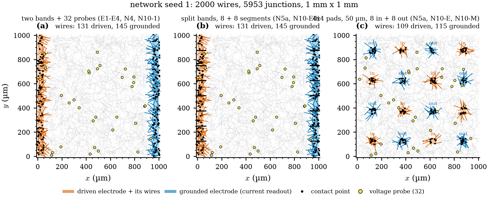

*Electrode layouts on network seed 1 (orange: driven electrode and the wires it contacts; blue: grounded electrode,
whose current is read out; black: contact points; yellow: the 32 voltage probes). (a) Two bands, 5 % of the width
each: the framework layout, used in every experiment so far (E1-E4, N4-1, N10-1), with the total current and the 32
internal probes as readouts. (b) The same bands cut into 8 + 8 segments and (c) a $4 \times 4$ array of 50 µm pads, 8 driven
+ 8 grounded: the multi-terminal layouts of N5a (binary model), next to be used with the N10 junction (N10-E),
where the 16 electrode currents replace the internal probes.*

## 1. Setup and operating point

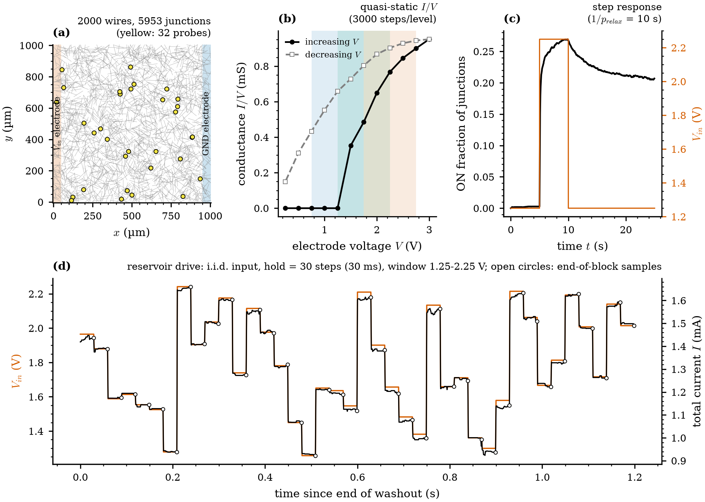

*Figure 1. (a) The network (seed 1): 2000 wires, 5953 junctions, electrodes on the left/right 5% bands, 32 random
voltage probes. (b) Quasi-static conductance for a slow up/down staircase (3000 steps per level, mean of the last
1000): conduction starts near 1.5 V on the way up and survives down to 0.25 V on the way down (strong hysteresis).
The shaded bands are the three input windows of the sweep. (c) ON fraction for a 1.25 V -> 2.25 V -> 1.25 V step.
SET saturates within ~0.5 s, while relaxation is slow: 15 s after the step the ON fraction is still 0.21, far above the ~0.002 of the
upward branch. (d) Reservoir drive: i.i.d. input held 30 steps in the 1.25-2.25 V window. The current follows
$V_{\mathrm{in}}$ almost instantaneously, with small switching transients within each block.*

The drive is a piecewise-constant electrode voltage V = $V_{\mathrm{lo}}$ + ($V_{\mathrm{hi}} - V_{\mathrm{lo}}$) u with u ~ U(0, 1), each value held for
`hold` steps (1 ms each). A random pre-drive of $10^{4}$ steps (one relaxation time) precedes every run. (Review: one
relaxation time is not enough; in representative runs the ON fraction still rises by 5-10 % during the scored
stream, section 6.)

### Conclusions

* The network has a sharp conduction onset (~1.5 V from the OFF state) and strong hysteresis. Once conducting, it
  stays conducting down to 0.25 V.
* Its two time scales are far apart: SET takes ~$10^{2}$ steps (0.1-0.5 s), relaxation ~$10^{4}$ steps (10 s). Input
  samples of 10-100 ms sit between the two.
* The electrode current follows $V_{\mathrm{in}}$ almost instantly. Most of the measured signal is therefore Ohm's law, not
  network state.

## 2. Consistency (echo-state property)

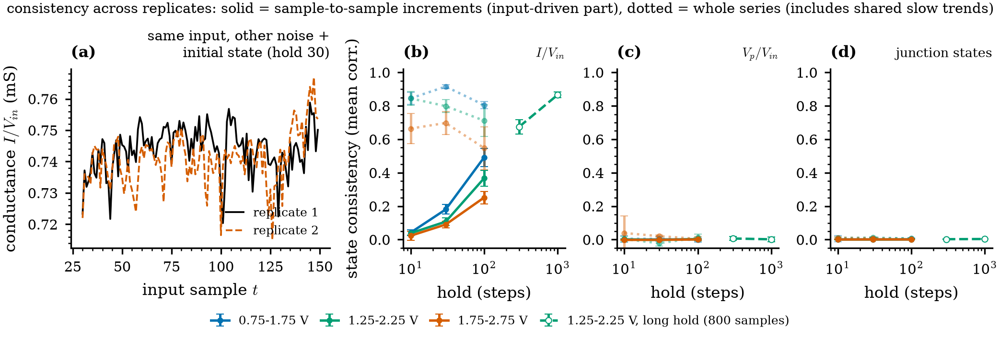

*Figure 2. Consistency = mean over features of the correlation between two replicates driven by the same input,
with different switching noise and different random pre-drive. Mean $\pm$ sd over 3 networks. All panels show the
**state** part: the conductance I/$V_{\mathrm{in}}$ in (b), the probe transfer ratios $V_p/V_{\mathrm{in}}$ in (c) (both independent of $V_{\mathrm{in}}$
for fixed junction states, tested) and the junction states in (d). Solid: consistency of the sample-to-sample
increments (the input-driven response); dotted: of the whole series, which also rewards slow trends shared by the
two replicates. (a) Conductance traces of the two replicates of one run.*

| state observable (config means) | E1, whole series | **E1, increments** | E3 increments (hold 300 / 1000) |
|---|---|---|---|
| conductance I/$V_{\mathrm{in}}$ | 0.55-0.92 | **0.02-0.49** (hold 10: $\le 0.05$; hold 100: up to 0.49) | 0.68 / 0.87 |
| probe ratios $V_p/V_{\mathrm{in}}$ | -0.02-0.04 | 0.00 | 0.01 / 0.00 |
| junction states | 0.00-0.01 | 0.00 | 0.00 / 0.00 |

Why the two differ: in a representative E1 run, 66-78 % of the conductance's variance is a slow trend
(`scripts/review_checks.py`) shared by both replicates, since both are still relaxing from their pre-drives. The
increments remove it.

### Conclusions

* At the input rates of the main sweep (10-100 ms per sample) the network has **no reproducible input-driven
  state**. Even the global conductance responds reproducibly only in part (increment consistency $\le 0.49$). The
  whole-series values (0.55-0.92) reported before the review were dominated by a shared slow drift.
* The conductance response becomes reproducible with slow inputs (0.68-0.87 at 0.3-1 s per sample) or with faster
  relaxation (0.72-0.73 at $p_{\mathrm{relax}} = 10^{-3}$ and $10^{-2}$, section 4). The binary network needs input samples of order
  its SET/relaxation times to respond reproducibly.
* Which junctions are ON, and hence the local voltage distribution, is set by the switching noise, not by the input
  history (consistency ~0). The thousands of junctions do not form a reproducible high-dimensional state.
* Raw current and probe voltages look reproducible (0.85-1.00) only because they contain $V_{\mathrm{in}}$ itself. Consistency
  has to be measured on the state part, and on its increments.

## 3. Memory and nonlinear processing

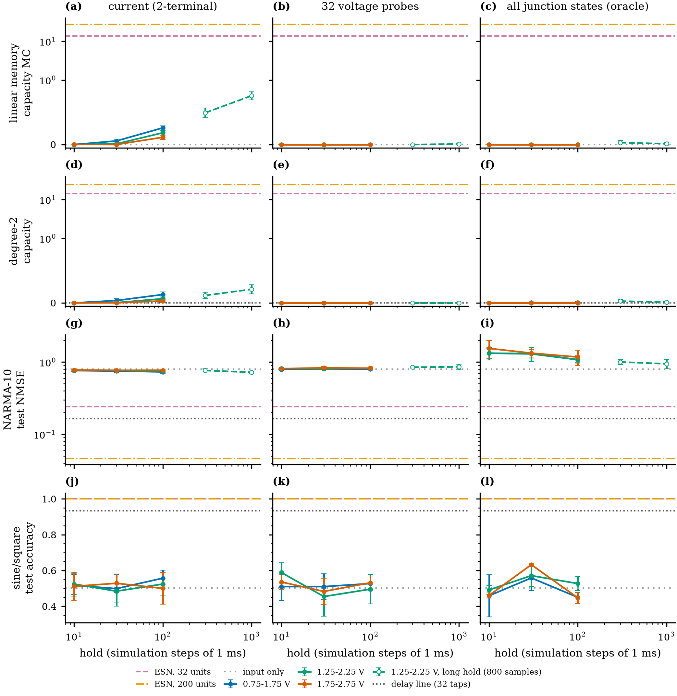

*Figure 3. Main sweep (E1, filled markers: hold 10/30/100 steps x three input windows, mean $\pm$ sd over 3 networks x
2 replicates) and long holds (E3, open markers: 300/1000 steps, 1.25-2.25 V). Columns are the three readout
scenarios. Horizontal lines are no-nanowire baselines on the same input streams: input only, delay line with 32
taps, and ESN with 32 and 200 tanh units. MC and degree-2 capacity sum only terms above the noise floor ($\le 0.025$).*

**Baselines** (mean over the 3 input streams):

| reference | lag-0 C | MC (lags 1-30) | degree-2 capacity | NARMA-10 NMSE | sine/square acc. |
|---|---|---|---|---|---|
| input only | 1.00 | 0.00 | 0.00 | 0.80 | 0.50 |
| delay line, 32 taps | 1.00 | 30.0 | 0.0 | 0.16 | 0.93 |
| quadratic delay line, 8 taps | 1.00 | 7.0 | 23.0 | 0.73 | 1.00 |
| ESN, 32 units | 1.00 | 13.8 | 14.4 | 0.24 | 1.00 |
| ESN, 200 units | 1.00 | 27.2 | 24.3 | 0.046 | 1.00 |

**AgNW network, best setting per metric** (mean $\pm$ sd over 3 networks $\times$ 2 replicates; the setting is in brackets as
hold in steps / window centre in V):

| readout | MC | degree-2 capacity | NARMA-10 NMSE | sine/square acc. |
|---|---|---|---|---|
| current (2-terminal, 10 virtual nodes) | $0.26 \pm 0.03$ [100/1.25] | $0.13 \pm 0.04$ [100/1.25] | $0.73 \pm 0.03$ [100/1.25] | $0.56 \pm 0.04$ [100/1.25] |
| 32 voltage probes | 0.00 | 0.00 | $0.80 \pm 0.03$ [10/1.25] | $0.59 \pm 0.05$ [10/1.75] |
| all junction states (oracle) | 0.00 | $0.01 \pm 0.01$ | $1.08 \pm 0.08$ [100/1.75] | $0.63 \pm 0.01$ [30/2.25] |
| current, hold 1000 (E3) | $0.76 \pm 0.06$ | $0.21 \pm 0.07$ | $0.72 \pm 0.03$ | not run |

The best setting is picked here *after* seeing the test scores, so these numbers are, if anything, optimistic. The
junction-state readout does worse than the mean on NARMA-10 (NMSE > 1). Its ~6000 binary features drift slowly
between the training and test segments, and the readout overfits.

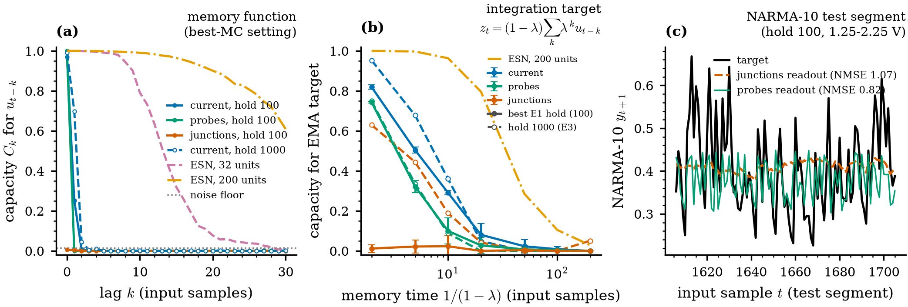

*Figure 4. (a) Memory function $C_k$ at the best-MC setting of each readout. All memory is at lag 1 (the current at
the start of a hold block still reflects the previous input), and it vanishes by lag 2. (b) Capacity for
exponential moving averages of the input, z_t = (1 - $\lambda$) $\Sigma$ $\lambda$^k u_{t-k}, against their memory time 1/(1 - $\lambda$). The
network behaves as a noisy low-pass filter with a memory time of a few samples. Longer holds (open markers) help
somewhat, but it never approaches the ESN. (c) NARMA-10 test segment: the readouts follow the mean and the
input-driven part of the target, not its history-dependent peaks.*

### Conclusions

* No readout beats the input-only baseline in a way that matters. MC $\le 0.26$ (ESN-32: 13.8), degree-2 capacity $\le 0.13$
  (ESN-32: 14.4), NARMA-10 $\ge 0.73$ (input only: 0.80), sine/square at chance.
* The only memory is one input sample back, carried by the global conductance. Holding each input 1 s raises it to
  $C_1 \approx 0.76$, and it is gone by lag 2.
* The network acts as a noisy low-pass filter with a memory time of a few samples (EMA capacity). The oracle
  readout of all junction states is no better than the two-terminal current. More readout channels do not help
  when the channels are noise.

## 4. Mechanism: the relaxation channel (E2, sensitivity study)

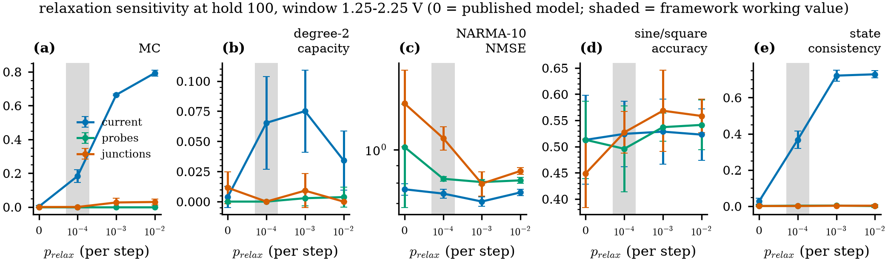

*Figure 5. Hold 100 steps, window 1.25-2.25 V, fixed before E1 was analysed. $p_{\mathrm{relax}} = 0$ is the published model
(RESET practically inactive at these currents) and $10^{-4}$ is the framework's working value (shaded). $10^{-3}$ and
$10^{-2}$ lie outside the working model. Mean $\pm$ sd over 3 networks.*

* **$p_{\mathrm{relax}} = 0$.** Junctions only turn ON (mean ON fraction 0.28), so the network saturates. MC = 0, and the
  conductance is "consistent" (0.97) only because it barely moves.
* **Faster relaxation** raises the current-readout MC from 0.18 ($10^{-4}$) to 0.66 ($10^{-3}$) and 0.79 ($10^{-2}$), and
  improves NARMA-10 slightly (0.75 -> 0.71). Degree-2 capacity stays $\le 0.08$ and classification stays at chance.
  Probe and junction readouts gain nothing.

### Conclusions

* Relaxation is the source of the fading memory. Without it (the published model) the network saturates and has
  none.
* Faster relaxation, even 100x beyond the working value, buys about one sample of linear memory (MC 0.79) and no
  nonlinear capacity. Tuning a single, homogeneous rate cannot make this network a reservoir.

## 5. Interpretation

Seen through its two electrodes, the simulated network is close to a **single stochastic leaky integrator with
asymmetric rates**: fast, threshold-gated SET and slow, input-independent relaxation. A reservoir needs many
reproducible, diverse, fading state variables. Here the thousands of junctions are Bernoulli switches whose
individual timing is noise, so they average into one collective variable, the global conductance, whose
input-driven part is only partly reproducible at these input rates (section 2). A linear readout of such a system
recovers the current input (for free, through Ohm's law) and a smeared average of the recent past, and nothing
else. That is exactly what the capacity profile shows.

## 6. Limitations: what could change the answer

These results hold for this model and this interface. They do not rule out AgNW reservoirs in general:

* **Junction model.** Junctions are binary Bernoulli switches with one relaxation rate. Experimental AgNW reservoirs
  rely on continuous, voltage- and history-dependent filament conductances with a spread of time scales, which a
  binary model cannot provide. $p_{\mathrm{relax}}$ itself is unconfirmed by the authors (see the framework's
  `docs/lamas_questions_es.md`).
* **Input.** One electrode pair and positive, piecewise-constant voltages. Multi-electrode (spatial) input,
  bipolar drive, or input masks with time-multiplexing (delay-based RC) could break the one-dimensional
  bottleneck. The circuit solver supports only two electrodes, so this needs framework changes.
* **Readout.** Linear ridge readout. Feature noise was not modelled beyond the 10 µV / 10 nA resolution floor.
  Averaging repeated trials would reduce switching noise but is not an online reservoir.
* **Scope.** One size (N = 2000), 3 networks, 2 noise replicates, 2000 input samples (800 for E3), and holds up to
  1 s. Wall time: 1.3-101 min per run (`results/metrics.json`, field `seconds`).
* **Washout (review 2026-09-27).** The 10 s pre-drive equals one relaxation time of the binary model. In representative
  binary runs (E1 and the pads of N5a) the ON fraction still rises by 5-10 % over the scored stream, and the
  continuous-filament model (N4, dissolution ~30 s) is further from stationarity. The readout is trained on the
  first 60 % and tested on the last 20 %, so drift penalizes it. This does not rescue any configuration: drift
  cannot make an irreproducible state reproducible. It should still be fixed (washout $\ge 3$ times the slowest time
  constant, plus a stationarity check) for new experiments.
* **Mean-field RESET (review 2026-09-27).** The mean-field step evaluates RESET at $I_{\mathrm{on}} = G_{\mathrm{on}}$ |dV| with dV from the
  mean-field circuit. For partly-ON junctions that dV is larger than an ON junction would see, so RESET, and with it
  forgetting, is overestimated (e.g. $p_{\mathrm{off}}$ ~$10^{-3}$ instead of $10^{-4}$ at |dV| = 0.3 V). This may flatter the
  mean-field results (sections 7-8) and is a limitation of the ablation, not of the binary model.

## 7. Ablation N1: the same dynamics without switching noise (mean-field)

To separate the two junction-model causes (stochastic switching vs. a single slow time scale), each junction's
Bernoulli state was replaced by its ON probability $P_j$. The update is the exact expectation of the framework's
`update_dynamics` (tested against Monte Carlo), and the circuit is solved with the mean conductances
(`agnw_rc/meanfield.py`, details in [NEXT_STEPS.md](NEXT_STEPS.md)). Same network, rates, circuit, holds, seeds and
replicates as E1. Replicates now differ only in the random pre-drive.

The mean-field network conducts only from ~3-4 V (stochastic: ~1.5 V). In the stochastic model, conduction starts
through cascades of individual switching events. The mean-field runs therefore use windows centred at 3.5 / 4.5 /
5.5 V. This is an ablation at its own operating point (currents 1.7-4.8 mA), not a device prediction.

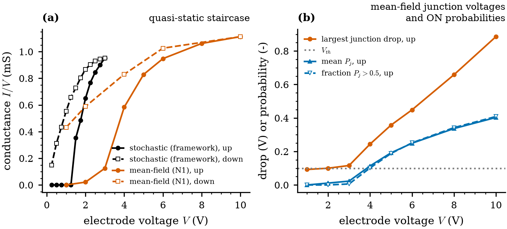

*Figure S1. (a) Quasi-static staircase (3000 steps per level, network seed 1): stochastic framework model vs.
mean-field (`scripts/pilot.py`, `scripts/meanfield_pilot.py`). (b) Mean-field: the largest junction voltage drop
stays pinned near $V_{\mathrm{th}} = 0.1$ V up to ~3 V, so nothing switches, and the ON probabilities stay nearly bimodal (mean
$P_j$ is about equal to the fraction with $P_j > 0.5$).*

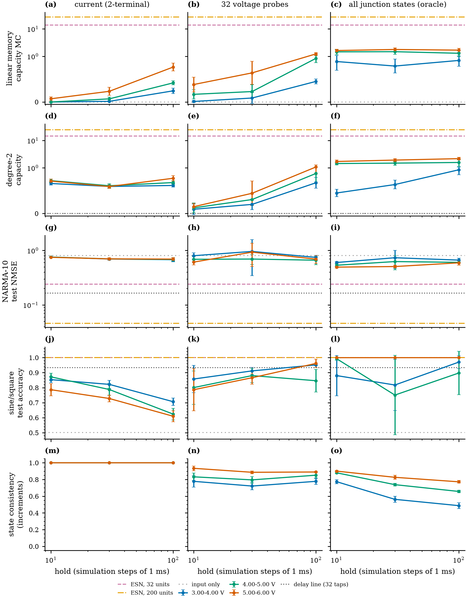

*Figure 6. As Fig. 3 for the mean-field network (M1), with a fifth row for state consistency (I/$V_{\mathrm{in}}$, $V_p/V_{\mathrm{in}}$,
$P_j$). Mean $\pm$ sd over 3 networks $\times$ 2 replicates.*

| best setting | stochastic (E1) | mean-field (M1) | ESN, 32 units |
|---|---|---|---|
| state consistency (increments), junctions | 0.00 | 0.49-0.90 | n/a |
| state consistency (increments), conductance I/$V_{\mathrm{in}}$ | 0.02-0.49 | 1.00 | n/a |
| degree-2 capacity | 0.13 (current) | $2.17 \pm 0.25$ (junctions, hold 100 / 5.5 V); 0.77 (current) | 14.4 |
| sine/square accuracy | $\le 0.63$ (chance) | 1.00 (junctions); 0.96 (probes); 0.87 (current, hold 10) | 1.00 |
| NARMA-10 NMSE | 0.73 | $0.49 \pm 0.02$ (junctions, hold 10 / 5.5 V) | 0.24 |
| linear memory capacity | 0.26 | $1.77 \pm 0.25$ (junctions, hold 30 / 5.5 V); 1.22 (probes) | 13.8 |

### Conclusions (decision rule of NEXT_STEPS N1: "in between")

* **Conduction onset in the framework model is a fluctuation effect.** Without switching noise the voltage spreads
  evenly, junctions stay at $V_{\mathrm{th}}$, and the onset moves from ~1.5 V to ~3-4 V (Fig. S1).
* **Switching noise (J1) is what destroys reproducibility and nonlinear processing.** Without it the network state
  follows the input reproducibly. The degree-2 capacity rises ~15x, and sine/square becomes solvable. Even the
  two-terminal current then carries nonlinear information (0.6-0.77 degree-2 capacity, 0.87 accuracy).
* **The single slow time scale (J2) still caps memory.** MC stays at 1-2 samples (ESN-32: 14) and NARMA-10 at
  0.49-0.6 (delay line: 0.16). Individual $P_j$ keep part of the imprint of the pre-drive (junction increment
  consistency 0.49-0.90, falling with hold and at lower voltage). This fits junctions made bistable by voltage
  feedback, which hold a state for a long time, rather than fading memory at the input time scale. The review
  confirmed that this response is input-driven: in a representative run, the last 31 inputs explain 25-29 % of the
  variance of each $P_j$ (in-sample R$^{2}$, chance ~2 %) and 58-68 % of the conductance.

## 8. N2: heterogeneous forgetting, and the limit of relaxational elements

N2 tests cause J2 (a single forgetting time scale) directly. In the mean-field model, each junction gets its own
fixed relaxation probability, log-uniform between the working value $10^{-4}$ and $p_{\mathrm{max}}$ $\in$ {$10^{-3}$, $10^{-2}$, $10^{-1}$}. This is
quenched junction-to-junction variability; the draw depends only on the network seed. Homogeneous $10^{-3}$ and $10^{-2}$
runs are controls, and homogeneous $10^{-4}$ is M1. Window 5.0-6.0 V (best M1 region), holds 10 and 30,
3 networks $\times$ 2 replicates.

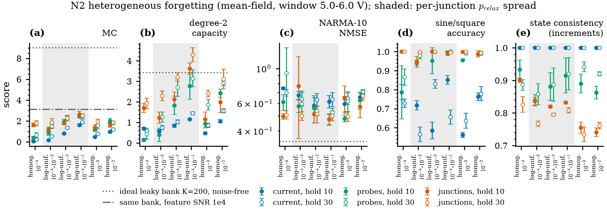

*Figure 7. Scores per forgetting condition (shaded: heterogeneous rates). Filled markers: hold 10; open: hold 30.
Reference lines: an ideal bank of 200 leaky integrators, noise-free (dotted) and with feature noise at SNR $10^{4}$
(dash-dot, MC panel); see below.*

| junctions readout, best hold | homog. $10^{-4}$ | homog. $10^{-3}$ | homog. $10^{-2}$ | log-unif. 1e-4..1e-2 | log-unif. 1e-4..1e-1 | ESN-32 |
|---|---|---|---|---|---|---|
| MC | 1.77 | 1.94 | 1.86 | 2.28 | 2.63 | 13.8 |
| degree-2 capacity | 1.92 | 2.40 | 3.11 | 3.20 | 4.29 | 14.4 |
| NARMA-10 NMSE | 0.49 | 0.50 | 0.57 | 0.51 | 0.47 | 0.24 |

The two-terminal current gains most: MC rises from 0.23 to 1.89 (hold 30) with the widest spread. At equal *mean*
rate (log-uniform 1e-4..1e-2 has mean rate $\approx 2 \times 10^{-3}$), the spread beats the homogeneous $10^{-3}$ control for every
readout (MC 2.28 vs 1.94 junctions, 2.29 vs 1.59 probes, 1.38 vs 0.77 current).

**Why memory stays low: two references** (saved scripts, results in `results/`):

* *Effective dimension* (`scripts/effective_dimension.py`), as the participation ratio of the state features.
  Mean-field junctions: 3.6 (M1) and 4.6 (N2 widest spread). ESN: 3.3 (32 units) and 4.3 (200 units).
  Stochastic junctions: 14-93, almost all noise. The mean-field network is **not** lower-dimensional than the ESN
  by this measure, so low dimension does not explain its low memory.
* *Ideal leaky-integrator bank* (`scripts/leaky_bank_reference.py`): K independent, noise-free first-order low-pass
  filters $x_i$[t] = a_i $x_i$[t-1] + (1 - a_i) u[t], time constants log-uniform over 1..tau_max samples, scored with
  the same readout. This is the best a network of purely relaxational elements driven by one scalar can offer.

| ideal leaky bank (default ridge grid, $\alpha \ge 10^{-6}$) | MC | degree-2 capacity (with $x_i$^2 features) | NARMA-10 NMSE |
|---|---|---|---|
| K = 32, tau 1..100 | 5.7 | 3.3 | 0.36 |
| K = 200, tau 1..100 | 6.0 | 3.4 | 0.34 |
| K = 200, tau 1..1000 | 5.4 | 2.4 | 0.52 |

**Correction (review 2026-09-27).** For the noise-free bank the ridge parameter selected on validation sits at the
grid floor ($\alpha = 10^{-6}$) for every lag, so these MC values are set by the readout grid, not by the bank. With the
floor lowered to $10^{-14}$, and with feature noise, the same bank (K = 200, tau 1..100) gives
(`scripts/leaky_bank_reference.py`, `scripts/review_checks.py`):

| same bank | noise-free, $\alpha \ge 10^{-6}$ | noise-free, $\alpha \ge 10^{-14}$ | feature SNR $10^{8}$ | SNR $10^{4}$ | SNR $10^{2}$ |
|---|---|---|---|---|---|
| MC | 6.0 | 9.0 (still at the floor for 97 % of lags) | 5.0 | 3.1 | 2.1 |

The limit is therefore **noise**, not a structural number. Filters that only smooth the same input give nearly
collinear responses; separating many lags needs a very high signal-to-noise ratio, which a noisy device does not
have. This is the behaviour expected for "normal" (non-rotating, e.g. purely relaxational) dynamical systems, whose
memory is noise-limited, as opposed to networks with non-normal or rotating dynamics such as an ESN (MC 14-27)
(Ganguli, Huh & Sompolinsky, PNAS 105, 18970 (2008); White, Lee & Sompolinsky, PRL 92, 148102 (2004); to be checked
against the papers before citing).

### Conclusions

* A spread of forgetting rates helps. MC and degree-2 capacity rise by ~1.5-2x (current: ~8x), and at equal mean
  rate the spread beats the homogeneous control. J2 is a real limitation.
* The gains are limited, and the limit is noise. Purely relaxational elements driven by one scalar input reach
  MC $\approx 9$ noise-free, where only numerical conditioning stops them, but only 2-3 at feature SNR $10^{2}-10^{4}$. The
  mean-field network (MC 2.6, degree-2 capacity 4.3) is in the range of a moderately noisy ideal bank. (Corrected
  2026-09-27: this bullet previously called MC $\approx 6$ a "structural cap"; that number was the ridge-grid floor.)
* Tuning junction relaxation (N2) or making it graded (N4) cannot by itself produce ESN-like memory in a
  two-terminal, single-input device. Longer memory needs input channels that carry different information
  (multi-electrode drive, delayed input copies) or dynamics that are not purely relaxational.
* Effective dimension is not the bottleneck. The mean-field state is as high-dimensional as a 200-unit ESN.

## 9. N7a: can the switching noise be averaged away?

The framework model is the stochastic one, so the practical question is how much of its deficit averaging removes.
For one E1 point (hold 30, 1.25-2.25 V, 3 networks), 8 noise replicates were run, each with its own switching noise
and random pre-drive. The readout features were averaged over R = 1, 2, 4, 8 replicates, which is equivalent to R
identical devices driven in parallel or R repeated trials (`scripts/noise_averaging.py`).

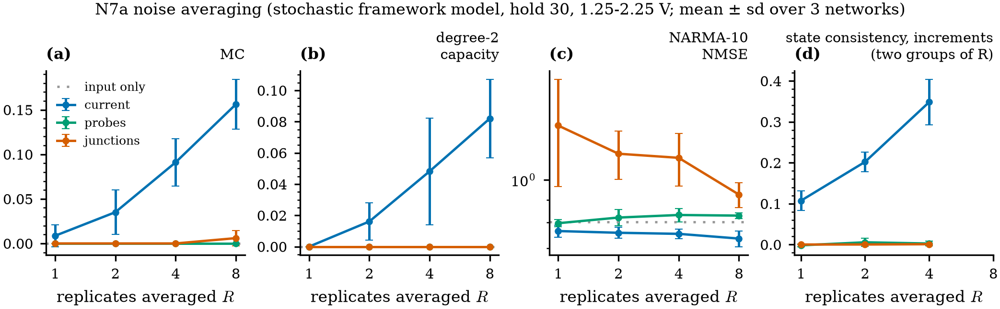

*Figure 8. Scores of replicate-averaged features vs R (mean $\pm$ sd over 3 networks). (d) Consistency of the state
increments between two disjoint groups of R replicates.*

| R | 1 | 2 | 4 | 8 |
|---|---|---|---|---|
| conductance consistency, whole series | 0.80 | 0.90 | 0.94 | n/a |
| conductance consistency, increments | 0.11 | 0.20 | 0.35 | n/a |
| junction-state consistency | 0.012 | 0.012 | 0.015 | n/a |
| MC, current | 0.01 | 0.04 | 0.09 | 0.16 |
| MC / degree-2 capacity, junctions | 0.00 / 0.00 | 0.00 / 0.00 | 0.00 / 0.00 | 0.01 / 0.00 |
| NARMA-10 NMSE, current (input only: 0.80) | 0.77 | 0.76 | 0.76 | 0.74 |

### Conclusions

* Averaging works as independent noise predicts for the global conductance. Its input-driven part (increment
  consistency) grows 0.11 -> 0.20 -> 0.35 for R = 1, 2, 4, as expected for an ~11 % input-driven share of the
  variance. The whole-series values (0.80 -> 0.94) were dominated by a shared slow trend. It is one dimension, and it
  adds almost nothing (MC 0.16 with 8 devices).
* For individual junctions and probes, averaging barely helps: consistency stays $\le 0.015$ up to R = 4. Only ~1% or
  less of a junction's state variance follows the input at this operating point, so reaching the mean-field
  regime would need on the order of 100 or more parallel devices or trials. Noise averaging is not a practical
  remedy here.
* The mean-field network, however, ran at higher voltage (3.5-5.5 V). Part of its advantage may therefore come
  from the operating point rather than from removing the noise. That is tested next (N7b).

## 10. N7b: is the mean-field advantage just the higher voltage?

The mean-field runs (M1) used 3.5-5.5 V, the stochastic E1 runs 1.25-2.75 V. N7b runs the **stochastic framework
model at the M1 windows** (holds 10/30, 3 networks $\times$ 2 replicates, both streams) with everything else unchanged.

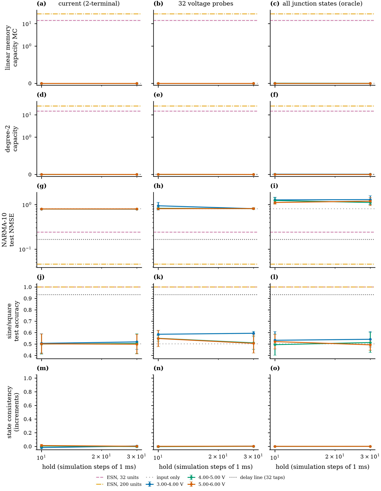

*Figure 9. As Fig. 6 (same windows and layout) for the stochastic framework model.*

| same windows, best setting | stochastic (N7b) | mean-field (M1) |
|---|---|---|
| MC (junctions) | 0.00 | 1.77 |
| degree-2 capacity (junctions) | $\le 0.01$ | 1.92 |
| NARMA-10 NMSE (best readout) | 0.79 | 0.49 |
| sine/square accuracy (best readout) | $\le 0.59$ (chance) | 1.00 |
| junction-state consistency (increments) | 0.00 | 0.49-0.90 |
| conductance consistency I/$V_{\mathrm{in}}$ (increments) | -0.02-0.01 | 1.00 |

At these voltages the stochastic network is more strongly ON (ON fraction 0.38-0.48 vs 0.09-0.22 in mean-field),
and its conductance response is not reproducible at all (increments -0.02-0.01; E1: 0.02-0.49).

### Conclusions

* The confound is ruled out. At the same windows the stochastic model fails exactly as in E1, so the mean-field
  gains (N1) come from removing the switching noise, not from the operating point.
* Higher voltage makes the stochastic network worse: more junctions switch, so there is more noise, and even the
  global conductance loses reproducibility.

## 11. N5a: multi-electrode input with random weights

To break the single-input bottleneck (cause I1), the network was driven through 8 input electrodes and read through
the currents of all 16 electrodes (8 inputs, 8 grounded outputs), plus the probes and junction states as before.
The multi-terminal circuit is implemented in this project (`agnw_rc/multicircuit.py`); its two-band special case
has the framework's circuit matrix to round-off (tested). Two layouts (Fig. S3): the framework bands **split** into
8 + 8 segments, and a $4 \times 4$ array of 50 µm **pads** in a checkerboard. Canonical encoding: each input electrode gets
V_e(t) = $V_c$ + ½ $w_e$ (2u(t) - 1) with fixed random $w_e$ $\in$ [-1, 1]. Stochastic framework dynamics, holds 10 / 30,
3 networks $\times$ 2 replicates. Windows come from a quasi-static pilot (Fig. S2): split bands have the two-band onset
(~1.5 V, windows centred at 1.25/1.75/2.25 V); pads conduct from ~0.3-0.5 V (windows centred at 0.5/0.75/1.0 V).


*Figure S3. The three network + electrode configurations on network seed 1 (driven electrodes and their wires in
orange, grounded in blue, contact points black, voltage probes yellow).*

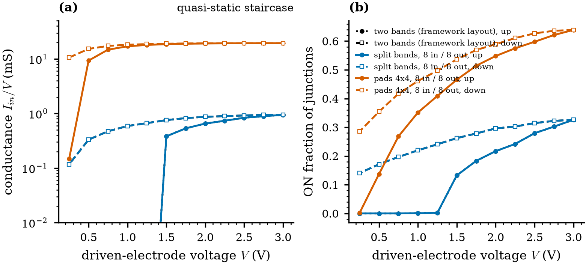

*Figure S2. Quasi-static staircase with all driven electrodes at the same V (`scripts/multi_pilot.py`). The split
bands reproduce the two-band curve exactly. Pads conduct ~20x more and switch on below 0.5 V.*

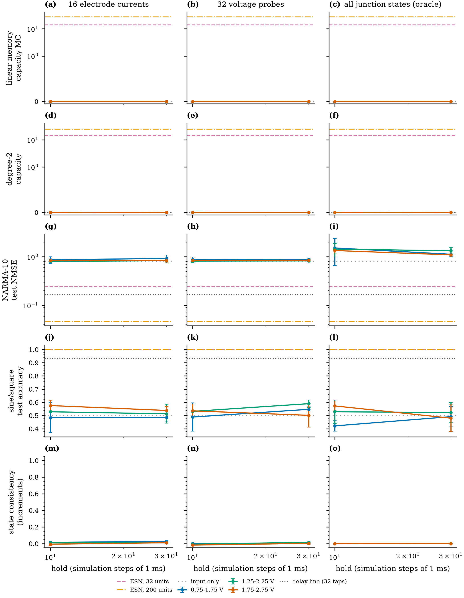
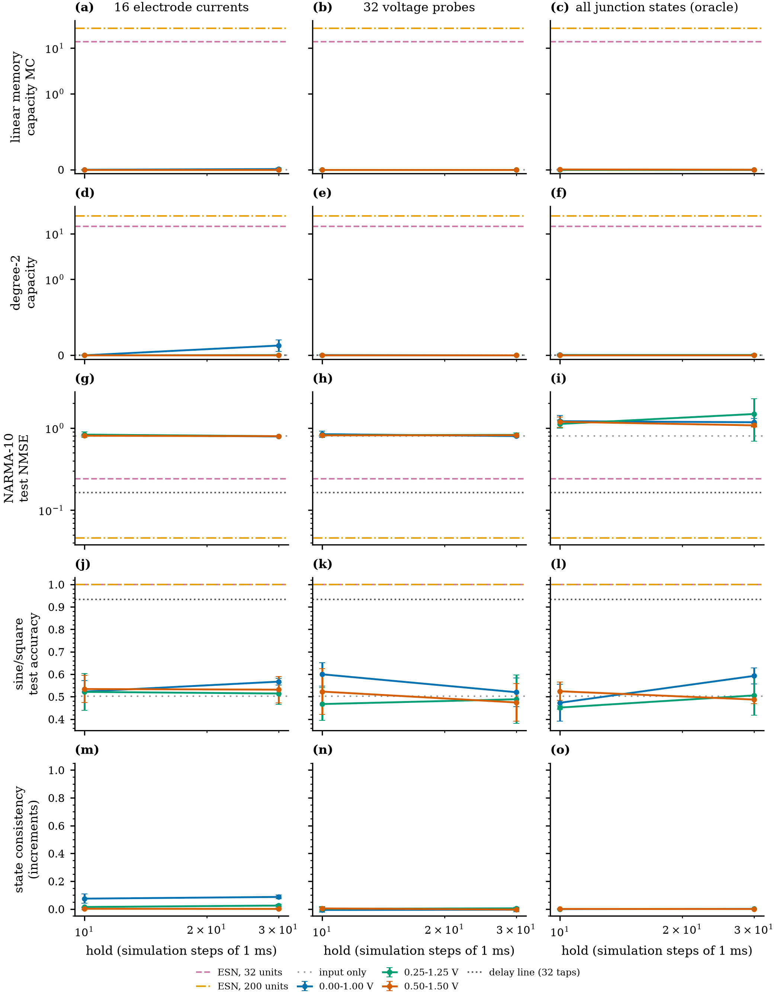

*Figure 10. N5a scores for split bands (top) and pads (bottom), laid out as Fig. 6. The state consistency of the
electrode currents and probes is measured on the residual after regressing out the instantaneous electrode voltages.*

| best over settings | split bands | pads | two bands, same holds (E1) | input only |
|---|---|---|---|---|
| MC | 0.00 | 0.01 | 0.06 | 0 |
| degree-2 capacity | $\le 0.01$ | 0.13 (currents, 0.0-1.0 V, hold 30) | 0.04 | 0 |
| NARMA-10 NMSE | 0.80 | 0.79 | 0.75 | 0.80 |
| sine/square accuracy | $\le 0.59$ | $\le 0.60$ | $\le 0.63$ | 0.50 |
| junction-state consistency (increments) | 0.00 | 0.00 | 0.00 | n/a |
| state consistency of the currents (increments) | -0.01-0.03 | 0.00-0.09 | 0.02-0.49 (I/$V_{\mathrm{in}}$) | n/a |

### Conclusions

* Multi-electrode drive with random weights does **not** rescue the stochastic framework model. Every score stays
  at the input-only level, in both layouts and all windows. Sixteen current channels plus probes add no usable
  memory or nonlinearity.
* The reason is the one identified in N1/N7: the switching noise (J1). Junction states remain irreproducible
  (consistency $\le 0.01$), and once the input echo is removed the electrode currents carry little reproducible state
  either. A richer interface cannot extract information the noisy state does not hold.
* As a consequence, interface work (N5b delays, masks, feedback) on the stochastic model can at most reproduce
  what the interface itself supplies. For example, delayed input copies would give MC $\approx$ number of delays through
  Ohm's law alone. Such experiments are only informative on a network whose state is reproducible (mean-field, or
  a less noisy junction model).

## 12. N4-1: the calibrated continuous-filament network as a reservoir

N4 replaces the binary junctions with the continuous-filament model (design, equations and calibration:
[N4_DESIGN.md](N4_DESIGN.md)). It is calibrated on Lamas Fig. 4: $V_{\mathrm{set}} = 0.06$ V, $V_{\mathrm{reset}} = 0.03$ V, b = 0.02,
$\Lambda_{\mathrm{crit}} = 0.01$ V s; the N = 2000 metrics fit within ~5 %. N4-1 repeats the E1 protocol: two bands, i.i.d. input held
10/30/100 steps, windows centred at 1.75/2.25/2.75 V around the N4 onset (~2 V), noise-free, 3 networks $\times$ 2
replicates, sine/square included.

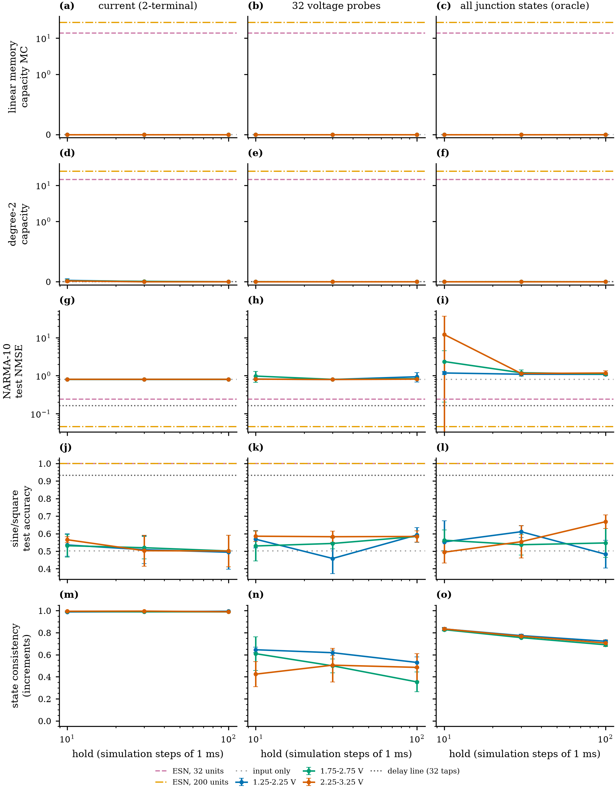

*Figure 11. N4-1 scores, laid out as Fig. 6 (the junction observable is $\Lambda/\Lambda_{\mathrm{crit}}$).*

| best over settings | N4-1 (calibrated filament) | binary framework model (E1) | mean-field (M1) | input only |
|---|---|---|---|---|
| junction-state consistency, increments (whole series) | 0.69-0.83 (0.87-0.94) | 0.00 (0.00-0.01) | 0.49-0.90 (0.52-0.95) | n/a |
| conductance / current state consistency, increments | 0.99-1.00 | 0.02-0.49 | 1.00 | n/a |
| variance of a junction state explained by the last 31 inputs (review) | 0.4-2.6 % (chance ~2 %) | ~1-2 % | 25-29 % | n/a |
| lag-0 capacity, junctions | 0.00 | 0.00-0.04 | up to 1.00 | n/a |
| MC | 0.00 | 0.26 | 1.77 | 0 |
| degree-2 capacity | $\le 0.02$ | 0.13 | 2.17 | 0 |
| NARMA-10 NMSE | 0.79 | 0.73 | 0.49 | 0.80 |
| sine/square accuracy | $\le 0.67$ | $\le 0.63$ | 1.00 | 0.50 |

**Why nothing moves.** In the calibrated model a junction grows only above 0.06 V and dissolves only below 0.03 V,
slowly (~30 s at b = 0.02); in between it holds. Under a drive biased at 1.25-3.25 V, junctions above threshold
saturate at $\Lambda_{\mathrm{max}}$ within ~0.1 s and stay there, and the rest sit in the hold band or dissolve over tens of seconds.
Only 5-15 % of the junctions are closed, and they barely change from one input sample to the next. The network is
effectively a fixed resistor network.

**Zero-mean drive** (`scripts/n4_bipolar_check.py`, `results/n4_bipolar_check.json`). With V = $\pm3$ V (hold 30),
the bipolar model could in principle follow the input's sign. Instead no junction closes (closed fraction 0.000,
largest |$\Lambda$| = $0.92 \Lambda_{\mathrm{crit}}$): the polarity changes every 30 ms, faster than a filament grows (~0.25 s), so $\Lambda$
random-walks near zero and the network never conducts.

### Conclusions

* **Removing the switching noise with a physical model makes the state reproducible**: junction increment
  consistency 0.69-0.83 vs 0.00 for the binary model, which confirms that the binary model's noise was the
  reproducibility problem. But the reproducible part is a very slow integral of the input: the last 31 inputs
  explain almost none of a junction's state (0.4-2.6 %, chance ~2 %). The state is reproducible but tracks the
  input history over tens of seconds, not over the ~1 s spanned by 30 samples.
* **But the Fig. 4-calibrated dynamics are too slow for the input.** The calibration requires ~30 s of filament
  persistence (N4_DESIGN section 5.1). Together with the wide hold band, this freezes the network under a biased
  drive, and a zero-mean drive is too fast to form filaments at all. The reservoir scores fall back to the
  input-only level, below even the mean-field ablation.
* The limiting factor is now clearly **time scales** (J2), not noise (J1). Filaments react on ~0.1 s, persist for
  ~30 s, and the inputs change every 10-100 ms. A reservoir built from this network needs either inputs on the
  network's own time scale (seconds) or junction dynamics that are faster than the Fig. 4 calibration allows.

## 13. E4: inputs on the network's own time scale (decisive experiment of the review plan)

All earlier experiments drove the network 10-300 times faster than it forgets. E4 holds each input for
**0.3, 1 and 3 s**, closer to the binary model's relaxation (10 s) and to the calibrated N4 filament persistence
(~30 s). It is the first experiment run with the Phase 0 methodology of the review
([REVIEW_2026-09-27.md](REVIEW_2026-09-27.md)):

* **washout** of 3 forgetting times before scoring (binary 30 s, N4 75 s), and a stationarity check (drift of the
  ON fraction between the first and last 20 % of the stream);
* **dense readout**: 50 virtual nodes (current samples) per hold, so the readout sees the transient within each
  input as well as the slow state;
* **operating point chosen on validation data** (`agnw_rc/criteria.py`), with the go/no-go criteria G0-G2 fixed
  before the runs (NEXT_STEPS, "Decisive plan") and a 2-standard-deviation margin over 3 networks $\times$ 2 replicates;
* baselines computed on streams of the same length (800 samples), so ESN, delay line and noise floor
  (0.025) are directly comparable;
* **N4 integrated with a 2 ms step**. `scripts/n4_stride_check.py`: 2 ms reproduces the 1 ms Fig. 4 metrics within
  0.9 % (E4 features: current 1 %, junction states 7.7 % relative RMS). 5 and 10 ms fail by 5-12 %, and
  `scripts/n4_substep_check.py` shows that finer Euler substeps do not help: the circuit must be re-solved during
  SET avalanches.

Setup: two bands, i.i.d. and sine/square streams of 800 samples, windows 1.75/2.25 V (binary) and 2.25/2.75 V (N4,
around its onset), 3 networks $\times$ 2 replicates, 108 runs (`python scripts/run_sims.py e4`; part of the N4 0.3 s runs
was computed on a second machine with identical code and framework commit).

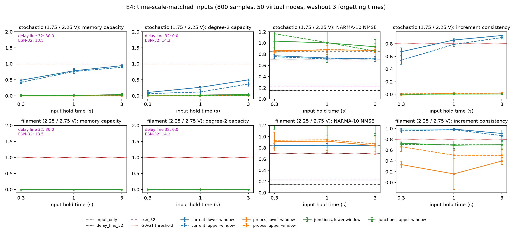

*Figure 12. E4 scores vs input hold time. Rows: binary framework model, calibrated N4. Solid / dashed: lower /
upper voltage window. Red dotted: G1 thresholds (capacities, NARMA) and the G0 threshold (consistency). Capacity
panels quote the off-scale baselines. Consistency is the sample-to-sample increment version.*

**Go/no-go at the operating point chosen on validation** (`results/e4_criteria.json`):

| readout | model | operating point | MC | degree-2 | NARMA-10 | sine/square | consistency (inc.) | G0 | G1 | G2 |
|---|---|---|---|---|---|---|---|---|---|---|
| current, 50 virtual nodes | binary | 3 s, 1.75 V | $0.94 \pm 0.04$ | $0.50 \pm 0.03$ | $0.71 \pm 0.04$ | 0.53 | 0.93 | **yes** | no | no |
| 32 probes | binary | 3 s, 1.75 V | 0.00 | 0.00 | 0.87 | 0.54 | 0.02 | no | no | no |
| junction states (oracle) | binary | 3 s, 2.25 V | 0.02 | 0.01 | 0.86 | 0.64 | 0.01 | no | no | no |
| current, $2 \times 50$ nodes | N4 | 0.3 s, 2.25 V | 0.00 | 0.00 | 0.84 | 0.50 | 0.99 | **yes** | no | no |
| 32 probes | N4 | 3 s, 2.25 V | 0.00 | 0.00 | 0.84 | 0.50 | 0.40 | no | no | no |
| junction states (oracle) | N4 | 1 s, 2.25 V | 0.00 | 0.00 | 1.20 | 0.50 | 0.69 | no | no | no |
| *baselines (800 samples)* | input only | | 0 | 0 | 0.84 | 0.50 | | | | |
| | delay line 32 | | 30.0 | 0 | 0.15 | 0.99 | | | | |
| | ESN-32 / ESN-200 (MC + degree-2) | | 13.5 + 14.2 = 27.7 / 50.1 | | 0.23 | 1.00 | | | | |

G1 needs MC $\ge 1$ with $\ge 2$ lags above the floor, degree-2 $\ge 1$ and NARMA $\le 0.70$, each with a 2 sd margin. G2 needs
MC + degree-2 $\ge 50 \%$ of an ESN of the readout's size (here ESN-200, 25) and sine/square $\ge 0.95$.

**Binary model: slower inputs help, monotonically, but not enough.** With the current readout, from 0.3 to 1 to
3 s holds: MC 0.49 -> 0.78 -> 0.94, degree-2 0.10 -> 0.26 -> 0.50, NARMA 0.77 -> 0.73 -> 0.71, and the increment
consistency of the conductance 0.67 -> 0.86 -> 0.93 (lower window). The conductance is now a reproducible
function of the input history (G0 met), and it carries about one sample of memory (1-3 lags above the floor) and
a little nonlinearity. The probes and the junction states stay irreproducible (consistency $\le 0.02$): single
junctions and local voltages are dominated by switching noise at every hold time. Sine/square stays at chance,
because a 1-lag memory cannot tell the two 8-sample waveforms apart. Drift: 5 of 54 runs drift by 2.6-4.3 %,
all in the 1.75 V window at 0.3-1 s holds (the washout of 3 relaxation times is marginal there); they do not
affect the selected point.

**N4: the network freezes at every hold time.** With the calibrated filament dynamics the state is almost
constant (`n4_state_diagnostic` in `results/e4_criteria.json`, i.i.d. runs):
* 82-87 % of the junctions are pinned (at |$\Lambda$| $\ge 0.99$ $\Lambda_{\mathrm{crit}}$ or at 0), and only 5-17 of 5953 junctions change by
  more than $10^{-3}$ $\Lambda_{\mathrm{crit}}$ from one input sample to the next;
* the end-of-hold conductance varies by 0-0.4 % and is uncorrelated with the current or the previous input
  (|r| < 0.06);
* hence the lag-0 capacity of the junction states is 0.00, MC and degree-2 are 0, and all tasks sit at the
  input-only level. The high current consistency (0.87-0.99) is the reproducibility of a nearly fixed resistor
  network; it is not an input response.

Holding the input for 3 s instead of 10 ms does not unfreeze the calibrated network. Above $V_{\mathrm{set}} = 0.06$ V a
junction saturates within ~0.1 s, whatever the hold. Below $V_{\mathrm{reset}} = 0.03$ V it dissolves over ~30 s. The input
window moves the junction voltages within the wide hold band in between, where nothing happens.

### Conclusions

* **G1 fails for both models; E4 is a "no-go" at the pre-registered criteria.** No readout of either junction
  model computes more than the current input at 0.3-3 s per sample. By the decision rule of the plan, the next step
  is the **N8 trade-off map**, not the noise/mask/multi-electrode refinements.
* **Binary model: time-scale matching is the right direction but saturates far below a reservoir.** Matching the
  input to the relaxation time makes the global conductance reproducible (G0) and gives it ~1 sample of memory and
  a weak nonlinearity (MC 0.94, degree-2 0.50 at 3 s), close to but below G1. Even with the trend extrapolated to
  10 s holds, MC + degree-2 $\approx 2$ would remain an order of magnitude below the ESN (25-50) and the delay line (30).
  The one reproducible channel is a single leaky integrator, so it cannot supply dimension.
* **Calibrated N4: the Fig. 4 calibration itself is the obstacle.** The thresholds and the 30 s persistence that
  reproduce the measured I-V loop leave the network frozen under any biased drive, at 10 ms (N4-1) and at 3 s
  (E4) per sample alike. A Fig. 4-compatible network can only compute if a different region of the junction
  parameters fits Fig. 4 acceptably while forgetting on a ~1 s scale (N8), or if the junction has two time scales
  (N10: fast volatile + slow retention, as the SLT-HP model in Kasdorf et al. 2025).
* **Methodological note.** With validation-based selection, pre-registered thresholds, a washout of 3 relaxation
  times and same-length baselines, the binary-model numbers are consistent with E3 (1 s holds, MC 0.76). The
  earlier negative results were therefore not an artifact of the evaluation.

## 14. N8 (short): hold band vs forgetting time in the filament model

E4 left one question about N4: is it frozen because the calibrated filaments persist too long (dissolution time
$\tau_d = \Lambda_{\mathrm{max}}$ / (b $V_{\mathrm{reset}}$) = 25 s), or because of the **hold band** $V_{\mathrm{reset}} \le$ |V| $\le V_{\mathrm{set}}$ in which a junction
neither grows nor dissolves? Lamas Fig. 4 is a simulation that is only qualitatively similar to measurements (Juan,
2026-09-27), so the full N8 trade-off map was reduced to a quick scan (`scripts/n8_short.py`, run on the second
machine):

* $V_{\mathrm{set}} = 0.06$ V and $\Lambda_{\mathrm{crit}} = 0.01$ V s as calibrated; $\tau_d = 0.3$, 1, 3, 10, 25 s (b set accordingly); hold-band
  ratio r = $V_{\mathrm{reset}} / V_{\mathrm{set}} = 0.5$ (calibrated, wide band) or 0.9 (narrow band);
* per point, the Fig. 4 loss (N = 2000, 2 ms step), and a reservoir probe: E4-like i.i.d. run, 1 network,
  400 samples, 300 ms holds, 50 virtual nodes, washout max($3 \tau_d$, 3 s), windows 1.75/2.25/2.75 V with the window
  chosen on validation. Baselines on the same 400-sample stream: input only MC 0, degree-2 0, NARMA-10 1.15;
  32-tap delay line MC 30, NARMA-10 0.21; noise floor 0.032.

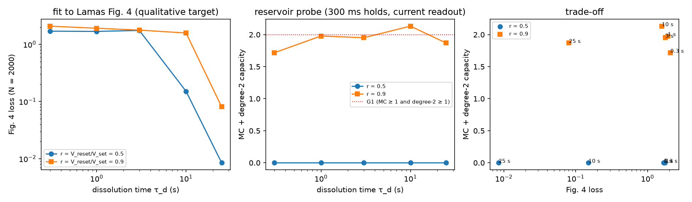

*Figure 13. Left: Fig. 4 loss vs dissolution time. Middle: MC + degree-2 capacity of the current readout. Right:
the trade-off (labels: $\tau_d$).*

| $\tau_d$ (s) | r | Fig. 4 loss | A-/A+ (target 0.44) | window (V) | MC | degree-2 | NARMA-10 | junctions changing per sample |
|---|---|---|---|---|---|---|---|---|
| 0.3 | 0.5 | 1.70 | 1.00 | 1.75 | 0.00 | 0.00 | 1.13 | 21 |
| 1 | 0.5 | 1.68 | 1.00 | 1.75 | 0.00 | 0.00 | 1.13 | 26 |
| 3 | 0.5 | 1.75 | 1.01 | 2.25 | 0.00 | 0.00 | 1.14 | 21 |
| 10 | 0.5 | 0.15 | 0.60 | 2.75 | 0.00 | 0.00 | 1.14 | 25 |
| **25** | **0.5** | **0.008** (calibrated) | 0.43 | 2.25 | 0.00 | 0.00 | 1.14 | 21 |
| 0.3 | 0.9 | 2.08 | 1.00 | 2.25 | 1.29 | 0.43 | 0.95 | 1694 |
| 1 | 0.9 | 1.91 | 1.00 | 2.75 | 1.02 | 0.96 | 0.98 | 843 |
| 3 | 0.9 | 1.77 | 1.00 | 2.75 | 1.02 | 0.93 | 0.97 | 846 |
| 10 | 0.9 | 1.58 | 0.98 | 2.75 | 0.84 | 1.29 | 0.99 | 812 |
| **25** | **0.9** | **0.081** | 0.33 | 2.75 | 0.85 | 1.02 | 1.02 | 705 |

(`results/n8_short.json`; 1 network, so no error bars. The G1 criteria of E4 need 3 networks and 800 samples.)

**The hold band freezes the network, not the persistence.** With the calibrated band (r = 0.5) the network is
frozen at every forgetting time, even at $\tau_d = 0.3$ s: about 20 of 5953 junctions change per input sample, and every
score equals the input-only baseline. With a narrow band (r = 0.9) about 700-1700 junctions change per sample at
every $\tau_d$, and the current readout gains about one sample of memory, a degree-2 capacity of 0.4-1.3, and a
NARMA-10 error of 0.95-1.02 against 1.15 for the input alone.

**Fig. 4 needs slow forgetting, whatever the band.** For $\tau_d \le 3$ s the loop is symmetric (A-/A+ = 1.00, loss $\ge 1.7$);
the asymmetry appears only for $\tau_d \ge 10$ s.

**Both at once is possible.** $\tau_d = 25$ s with the narrow band fits Fig. 4 acceptably (loss 0.081; A-/A+ 0.33 vs
0.44) and computes about as much as the binary model's best E4 point (MC 0.85, degree-2 1.02; E4 binary at 3 s:
MC 0.94, degree-2 0.50).

### Conclusions

* **The N4 freezing seen in N4-1 and E4 comes from the hold band.** A junction whose voltage stays between $V_{\mathrm{reset}}$
  and $V_{\mathrm{set}}$ does nothing, and with r = 0.5 almost every junction sits there under a biased drive. Faster forgetting
  alone does not help.
* **A narrow hold band unfreezes the network without breaking the Fig. 4 fit**, if the forgetting stays slow
  ($\ge 10$ s). The network then computes weakly (MC $\approx 1$, degree-2 $\approx 1$), still far from G2 (ESN-32: 28) and probably
  below G1 once measured over 3 networks with the 2-sd margin, but no longer at the input-only level.
* **This supports N10**, whose junction has no hold band at all (measured AgNW junctions relax spontaneously).
  A cheap follow-up is an E4-style check of N4 with r = 0.9 (3 networks, G0-G2), to have both "physical"
  junction models on the same footing.

## 15. N10: a volatile junction constrained by measured AgNW data, and N10-1

Lamas Fig. 4 is a simulation, only qualitatively like measurements, so the next junction model was built from
**measured** AgNW network behaviour (literature: [LITERATURE_NOTES.md](LITERATURE_NOTES.md); design:
[N10_DESIGN.md](N10_DESIGN.md)). Measured networks relax spontaneously after a stimulus (no hold band), have
short-term and amplitude-dependent long-term memory, switch non-polarly, rupture filaments at high power, and
compute with inputs of 1 ms to 1 s. N10 gives each junction a volatile filament x (the rate-balance law of Milano
et al. 2022, relaxing at zero bias with time $\tau_s$) and a consolidated filament y (grows only while the junction
dissipates > 1 µW, decays over $\tau_l = 10^{3}$ s), with G = $G_{\mathrm{off}}$ ($G_{\mathrm{on}}/G_{\mathrm{off}}$)^min(1, x+y) (`agnw_rc/volatile.py`,
tests/test_volatile.py).

**Adjustments found while building it** (all saved as scripts):

* Milano's parameters describe a whole network between two electrodes. Applied per junction the network onset was
  ~10 V with $\le 0.08$ mA. A voltage-scale factor v_scale = 5 puts the onset at 2.2 V for every $\tau_s$
  (`n10_phenomenology.py vscale`), i.e. a per-junction threshold of ~0.1 V, like the framework's.
* Above threshold Milano's growth rate reaches $10^{3}-10^{9}$ s$^{-1}$, so the junction-circuit feedback made the results
  depend on the step (22 % between 1 and 2 ms). A cap $k_{\mathrm{max}} = 100$ s$^{-1}$ (switching $\ge 10$ ms) removes this: 2 ms then
  agrees with 1 ms within 0.2 % (current) and 1.6 % (states); 5 and 10 ms still fail (`n10_kmax_check.py`,
  `n10_stride_check.py`).
* Growth stops while a junction dissipates more than $P_c = 1$ mW (otherwise rupture could never compete).
* Consolidation is gated on junction power, not voltage: formed junctions self-regulate at 0.07-0.1 V whatever
  the drive, while their power separates weak from strong drive ($\le 4 \times 10^{-8}$ W at 2 V, median $2 \times 10^{-6}$ W at 3.5 V;
  `n10_power_gate.py`).

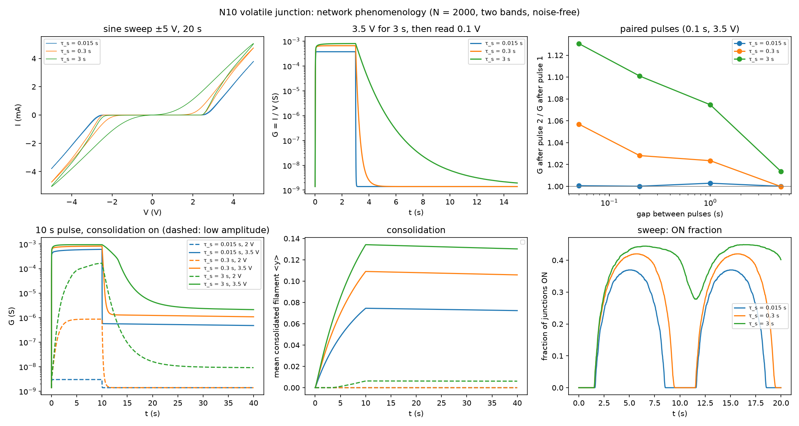

*Figure 14. N10 network phenomenology (N = 2000, two bands, noise-free) for $\tau_s = 0.015$, 0.3, 3 s: sine sweep,
activation and relaxation after a 3.5 V pulse, paired-pulse facilitation, consolidation after 10 s pulses at 2 V
(dashed) and 3.5 V, ON fraction during the sweep.*

The model reproduces the measured phenomenology qualitatively: a non-polar loop with onset 2.2 V and hysteresis
growing with $\tau_s$; activation within ~0.1 s; relaxation on the scale $\tau_s$; paired-pulse facilitation up to 13 %,
fading with the gap; and amplitude-dependent consolidation (after a 10 s, 3.5 V pulse the conductance stays
~$1000 \times$ above baseline for 30 s; after 2 V it returns to baseline). Not reproduced: the abrupt drops and random
plateaus of measured relaxation (no switching noise in this version).

**N10-1** repeats the E4 protocol (two bands, 800 samples, 50 virtual nodes, washout $\max(3\,\tau_s e^{2\sigma_\mathrm{ln}},\ 3\ \mathrm{s})$,
3 networks $\times$ 2 replicates, validation-selected operating point, G0-G2) on the **pure volatile** junction (no
consolidation), for $\tau_s = 0.03$, 0.3, 3 s, a homogeneous or log-normally spread $\tau_s$ ($\sigma_{\mathrm{ln}} = 1$), holds $\tau_s$/3 and $\tau_s$
(10 ms-3 s), windows 2.25/2.75 V, 2 ms step: 216 runs. `scripts/n10_report.py` -> `results/n10_1_criteria.json`,
fig15.

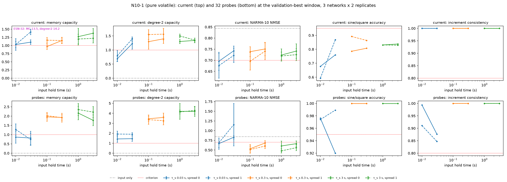

*Figure 15. N10-1: current (top) and 32 probes (bottom) at the validation-best window, vs input hold time;
solid/dashed: spread 0/1. Red dotted: G0-G2 criteria; grey: input only.*

| $\tau_s$ | spread | readout | operating point | MC | degree-2 | NARMA-10 | sine/square | consistency (inc.) | G0 | G1 | G2 |
|---|---|---|---|---|---|---|---|---|---|---|---|
| 0.03 s | 1 | current | 30 ms, 2.75 V | $1.41 \pm 0.09$ | 1.39 | 0.72 | 0.87 | 1.00 | yes | no | no |
| 0.03 s | 1 | probes | 10 ms, 2.75 V | $1.28 \pm 0.30$ | 1.92 | 0.69 | 0.97 | 0.91 | yes | no | no |
| 0.3 s | 0 | probes | 100 ms, 2.75 V | $1.96 \pm 0.24$ | 3.46 | 0.53 | 1.00 | 1.00 | yes | no (NARMA margin) | no |
| 0.3 s | 1 | current | 100 ms, 2.75 V | $1.16 \pm 0.08$ | 1.55 | 0.70 | 0.89 | 1.00 | yes | no | no |
| **0.3 s** | **1** | **probes** | **100 ms, 2.75 V** | **$2.02 \pm 0.12$** | **$3.36 \pm 0.48$** | **0.51** | **1.00** | **1.00** | **yes** | **yes** | no |
| 3 s | 0 | probes | 1 s, 2.75 V | $2.16 \pm 0.36$ | 4.20 | 0.61 | 1.00 | 1.00 | yes | no (NARMA margin) | no |
| **3 s** | **1** | **probes** | **1 s, 2.75 V** | **$2.35 \pm 0.33$** | **$4.13 \pm 0.20$** | **0.48** | **1.00** | **1.00** | **yes** | **yes** | no |
| 3 s | 1 | junctions (oracle) | 3 s, 2.75 V | 3.88 | 8.53 | 0.37 | 1.00 | 1.00 | yes | yes | no |
| *baselines (800 samples)* | | input only / delay line 32 / ESN-32 | | 0 / 30 / 13.5 | 0 / 0 / 14.2 | 0.84 / 0.15 / 0.23 | 0.50 / 0.99 / 1.00 | | | | |

**Holding the input for $\tau_s$ instead of $\tau_s/3$** (3 s at $\tau_s = 3$ s) does not help the physical readouts:
the probes keep degree-2 $\approx 4.2$ but lose memory (MC 1.8-2.2) and NARMA (0.56-0.66), and the validation-selected
probe operating point stays at 1 s. Only the oracle junction readout gains (degree-2 8.4-8.5). The best hold is
about $\tau_s/3$.

For comparison, the best points of the earlier models under the same protocol: binary framework model (E4,
current, 3 s holds) MC 0.94, degree-2 0.50, NARMA 0.71, sine/square 0.53; calibrated N4 (E4) all 0.

**Stationarity.** At the selected 2.75 V window the mean drift of the ON fraction is $\le 0.6 \%$ (largest single run
1.8-4.4 %). Larger values (up to 19 %) occur only in the 2.25 V window, where few junctions are ON and their
number follows the input; their mean is -1 to -3 %. The 2 % drift flag therefore reacts to input-driven
fluctuations for these fast models, not to a trend.

### Conclusions

* **For the first time in this project, a physical readout meets G1.** With a volatile junction built from measured
  AgNW behaviour, the 32 probe voltages carry about two samples of memory, a degree-2 capacity of 3.4-4.1,
  NARMA-10 errors of 0.48-0.51 (input only 0.84) and perfect sine/square classification, reproducibly over three
  networks (consistency 1.00), at 0.1-1 s per input.
* **The ingredients that matter are volatility without a hold band and a match between $\tau_s$ and the input rate.**
  $\tau_s = 0.3$ s and 3 s both reach G1 with the input held for about $\tau_s/3$ (holding for $\tau_s$ is slightly
  worse), i.e. the absolute time scale is free as long as input and forgetting match. A spread of relaxation times across junctions helps modestly (it turns two NARMA
  near-misses into passes). The fastest junctions ($\tau_s = 0.03$ s) give less (probes MC 0.8-1.3, no G1), probably
  because the 10 ms growth-rate cap is then comparable to $\tau_s$.
* **The network is still far from useful (G2).** MC + degree-2 of the probe readout is 5.4-6.5, against 13.8 needed
  (half of a 32-unit ESN), and a 32-tap delay line alone has MC 30. The total current, the only readout of a
  two-terminal device, reaches MC $\approx 1.2\text{–}1.4$ and degree-2 $\approx 1.4\text{–}1.6$, just below G1.
* **This is a model result**: v_scale, $k_{\mathrm{max}}$ and the consolidation gate are choices constrained by qualitative
  measurements, not fits. It shows that a nanowire network with measured-like volatile junctions **can** work as a
  weak reservoir, and that the obstacle in the earlier models was the junction model (switching noise, the hold
  band), not the network. Next: noise (measured relaxation is random), consolidation on, more electrodes, and
  measured data to pin v_scale and $\tau_s$.

## 16. N10-E0: the N10 junction read out through 16 electrodes (pilot)

The 32-probe result of section 15 needs contacts inside the network. N10-E0 asks whether electrodes that a chip
can have give the same. Pilot: 1 network, N10 junction with $\tau_s = 0.3$ s and spread 1, inputs held 100 ms,
800 samples, 50 virtual nodes, 2 ms step (`scripts/n10e_pilot.py`, 36 runs).

* **Layouts** (`figures/fig_setup_next.png`):
  * split bands, 8 driven + 8 grounded edge segments;
  * a 4 $\times$ 4 grid of 50 µm pads, 8 driven + 8 grounded;
  * `pads_float`: the same grid with 4 driven, 4 grounded and 8 floating pads whose voltage is read, interleaved.
* **Input encoding**: the same signal on every driven electrode ("direct"), or random fixed weights per electrode
  ("weights", as N5a).
* **Voltage windows scaled to each layout's onset**, from a slow sweep (`n10e_pilot.py sweep`,
  `results/n10e_sweep.json`): 2.08 V for the bands, but 0.36 V for the pads and 0.73 V for `pads_float`, because the
  pads are only ~250 µm apart. Windows at $1.05\times$ and $1.25\times$ the onset, width $0.45\times$ the onset (the
  shape of the two-band window that worked); the better one is chosen on validation data.
* **Readouts**: "electrodes" = currents of the driven and grounded electrodes plus the voltages of the floating
  ones (what a chip measures); the 32 internal probes as a reference.

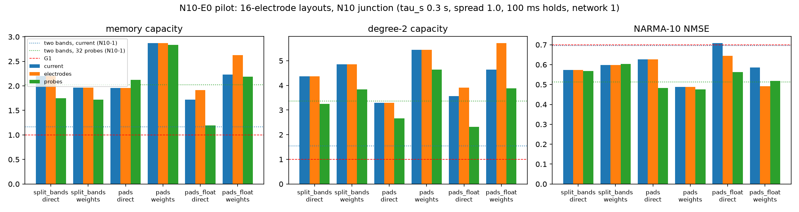

*Figure 16. N10-E0 pilot (network 1): memory capacity, degree-2 capacity and NARMA-10 for each layout and encoding,
for the electrode currents ("current"), the full electrode readout ("electrodes": currents + floating-pad
voltages) and the 32 internal probes. Dotted: the two-band N10-1 results (3 networks); dashed: G1.*

| layout, encoding | electrode readout: MC | degree-2 | NARMA-10 | sine/square | 16 end-of-hold values only: MC / degree-2 / NARMA |
|---|---|---|---|---|---|
| split bands, direct | 2.20 | 4.36 | 0.57 | 1.00 | 1.42 / 2.04 / 0.63 |
| split bands, weights | 1.97 | 4.85 | 0.60 | 1.00 | 1.11 / 2.42 / 0.65 |
| pads, direct | 1.96 | 3.29 | 0.63 | 1.00 | 1.10 / 1.23 / 0.76 |
| **pads, weights** | **2.87** | **5.45** | **0.49** | **1.00** | 2.06 / 2.02 / 0.50 |
| pads_float, direct | 1.92 | 3.91 | 0.65 | 1.00 | 1.53 / 2.20 / 0.72 |
| **pads_float, weights** | **2.62** | **5.71** | **0.49** | **1.00** | **2.06 / 3.66 / 0.53** |
| *two bands (N10-1): total current / 32 probes* | 1.16 / 2.02 | 1.55 / 3.36 | 0.70 / 0.51 | 0.89 / 1.00 | |
| *ESN-16 / ESN-32 (800 samples, 3 networks)* | 9.4 / 13.5 | 6.0 / 14.2 | 0.37 / 0.23 | 1.00 / 1.00 | |

Increment consistency is 0.99-1.00 for every readout. Last column (`scripts/n10e_channels.py`,
`results/n10e_channels.json`): the same runs scored with only the end-of-hold value of each electrode (16
features). With a single electrode every score drops to the input-only level (MC 0), and 5 virtual nodes per hold
give as much as 50. ESN baselines: `scripts/esn16_baseline.py`, `results/esn16_baseline.json`.

### Conclusions

* **Electrodes a chip can have work as well as internal probes, or better.** Every 16-electrode layout gives at least
  the G1 level (MC $\ge 1.9$, degree-2 $\ge 3.3$, NARMA $\le 0.65$) on the pilot network, and the best (pads with
  random input weights, with or without floating read pads) reach MC $\approx 2.6\text{–}2.9$, degree-2
  $\approx 5.5\text{–}5.7$ and NARMA 0.49, above the two-band 32-probe readout (2.0 / 3.4 / 0.51).
* **The capacity is spatial.** One electrode alone carries nothing; the 16 end-of-hold values alone keep most of
  the memory (MC 2.1) and part of the nonlinearity; sampling the transient within each hold (5 virtual nodes are
  enough) roughly doubles the degree-2 capacity.
* **Random input weights across electrodes help on the pads** (MC 2.0 -> 2.9, degree-2 3.3 -> 5.5): different
  regions of the network get different drives. The two-terminal current alone (section 15) was the bottleneck,
  not the network.
* **G2 now depends on how channels are counted.** MC + degree-2 is 8.3 for the two best configurations: above half
  of an ESN with 16 units (7.7, one unit per electrode), but far below half of an ESN matching the 80-800 features
  once the virtual-node samples are counted (ESN-32 alone gives 13.8). With the 16 end-of-hold values only, 5.7.
  This has to be fixed before the full N10-E run (3 networks, G0-G2).
* Caveats: one network (no error bars); the model settings of section 15 still apply; the pads' onset of 0.36 V is
  low, so the per-junction threshold (via the voltage scale) matters more for pad layouts.

## 17. N10-E: the N10 junction on 16 electrodes, 3 networks

The two best pilot configurations (section 16) under the full protocol: pads (8 driven + 8 grounded) and
`pads_float` (4 driven + 4 grounded + 8 floating read pads), random input weights, N10 junction with
$\tau_s = 0.3$ s and spread 1, inputs held 100 ms, the pilot's two voltage windows per layout (chosen on
validation), 3 networks $\times$ 2 replicates plus sine/square, 800 samples, 50 virtual nodes (36 runs; network 1
reused from the pilot). Criteria G0-G2 with the 2-sd margin (`scripts/n10e_pilot.py full` / `full_report`,
`results/n10e_criteria.json`). G2 is reported two ways (decided before the runs): **strict** (headline), an ESN with
as many units as readout features including the virtual-node samples (here the largest baseline, ESN-200:
MC + degree-2 = 50.1, so 25 needed); **loose**, one ESN unit per physical channel (ESN-16: 15.4, so 7.7 needed).

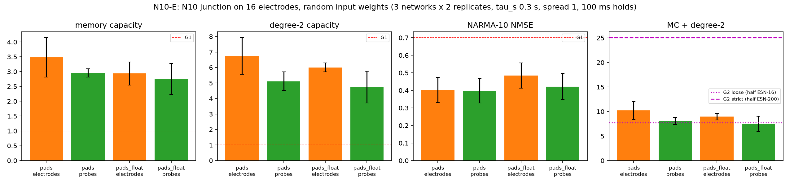

*Figure 17. N10-E over 3 networks $\times$ 2 replicates (mean $\pm$ sd): electrode readout (orange) and the 32
internal probes (green, reference). Red dashed: G1; magenta: G2 thresholds, loose (dotted) and strict (dashed).*

| layout | readout | MC | degree-2 | NARMA-10 | sine/square | consistency (inc.) | G0 | G1 | G2 strict | G2 loose |
|---|---|---|---|---|---|---|---|---|---|---|
| **pads** | **16 electrode currents** | $\mathbf{3.48 \pm 0.66}$ | $\mathbf{6.74 \pm 1.18}$ | $\mathbf{0.40 \pm 0.07}$ | 1.00 | 1.00 | yes | **yes** | no (10.2 / 25) | **yes** (10.2 / 7.7) |
| pads | 32 probes | $2.96 \pm 0.14$ | $5.11 \pm 0.61$ | $0.40 \pm 0.07$ | 1.00 | 1.00 | yes | yes | no | no (8.1 / 13.8) |
| **pads_float** | **8 currents + 8 floating voltages** | $\mathbf{2.94 \pm 0.39}$ | $\mathbf{6.00 \pm 0.29}$ | $\mathbf{0.49 \pm 0.07}$ | 1.00 | 1.00 | yes | **yes** | no (8.9 / 25) | **yes** (8.9 / 7.7) |
| pads_float | 16 currents only | $2.61 \pm 0.71$ | $5.57 \pm 0.94$ | $0.56 \pm 0.12$ | 1.00 | 1.00 | yes | no (margin) | no | no |
| pads_float | 32 probes | $2.75 \pm 0.52$ | $4.73 \pm 1.03$ | $0.42 \pm 0.08$ | 1.00 | 1.00 | yes | yes | no | no |
| *ESN-16 / ESN-32* | | 9.4 / 13.5 | 6.0 / 14.2 | 0.37 / 0.23 | 1.00 / 1.00 | | | | | |

The selected windows are the upper ones (0.45 V for pads, 0.91 V for `pads_float`). Memory reaches 8-13 lags above
the noise floor (the criterion needs 2).

### Conclusions

* **A chip-compatible readout meets G1 robustly.** With 16 electrodes and random input weights, the network carries
  3-3.5 samples of memory, a degree-2 capacity of 6-7 and a NARMA-10 error of 0.40-0.49, over three networks, with
  perfect reproducibility. This is 3x the memory and 4x the nonlinear capacity of the two-terminal current
  (section 15), and above the 32 internal probes of the same layout.
* **NARMA-10 comes close to a 16-unit echo-state network** (0.40 vs 0.37), and degree-2 capacity exceeds it (6.7 vs
  6.0), while memory stays well below (3.5 vs 9.4): the network is nonlinear but short-memory.
* **G2: loose yes, strict no.** MC + degree-2 is 10.2 (pads) and 8.9 (`pads_float`), above half of ESN-16 (7.7) but
  far below half of an ESN as large as the 800 read-out features (25). Per physical contact the network is
  competitive with a small digital reservoir; per recorded number it is not.
* **Floating read pads are not needed here**: the plain 8 + 8 pad array does at least as well, and its readout is
  simpler (currents only).
* Next: the memory is the weak point. Candidates: a longer $\tau_s$ with matched holds, a wider spread of $\tau_s$,
  delayed inputs on different electrodes (N5b-type), and noise to test robustness (N10-2).

## 18. N10-M: what limits the memory, and how much noise the result tolerates

N10-E (section 17) is nonlinear but short-memory (MC 3.5 against 9.4 for ESN-16). N10-M changes one thing at a time
on the same setup (4 $\times$ 4 pads, 8 driven with random weights + 8 grounded, 16 electrode currents, 3 networks
$\times$ 2 replicates + sine/square, the two pad windows, criteria G0-G2 with G2 strict and loose;
`config.N10M_BLOCKS`, `run_sims.py n10m`, 144 runs split between this machine and a second one,
`scripts/n10m_report.py`, `results/n10m_criteria.json`):

* **tau1 / tau3**: slower junctions with matched inputs, $\tau_s = 1$ s (hold 330 ms) and 3 s (hold 1 s);
* **spread**: no spread of $\tau_s$ across junctions ($\sigma_\mathrm{ln} = 0$) or a wider one (2);
* **delays**: the 8 driven pads carry the input delayed by 0, 1, ..., 7 samples (N5b-type encoding), so part of the
  memory is supplied by the interface; compared with 8-tap delay lines on the same streams;
* **noise**: additive noise on the volatile filament, $\sigma = 0.03,\ 0.1,\ 0.3$ per $\sqrt{\mathrm{s}}$, i.e.
  stationary fluctuations of $x$ of roughly $\sigma\sqrt{\tau_s/2} \approx 0.012,\ 0.04,\ 0.12$ of its full range at
  zero bias.

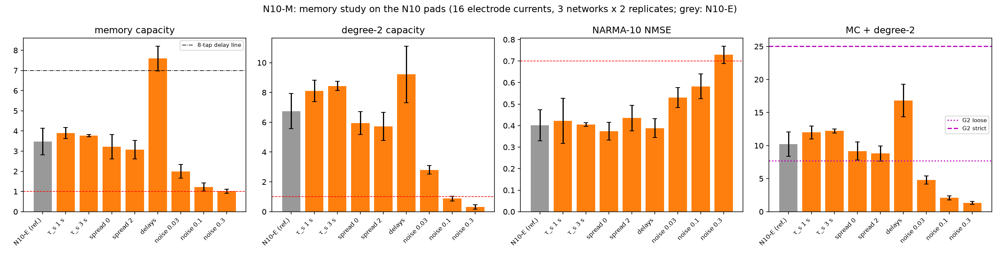

*Figure 18. N10-M, 16 electrode currents, mean $\pm$ sd over 3 networks $\times$ 2 replicates (grey: N10-E reference).
Red dashed: G1; black dash-dot: 8-tap delay line (MC 7); magenta: G2 loose (dotted) and strict (dashed).*

| change vs N10-E | MC | degree-2 | NARMA-10 | sine/square | consistency | G0 | G1 | G2 loose | G2 strict |
|---|---|---|---|---|---|---|---|---|---|
| *N10-E reference* ($\tau_s$ 0.3 s, spread 1, 100 ms) | $3.48 \pm 0.66$ | $6.74 \pm 1.18$ | $0.40 \pm 0.07$ | 1.00 | 1.00 | yes | yes | yes | no |
| $\tau_s = 1$ s, hold 330 ms | $\mathbf{3.89 \pm 0.27}$ | $8.11 \pm 0.73$ | $0.42 \pm 0.11$ | 1.00 | 1.00 | yes | yes | yes | no |
| $\tau_s = 3$ s, hold 1 s | $3.77 \pm 0.06$ | $\mathbf{8.43 \pm 0.30}$ | $0.41 \pm 0.01$ | 1.00 | 1.00 | yes | yes | yes | no |
| spread 0 | $3.22 \pm 0.61$ | $5.95 \pm 0.77$ | $\mathbf{0.37 \pm 0.04}$ | 1.00 | 1.00 | yes | yes | yes | no |
| spread 2 | $3.07 \pm 0.45$ | $5.73 \pm 0.94$ | $0.44 \pm 0.06$ | 1.00 | 1.00 | yes | yes | yes | no |
| delayed inputs | $7.59 \pm 0.61$ | $9.21 \pm 1.90$ | $0.39 \pm 0.04$ | 1.00 | 1.00 | yes | yes | yes (16.8) | no |
| noise $\sigma = 0.03$ | $2.00 \pm 0.34$ | $2.80 \pm 0.29$ | $0.53 \pm 0.05$ | 0.99 | 0.82 | yes | yes | no | no |
| noise $\sigma = 0.1$ | $1.23 \pm 0.20$ | $0.87 \pm 0.16$ | $0.58 \pm 0.06$ | 0.86 | 0.47 | no | no | no | no |
| noise $\sigma = 0.3$ | $1.01 \pm 0.09$ | $0.31 \pm 0.15$ | $0.73 \pm 0.04$ | 0.65 | 0.23 | no | no | no | no |
| *8-tap delay line / quadratic delay line* | 7.0 / 7.0 | 0 / 23.0 | 0.71 / 0.72 | | | | | | |
| *ESN-16* | 9.4 | 6.0 | 0.37 | 1.00 | | | | | |

### Conclusions

* **The network's own memory is capped at about 4 past inputs**, whatever its time scale: with $\tau_s$ from 0.3 to 3 s
  and matched inputs, MC stays 3.5-3.9. Slower junctions help only modestly (+10-20 % in MC and degree-2 capacity).
  The time scale sets *when* the network remembers, not *how much*: the limit comes from a single scalar input
  driving a saturating, relaxational medium, as found for leaky-integrator banks in section 8.
* **The spread of relaxation times matters little** (spread 1 is best for capacity, no spread gives the best
  NARMA-10, 0.37, equal to ESN-16).
* **Delayed inputs across electrodes add memory, but it is the interface's memory.** MC 7.6 is the 8-tap delay line
  (7) plus about 0.6, and the degree-2 capacity (9.2) stays well below a quadratic delay line on the same taps (23).
  It lifts MC + degree-2 to 16.8 (G2 loose clearly, strict still no), which is a useful engineering option. It is not
  evidence of more memory in the nanowires.
* **Noise is the main risk.** Reproducible computation survives filament fluctuations of about 1 % of their range
  ($\sigma = 0.03$: consistency 0.82, G1 still met, capacities halved) but not 4 % ($\sigma = 0.1$: consistency 0.47,
  G0 and G1 fail). The measured AgNW relaxation is random (Diaz-Alvarez 2019), so the size of the junction noise in
  real networks decides whether the N10 result carries over; this is now the most important number to get from the
  measurements (docs/MEASUREMENT_REQUEST.md, priority 3 -> should be raised).
* **G2 strict is out of reach for all variants** (best 16.8 with delays vs 25): per recorded number, a 16-contact
  nanowire network does not match a digital reservoir of the same size; per contact it does (G2 loose).

## 19. N10-S: sensitivity to the model settings we chose

Two N10 settings were chosen, not fitted (section 15): the voltage scale $s_V = 5$ (per-junction threshold, hence
the onset voltage) and the growth-rate cap $k_\mathrm{max} = 100\ \mathrm{s^{-1}}$ (switching time $\ge 10$ ms).
N10-S repeats the N10-E best configuration (4 $\times$ 4 pads, random weights, 16 electrode currents,
$\tau_s = 0.3$ s, spread 1, 100 ms holds, 3 networks $\times$ 2 replicates + sine/square) with one of them changed:
$s_V = 3$ and 8, $k_\mathrm{max} = 30$ and $300\ \mathrm{s^{-1}}$ (the latter at a 1 ms step). Each setting gets its
own onset sweep and voltage windows ($1.05\times$ and $1.25\times$ onset, width $0.45\times$ onset), as for N10-E
(`scripts/n10s_sensitivity.py`, 72 runs on two machines, `results/n10s_criteria.json`).

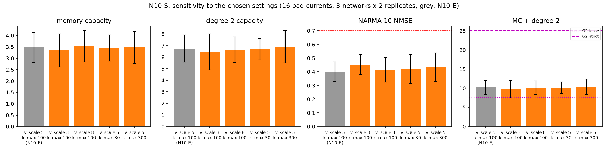

*Figure 19. N10-S: scores of the 16 pad currents for each setting (grey: N10-E), mean $\pm$ sd over 3 networks.*

| setting | onset (V) | MC | degree-2 | NARMA-10 | sine/square | G0 | G1 | G2 loose | G2 strict |
|---|---|---|---|---|---|---|---|---|---|
| $s_V = 5$, $k_\mathrm{max} = 100$ (N10-E) | 0.345 | $3.48 \pm 0.66$ | $6.74 \pm 1.18$ | $0.40 \pm 0.07$ | 1.00 | yes | yes | yes | no |
| $s_V = 3$ | 0.555 | $3.34 \pm 0.73$ | $6.44 \pm 1.56$ | $0.45 \pm 0.08$ | 1.00 | yes | yes | yes | no |
| $s_V = 8$ | 0.222 | $3.53 \pm 0.68$ | $6.65 \pm 1.09$ | $0.42 \pm 0.09$ | 1.00 | yes | yes | yes | no |
| $k_\mathrm{max} = 30\ \mathrm{s^{-1}}$ | 0.345 | $3.45 \pm 0.58$ | $6.70 \pm 0.93$ | $0.42 \pm 0.11$ | 1.00 | yes | yes | yes | no |
| $k_\mathrm{max} = 300\ \mathrm{s^{-1}}$ | 0.345 | $3.48 \pm 0.69$ | $6.89 \pm 1.38$ | $0.43 \pm 0.11$ | 1.00 | yes | yes | yes | no |

### Conclusions

* **The N10-E result does not depend on the two chosen settings.** Over a factor 2.7 in the voltage scale and 10 in
  the switching cap, every score stays within one standard deviation of the reference, and every G0-G2 verdict is
  unchanged.
* **The voltage scale only sets the operating voltage**: the onset moves as $\approx 1/s_V$ (0.56, 0.35, 0.22 V) and
  the network works equally well once the input window follows it. A measured onset for a known geometry fixes
  $s_V$ directly, but the conclusions do not need it.
* **The switching speed does not matter between 3 and 33 ms** (at 100 ms per input). It will matter only for inputs
  faster than the switching time.
* What remains unfitted and does matter: $\tau_s$ (sets the usable input rate; results hold for 0.3-3 s) and, above
  all, the junction noise (section 18).

## 20. N10-R: realistic junction noise (random ruptures) and mitigation

N10-M showed that smooth Gaussian noise on the filament state of about 4 % of its range breaks the result. Measured
AgNW relaxation shows abrupt drops and plateaus instead (Diaz-Alvarez 2019; Milano 2025 separate network-level
Gaussian noise and Poisson-distributed jumps). N10-R adds **random complete ruptures** of the volatile filament
(Poisson events per junction at rate $r$; a rupture sets $x$ to 0) to the N10-E setup (4 $\times$ 4 pads, random
weights, 16 electrode currents, $\tau_s = 0.3$ s, spread 1, 100 ms holds, 3 networks $\times$ 2 replicates +
sine/square), at $r = 0.01$ to 3 per second. It also tests three mitigations at the Gaussian level that broke G1
in N10-M ($\sigma = 0.1$): larger pads (100 µm, 4 $\times$ the area, onset 0.19 V), inputs held 300 ms, and
presenting each input twice and averaging the two responses (post hoc, from the two replicates; G0 cannot be tested
then). `scripts/n10r_noise.py`, 144 runs on two machines, `results/n10r_criteria.json`.

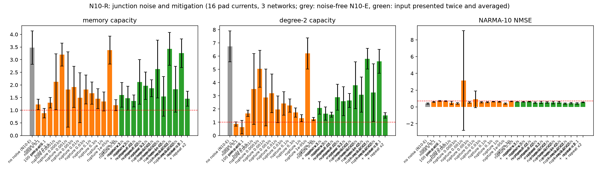

*Figure 20. N10-R: memory capacity, degree-2 capacity and NARMA-10 of the 16 pad currents (mean $\pm$ sd over
3 networks). Grey: noise-free N10-E; orange: noise and mitigations; green: input presented twice and averaged.*

| condition | MC | degree-2 | NARMA-10 | sine/square | consistency | G0 | G1 |
|---|---|---|---|---|---|---|---|
| *no noise (N10-E)* | $3.48 \pm 0.66$ | $6.74 \pm 1.18$ | 0.40 | 1.00 | 1.00 | yes | yes |
| rupture 0.01 /s | $1.50 \pm 0.99$ | $1.98 \pm 1.00$ | 0.91 | 0.98 | 0.94 | yes | no |
| rupture 0.03 /s | $1.82 \pm 0.57$ | $2.42 \pm 0.89$ | 0.55 | 0.99 | 0.81 | yes | no |
| rupture 0.1 /s | $1.68 \pm 0.44$ | $2.27 \pm 0.51$ | 0.57 | 0.97 | 0.69 | no | no |
| rupture 0.3 / 1 / 3 /s | 1.46 / 1.35 / 1.20 | 1.74 / 1.32 / 1.24 | 0.62-0.67 | 0.88-0.97 | 0.55 / 0.45 / 0.36 | no | no |
| Gaussian $\sigma = 0.1$ (N10-M) | $1.23 \pm 0.20$ | $0.87 \pm 0.16$ | 0.58 | 0.86 | 0.47 | no | no |
| $\sigma = 0.1$, 100 µm pads | $0.88 \pm 0.19$ | $0.63 \pm 0.51$ | 0.71 | 0.71 | 0.26 | no | no |
| $\sigma = 0.1$, 300 ms holds | $1.29 \pm 0.21$ | $1.67 \pm 0.23$ | 0.69 | 0.89 | 0.49 | no | no |
| input presented twice: rupture 0.01 / 0.1 / 1 /s | 2.12 / 1.87 / 1.47 | 2.90 / 2.65 / 1.66 | 0.51 / 0.54 / 0.60 | | | | |
| input presented twice: $\sigma = 0.1$ | 1.45 | 1.52 | 0.55 | | | | |

**Rare events matter.** At $r = 0.01$ /s, 11 of 12 runs keep MC 0.6-2.4, degree-2 1.2-4.0 and NARMA 0.46-0.67,
but one (network 3) collapses on test data (MC 0, NARMA 2.9) although its validation score is normal (MC 2.65): a
rupture on a critical junction reroutes the current mid-stream, and a readout trained before it no longer applies.
This drives the large spread and the NARMA mean at the lowest rate.

**How our rates compare with measurements.** With a few thousand formed filaments in the network, a per-junction
rate of 0.01 /s already means tens of rupture events per second at network level. Milano et al. (2025) detect about
0.08 jumps per second in a much larger network (7 mm electrode gap), but only jumps above their resolution (1 nA
range, 1.6 Hz sampling), so most small events are invisible. The real per-junction rupture rate is therefore
unknown but may well be orders of magnitude below the rates tested here.

### Lower rupture rates: where the tolerance lies (2026-10-04)

Blocks `rupture_vlow` (0.001, 0.003 /s) and `rupture_vvlow` ($10^{-5}$, $10^{-4}$, $3 \times 10^{-4}$ /s), 90 runs, same
setup. Each pad network has about 6000 junctions and a run lasts 86.7 s (washout + 800 inputs), so the rates mean
about 5, 50, 150, 500 and 1500 ruptures per run. `n10r_noise.py twins` (`results/n10r_twins.json`) compares every
run with its rupture-free twin (same network, replicate and window); a run "collapses" when its MC + degree-2 falls
below half of the twin's.

| rupture rate (/s per junction) | ruptures per run | MC | degree-2 | NARMA-10 | G1 | (MC + degree-2) / twin, median | runs worse / collapsed (of 12) |
|---|---|---|---|---|---|---|---|
| 0 (N10-E) | 0 | $3.48 \pm 0.66$ | $6.74 \pm 1.18$ | 0.40 | yes | 1 | |
| $10^{-5}$ | ~5 | $3.38 \pm 0.55$ | $6.21 \pm 1.18$ | 0.40 | yes | 1.00 | 10 / 0 |
| $10^{-4}$ | ~50 | $2.12 \pm 1.10$ | $3.52 \pm 2.68$ | 0.49 | no | 1.00 | 7 / 4 |
| $3 \times 10^{-4}$ | ~150 | $3.20 \pm 0.45$ | $5.04 \pm 1.39$ | 0.42 | yes | 1.00 | 6 / 0 |
| $10^{-3}$ | ~500 | $1.82 \pm 1.49$ | $2.87 \pm 2.15$ | 3.15 | no | 0.55 | 11 / 6 |
| $3 \times 10^{-3}$ | ~1500 | $1.92 \pm 0.81$ | $3.19 \pm 1.46$ | 0.53 | no | 0.64 | 12 / 4 |
| 0.01-0.1 | $5 \times 10^{3}$-$5 \times 10^{4}$ | 1.50-1.82 | 1.98-2.42 | 0.55-0.91 | no | 0.38-0.47 | 12 / 6-9 |

* Up to $3 \times 10^{-4}$ /s the typical run is unaffected (median ratio 1.00). Failures are **all-or-nothing
  collapses** of single runs (4 of 12 at $10^{-4}$, none at $3 \times 10^{-4}$: with 12 runs per rate the collapse
  probability is not resolved, hence the non-monotonic G1).
* From $10^{-3}$ /s every run loses capacity and the median drops to about half, flat up to 0.1 /s.
* **Tolerance: about $10^{-4}$ /s per junction** (tens of ruptures per scored stream), with an occasional collapse
  risk already there; $10^{-5}$ /s is safe.

### Conclusions

* **Abrupt filament ruptures are more harmful than smooth noise of similar size**: every rate from 0.01 to 3 per
  second per junction breaks G1. The capacities roughly halve already at 0.01-0.1 /s and degrade slowly above;
  consistency falls from 0.94 to 0.36. **The tolerance is about $10^{-4}$ /s per junction** (lower-rate blocks
  above): typical runs are unaffected up to $3 \times 10^{-4}$ /s, but single runs can collapse from $10^{-4}$ /s, and
  from $10^{-3}$ /s all runs lose about half their capacity.
* **Rare ruptures on critical junctions cause occasional collapses** of a trained readout, a failure mode that
  averaging cannot fix but that periodic or online retraining of the readout could (as in the online learning of
  Zhu et al. 2023).
* **None of the tested mitigations restores G1.** Larger pads make it worse (contacting more wires does not average
  the noise: the current runs through a few bottleneck junctions, as for the "winner-takes-all" paths reported in
  AgNW networks); 300 ms holds help the nonlinear capacity a little; presenting each input twice recovers 10-40 %.
* **Whether real networks work as reservoirs now hinges on their per-junction rupture rate**, which cannot be read
  directly from network-level measurements. The next step is to simulate the Milano 2025 protocol and match their
  measured jump statistics (N10-C, deferred), or to measure single-junction or small-network switching statistics.

## 21. N10-C: calibration on measured network data (Milano et al. 2025)

**Status 2026-10-06: complete** (60 runs; `results/n10c_sim.json`, `figures/fig22_n10c_sim.png`).

**Question.** N10-R puts the reservoir's tolerance at about $10^{-4}$ ruptures per second per junction (section 20).
Milano et al. (2025, *Nat. Commun.*, open dataset Zenodo 10.5281/zenodo.15050217, CC-BY, in `data/milano2025/`)
measured a real AgNW network for hours at constant voltage and detected about 0.08 conductance jumps per second.
Which per-junction rupture rate does that imply?

**Stage A: the measured statistics** (`scripts/n10c_data.py` $\to$ `results/n10c_data.json`, `figures/fig21_n10c_data.png`).
All numbers are recomputed from the data files.

| quantity (3.6 V stationary state, 7 mm gap, sampled every 0.6 s) | value |
|---|---|
| mean conductance | $3.4 \times 10^{-5}$ S (saturation $6.5 \times 10^{-5}$ S) |
| onset (10 $\times$ low-voltage conductance, their model curve) | 2.4 V |
| Gaussian noise, sd of $\Delta G/G$ per sample | $4.8 \times 10^{-4}$ |
| jump threshold, $\Delta G/G$ per sample | $1.2 \times 10^{-3}$ (2.6 Gaussian sd) |
| jumps per second (their Fig. 3g; paper 0.082) | 0.080 |
| up / down jumps | 797 / 768 |
| jump sizes: power-law exponent (paper $2.78 \pm 0.07$, other cut-off) | $2.98 \pm 0.05$; largest jump 2 % of $G$ |
| density $n L^2$ from the deposited mass (ours 9.8; percolation 5.64) | $\approx 5.8$, about $4.7 \times 10^{5}$ wires |

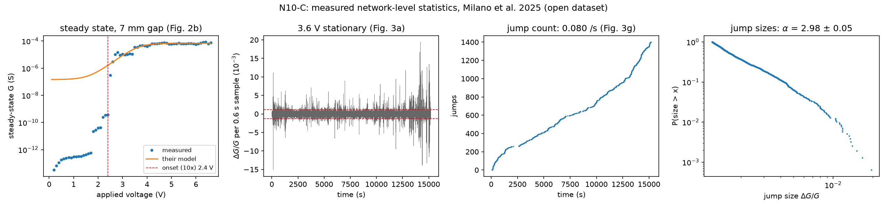

*Figure 21. Milano et al. 2025 open data: steady state vs voltage, relative conductance changes at 3.6 V with the
jump threshold, cumulative jump count, and jump-size distribution.*

**Stage B: their protocol on N10** (`scripts/n10c_sim.py`). Two facing band electrodes, the N10-E junction
($\tau_s = 0.3$ s, spread 1, `v_scale` 5, $k_\mathrm{max} = 100$ /s, 2 ms step), constant bias at 1.5 $\times$ the
network onset (their 3.6 V / 2.4 V), 20 s washout, 300 s recorded, conductance sampled every 0.6 s. Junction noise
is either random complete ruptures at rate $r$ per junction (as in N10-R) or Gaussian noise $\sigma$ on the filament state
(as in N10-M). A jump is a sample with $\lvert \Delta G/G \rvert$ above the measured threshold. The number of junctions whose
rupture is detectable is

$$N_\mathrm{det} = \lambda(r) / r ,$$

with $\lambda$ the detected jumps per second; its size dependence (network sides 1, 1.41, 2, 2.83 mm, 2 networks each)
is extrapolated to their gap / wire length $= 7\ \mathrm{mm} / 35\ \mathrm{\mu m} = 200$, and the per-junction rate
that reproduces their 0.08 /s is $r^\ast = 0.08 / N_\mathrm{det}$.

Design decisions made on the way:
* **Density.** Their mass-based $n L^2 \approx 5.8$ is 3 % above percolation; at that density our 2-2.8 mm networks barely
  conduct (first sweep, `results/n10c_sweep_nL5.8_first.json`). The size study therefore uses our density 9.8 (the
  N10-R networks, so tolerance and calibration refer to the same network); 5.8 is a 1 mm check.
* **Grid cut (2026-10-05).** At $r \ge 0.01$ /s and $\sigma \ge 0.03$ nearly every sample is already a jump at 1 mm
  ($\lambda$ up to 1.6 /s of at most 1.7 /s), so these settings carry no $N_\mathrm{det}$ information. Above 1 mm only
  $r = 0$, $10^{-4}$, $10^{-3}$ /s and $\sigma = 0.01$ are run; $10^{-4}$ checks that $10^{-3}$ is in the linear range.

**Onset vs gap** (`results/n10c_sweep.json`, density 9.8): 2.0, 2.8, 4.0, 5.9 V for sides 1, 1.41, 2, 2.83 mm, linear in
the gap. Extrapolated to 7 mm, N10 would switch on at about 14 V, against the measured 2.4 V; per gap / wire length
the difference is about 12 $\times$. Matching their network would need `v_scale` $\approx 30\text{–}60$ instead of 5
(N10-S showed the reservoir result itself is insensitive to `v_scale` once the input window follows the onset).

**Results** (all 60 runs; the 1 mm-only estimates given during the run, "$5 \times 10^{-4}$ /s, at the edge" and
"$\sigma \approx 0.004$", ignored the size dependence and are superseded).

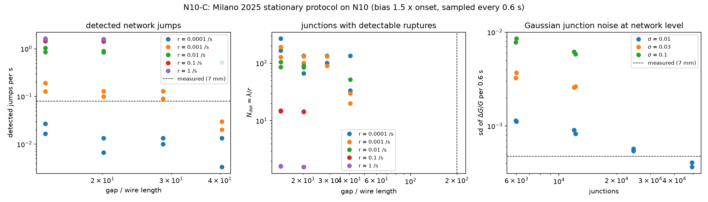

*Figure 22. N10-C stage B: detected jumps per second and $N_\mathrm{det} = \lambda / r$ vs gap / wire length (dashed: their
gap/L = 200), and the network-level Gaussian sd vs number of junctions, with the measured values.*

* Without ruptures: no jumps at any size (relative sd $\le 6 \times 10^{-10}$): detections come only from the junction noise.
  Jumps are half up, half down and at most 0.5-2 % of $G$, as measured.
* Detection saturates at $r \ge 0.01$ /s and $\sigma \ge 0.03$ (up to 1.6 of at most 1.7 jumps/s); only $r = 10^{-4}$ and
  $10^{-3}$ /s give $N_\mathrm{det}$.
* $N_\mathrm{det}$ is flat at about 100-200 for sides 1-2 mm (gap/L 14-29) and drops at 2.83 mm (gap/L 40): 20-30 at
  $r = 10^{-3}$ /s (6 and 9 jumps), 30-130 at $10^{-4}$ /s (1 and 4 jumps). With 49 000 junctions, ruptures of single
  junctions change $G$ too little to pass the threshold. Power-law fits extrapolated to gap/L = 200 give
  $N_\mathrm{det} \approx 3\text{–}15$, i.e. $r^\ast \approx 0.005\text{–}0.03$ /s per junction: **50-300 $\times$ above the N10-R
  tolerance ($10^{-4}$ /s)**. This rests on the 2.83 mm point, which has few jumps; the earlier 1 mm-only estimate
  ($5 \times 10^{-4}$ /s, "at the edge") assumed no size dependence and is superseded.
* Gaussian noise: at $\sigma = 0.01$ the network-level sd falls as junctions$^{-0.52}$ (8 networks, $1.1 \times 10^{-3}$ at
  6000 junctions to $3.9 \times 10^{-4}$ at 49 000), i.e. like averaging over independent junctions. Extrapolated to their
  network (about $8.7 \times 10^{5}$ junctions: $N_w\,nL^2/\pi$ from the deposited mass) it is $8.8 \times 10^{-5}$, so their
  $4.8 \times 10^{-4}$ needs $\sigma \approx 0.05$ (assuming linearity; an upper bound, since it also contains instrument noise and
  small ruptures). That lies between $\sigma = 0.03$ (G1 met, capacities halved, N10-M) and $\sigma = 0.1$ (G1 broken).
* At density 5.8 single ruptures can disconnect the network (conductance drops by 4 orders), which is never seen in
  the data (largest jump 2 %): their network behaves as one well above percolation.

**Caveats.** N10 junctions switch at a ~10 $\times$ higher voltage than theirs (`v_scale`), so the regrowth after a
rupture, and hence what a 0.6 s sampling sees, may differ; the jumps are measured deep in the conducting state, while
the reservoir works near onset; the extrapolation from gap/L 14-40 to 200 is long.

### Conclusions

* **The measured statistics are reproduced by the detection model**: no jumps without junction noise, jumps half up
  and half down, sizes at most a few % of $G$, as measured.
* **Per-junction rupture rate implied by Milano's 0.08 jumps/s: about 0.005-0.03 /s**, 50-300 $\times$ the N10-R tolerance
  ($10^{-4}$ /s). It comes from a size extrapolation (gap/L 14-40 to 200) whose largest-size point has few jumps, so it
  is an order-of-magnitude estimate, but both rupture rates used ($10^{-4}$ and $10^{-3}$ /s) give the same conclusion.
* **Gaussian junction noise implied by their sd: $\sigma \lesssim 0.05$**, at the edge of the N10-M tolerance.
* Taken together: N10-type junctions that produce the fluctuations of a real 7 mm network would be noisier than a
  1 mm N10 reservoir tolerates. Since measured-size fluctuations on the readout are harmless (section 22), the problem is
  the effect of ruptures inside small networks; the levers are network size, operating point, and junction
  protection (section 23).
* Calibration side result: N10's switching voltage is about 12 $\times$ too high per junction compared with their network
  (onset 14 V vs 2.4 V at 7 mm; `v_scale` $\approx 30\text{–}60$ would match).

## 22. N10-RN: measured network-level fluctuations at the readout

**Question.** N10-C says that junctions noisy enough to explain Milano's measured fluctuations would break the reservoir
(section 21). Is it the size of the fluctuations the readout sees, or what ruptures do inside the network? Here the
measured fluctuations are put directly on the readout: every electrode current of the noise-free N10-E runs is
multiplied by $(1 + z_e(t))$, with $z$ Milano's network-level model at 3.6 V (`results/n10c_data.json`):

$$dz = -\theta z\,dt + s\,dW + \Gamma\,dq ,$$

$\theta = 0.116$ /s (their fit at 3.6 V), $s$ such that the Gaussian increments have sd $4.8 \times 10^{-4}$ per 0.6 s, $q$ a
Poisson process at 0.080 /s, $\lvert\Gamma\rvert$ power law ($\alpha = 2.98$) between the detection threshold $1.2 \times 10^{-3}$ and the
largest measured jump (2 %), random sign. Variants: "white" (Gaussian part as independent reading noise, jumps as
above), independent $z$ per electrode or one $z$ for all, amplitudes 1, 3, 10, 30 $\times$ measured. Each replicate gets
its own noise (G0 tested). No new simulations: `scripts/n10e_readout_noise.py` $\to$ `results/n10e_readout_noise.json`.

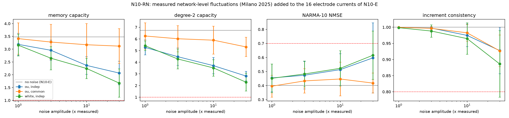

*Figure 23. N10-E scores with measured-like fluctuations on the 16 electrode currents vs amplitude (mean $\pm$ sd over
3 networks); grey: noise-free; red dashed: G1 / G0 thresholds.*

| noise on the readout | amplitude | MC | degree-2 | NARMA-10 | consistency | G0 | G1 | G2 loose |
|---|---|---|---|---|---|---|---|---|
| none (N10-E) | | $3.48 \pm 0.66$ | $6.74 \pm 1.18$ | 0.40 | 1.00 | yes | yes | yes |
| OU + jumps, per electrode | 1 / 3 | 3.19 / 2.96 | 5.27 / 4.48 | 0.45 / 0.47 | 1.00 / 1.00 | yes | yes / yes | yes / no |
| OU + jumps, per electrode | 10 / 30 | 2.36 / 2.07 | 3.71 / 2.81 | 0.51 / 0.60 | 0.97 / 0.93 | yes | no | no |
| OU + jumps, common | 1 / 30 | 3.41 / 3.12 | 6.26 / 5.32 | 0.40 / 0.42 | 1.00 / 0.93 | yes | yes | yes |
| white + jumps, per electrode | 1 / 3 / 10 | 3.16 / 2.65 / 2.24 | 5.42 / 4.28 / 3.51 | 0.45 / 0.48 / 0.52 | 1.00 / 0.99 / 0.96 | yes | yes / yes / no | yes / no / no |

### Conclusions

* **Fluctuations of the measured size at the readout do not break the reservoir**: G0, G1 and G2 (loose) hold at
  $1 \times$, G1 up to $3 \times$ (independent per electrode) and to $30 \times$ (common to all electrodes, a gain fluctuation the
  readout largely ignores).
* Hence what breaks N10 in N10-R is not the size of the fluctuations the readout sees but **what ruptures do inside a
  small network**: a rupture on a bottleneck junction reroutes the current, a change much larger than the measured
  jumps (at most 2 % in a 7 mm network) and one the trained readout cannot follow.
* This points to two levers: bigger networks (more parallel paths, smaller effect per rupture, as N10-C shows for
  detection) and protecting the bottleneck junctions (consolidation, N10-K, section 23).
* Limit: noise only on the readout, not on the junction states.

## 23. N10-K: consolidated backbone against ruptures

**Idea.** N10-RN shows that the damage done by ruptures comes from rerouting inside the network. N10 has a second,
consolidated filament per junction that was never switched on (section 15):

$$\frac{dy_j}{dt} = k_c\,x_j^{2}\,(1 - y_j)\,\Theta(P_j - P_{c2}) - \frac{y_j}{\tau_l}, \qquad
G_j = G_\mathrm{off}\left(G_\mathrm{on}/G_\mathrm{off}\right)^{\min(1,\,x_j + y_j)} ,$$

and ruptures act on the volatile $x$ only, so a consolidated junction keeps conducting. Physical basis: thin Ag
filaments are volatile and thick ones stable (lifetime $\propto d_0^{4}$, Wang et al. 2019); stimulation turns short-term
into long-term memory (Ohno et al. 2011); see docs/LITERATURE_NOTES.md "Modelling junction memory". Protocol: a constant
forming drive (10 s on all driven pads) lets $y$ build where the current concentrates, then the N10-E reservoir test
with ruptures. `scripts/n10k_consolidation.py`; new `RunSpec` fields `k_c`, `tau_l`, `p_c2`, `forming`, `forming_v`.

**Pilot** (`results/n10k_pilot.json`; network 1, window 0.45 V, 150 inputs after forming):

| forming V | $P_{c2}$ (W) | junctions consolidated ($y > 0.5$), $k_c$ = 0.1 / 1 / 10 /s | input-driven share of the currents |
|---|---|---|---|
| — (no consolidation) | | 0 | 0.30 |
| 0.72 | $10^{-4}$ | 0 / 0 / 0 | 0.30 |
| 0.72 | $10^{-5}$ | 0.014 / 0.014 / 0.015 | 0.21 / 0.10 / 0.09 |
| 0.72 | $10^{-6}$ | 0.051 / 0.125 / 0.129 | 0.09 / 0.06 / 0.06 |
| 1.08 | $10^{-5}$ | 0.078 / 0.079 / 0.079 | 0.11 / 0.07 / 0.07 |
| 1.08 | $10^{-6}$ | 0.155 / 0.266 / 0.281 | 0.09 / 0.06 / 0.06 |

* The backbone size is set by the forming voltage and the power gate; $k_c$ saturates above 1 /s. For reference,
  3.8 % of the junctions conduct without consolidation.
* $y$ does not drift during operation (fraction consolidated unchanged over 150 inputs; $\tau_l = 1000$ s).
* Cost: the backbone carries input-independent current, so the input-driven share of the electrode currents falls
  from 0.30 to 0.06-0.21.

**Runs** (2026-10-05 21:00 to 2026-10-06 01:20, 162 runs): backbones A (0.72 V, $P_{c2} = 10^{-5}$ W, 1.4 %), B (1.08 V,
$10^{-5}$ W, 8 %), C (0.72 V, $10^{-6}$ W, 12.5 %), $k_c = 1$ /s, ruptures 0, $10^{-3}$, $10^{-2}$ /s per junction; N10-E
protocol (both windows, 3 networks $\times$ 2 replicates + sine/square); report with G0-G2 and twins (each rupture run vs
the rupture-free run of the same backbone). Results: `results/n10k_criteria.json`, `figures/fig24_n10k.png`.

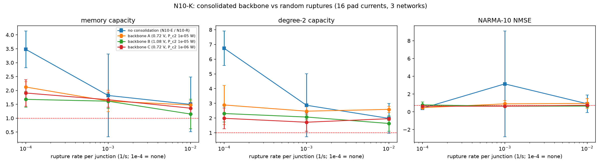

*Figure 24. N10-K: memory capacity, degree-2 capacity and NARMA-10 vs rupture rate (mean $\pm$ sd over 3 networks) for
the three backbones and without consolidation (N10-E at 0, N10-R at $10^{-3}$ and $10^{-2}$ /s; the N10-R NARMA mean at
$10^{-3}$ is inflated by one blow-up). Red dashed: G1 thresholds.*

| backbone (consolidated) | rupture /s | MC | degree-2 | NARMA-10 | sine/square | consistency | G1 | (MC + deg-2) / twin, median | collapsed (of 12) |
|---|---|---|---|---|---|---|---|---|---|
| none (N10-E / N10-R) | 0 / $10^{-3}$ / $10^{-2}$ | 3.48 / 1.82 / 1.50 | 6.74 / 2.87 / 1.98 | 0.40 / 3.15 / 0.91 | 1.00 / 0.99 / 0.98 | 1.00 / 0.96 / 0.94 | yes / no / no | — / 0.55 / 0.43 | — / 6 / 7 |
| A (1.7 %) | 0 / $10^{-3}$ / $10^{-2}$ | 2.12 / 1.62 / 1.48 | 2.89 / 2.47 / 2.59 | 0.47 / 0.90 / 0.94 | 0.97 / 0.99 / 0.98 | 1.00 / 0.97 / 0.88 | no / no / no | — / 0.90 / 0.84 | — / 0 / 0 |
| B (8 %) | 0 / $10^{-3}$ / $10^{-2}$ | 1.68 / 1.61 / 1.15 | 2.31 / 2.07 / 1.63 | 0.78 / 0.64 / 0.65 | 0.91 / 0.95 / 0.91 | 1.00 / 0.99 / 0.96 | no / no / no | — / 0.96 / 0.75 | — / 0 / 1 |
| C (12.7 %) | 0 / $10^{-3}$ / $10^{-2}$ | 1.91 / 1.67 / 1.36 | 1.98 / 1.72 / 1.96 | 0.63 / 0.64 / 0.74 | 0.89 / 0.93 / 0.90 | 1.00 / 0.99 / 0.97 | no / no / no | — / 0.90 / 0.88 | — / 0 / 0 |

### Conclusions

* **Consolidation removes the collapses.** With a backbone, ruptures at $10^{-3}$-$10^{-2}$ /s cost only 4-25 % of the
  capacity (twin medians 0.75-0.96) and almost never collapse a run (1 of 72), against 45-57 % and 13 of 24 collapses
  without it. Consistency stays $\ge 0.88$.
* **But the backbone costs more than it saves.** Without ruptures every backbone already loses half the memory and
  60-70 % of the degree-2 capacity (MC 1.7-2.1, degree-2 2.0-2.9 vs 3.48 and 6.74) and fails G1. At $10^{-2}$ /s the
  absolute scores equal those of the unprotected network (MC 1.2-1.5, degree-2 1.6-2.6). **No setting meets G1 at any
  rupture rate**, so N10-K as configured does not rescue the reservoir.
* Mechanism: consolidated junctions are static wires. They carry an input-independent current (the input-driven share of
  the electrode currents falls from 0.30 to 0.06-0.21) and remove dynamic junctions exactly on the main current paths.
  Robustness and computation compete for the same junctions.
* Open confound: the input windows (0.38 and 0.45 V) were tuned for the unconsolidated network. A backbone changes
  the network's conductance and onset, so re-tuning the window after forming (onset sweep on the formed network) is
  the first thing to try before discarding the idea. Other variants: a thinner or partial backbone (forming only some
  pads), larger networks.

## 24. N10-OR: online (periodic) retraining of the readout

**Question.** A rupture on a bottleneck junction reroutes the current and invalidates a readout trained earlier
(section 20). Can a readout that is retrained periodically follow the network? No new simulations: N10-R runs (all
rates, $10^{-5}$-3 /s) and their rupture-free twins. The test segment is predicted in blocks of $R$ inputs; before each
block a ridge readout is retrained causally on the $W$ preceding inputs (last 20 % of the window chooses the ridge
parameter), and the concatenated predictions are scored as usual. $(W, R)$ = (600, 40), (300, 20), (150, 10); the
static readout (trained once) as reference, which the same code reproduces exactly. `scripts/n10r_retrain.py` $\to$
`results/n10r_retrain.json`.

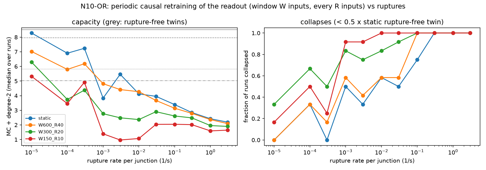

*Figure 27. Median MC + degree-2 over the 12 runs per rate (grey lines: rupture-free twins with the same readout) and
fraction of runs collapsed (< 0.5 $\times$ the static rupture-free twin).*

| readout | no ruptures | $10^{-4}$ /s | $10^{-3}$ /s | $10^{-2}$ /s | 0.1 /s |
|---|---|---|---|---|---|
| static (trained once) | 8.5 | 6.9 (4/12) | 3.8 (6/12) | 4.1 (7/12) | 3.4 (9/12) |
| retrained, W 600, every 40 | 8.0 | 5.8 (4/12) | 4.8 (7/12) | 4.3 (7/12) | 3.1 (12/12) |
| retrained, W 300, every 20 | 5.8 | 3.7 (8/12) | 2.8 (10/12) | 2.4 (10/12) | 2.6 (12/12) |
| retrained, W 150, every 10 | 5.0 | 3.5 (6/12) | 1.4 (11/12) | 1.1 (12/12) | 2.0 (12/12) |

*Median MC + degree-2 (runs collapsed).*

### Conclusions

* **Retraining does not rescue the reservoir.** It never beats the static readout by more than noise, and short
  windows are worse at every rate: the 16 electrodes $\times$ 50 virtual nodes give 800 features, and 150-300 recent inputs
  are too few to retrain them (capacity 5.0-5.8 even without ruptures).
* Ruptures do not just shift the readout's operating point; at $\ge 10^{-3}$ /s they keep changing the network faster
  than a readout can be re-fitted from the data available.

## 25. N10-B: bias deep in the conducting state + small input

**Question.** Milano et al. (2025) run their reservoir at a constant bias of 1.5 $\times$ the onset with a small (2.8 %)
input. Does operating far from the switching onset make N10 better or more robust? N10-E setup with the input window
moved to a bias $V_b$ = 1.5, 2, 3 $\times$ the pad onset (0.54, 0.72, 1.08 V) and a full input width of 3 % or 15 % of
$V_b$; ruptures 0, $10^{-3}$, $10^{-2}$ /s; operating point (bias, width) chosen on validation data per rupture rate.
Also re-scored with the measured network-level readout noise of N10-RN ($\times 1$), since a small input gives a small signal.
`scripts/n10b_bias.py`, 162 runs, `results/n10b_criteria.json`.

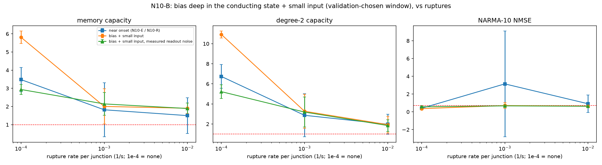

*Figure 25. N10-B (validation-chosen bias and width) vs the near-onset N10-E / N10-R, without and with measured readout
noise, vs rupture rate.*

| condition | operating point | MC | degree-2 | NARMA-10 | consistency | G1 | twins median (collapsed) |
|---|---|---|---|---|---|---|---|
| near onset, no ruptures (N10-E) | 0.38-0.45 V, width 0.16 | 3.48 | 6.74 | 0.40 | 1.00 | yes | |
| **bias, no ruptures** | 0.54 V, width 0.02 | $\mathbf{5.81 \pm 0.35}$ | $\mathbf{10.93 \pm 0.35}$ | **0.36** | 1.00 | **yes** | |
| bias 0.72 / 1.08 V, no ruptures | width 0.02 / 0.03 | 5.75 / 5.33 | 10.50 / 9.14 | 0.35 / 0.34 | 1.00 | yes | |
| bias, ruptures $10^{-3}$ /s | 0.54 V, width 0.08 | $2.00 \pm 0.97$ | $3.27 \pm 1.68$ | 0.71 | 0.92 | no | 0.16 (32/36) |
| bias, ruptures $10^{-2}$ /s | 0.54 V, width 0.08 | $1.90 \pm 0.29$ | $1.94 \pm 0.83$ | 0.64 | 0.72 | no | 0.11 (36/36) |
| bias, no ruptures, measured readout noise | 0.54 V, width 0.08 | $2.94 \pm 0.27$ | $5.23 \pm 0.68$ | 0.57 | 1.00 | no | |

### Conclusions

* **Without noise, bias + small input is the best N10 reservoir so far**: MC 5.8, degree-2 10.9, NARMA-10 0.36, all
  three networks, G1 and G2 loose with margin (MC + degree-2 = 16.7 > ESN-16 15.4; G2 strict, ESN-32 27.7, not met). The
  lowest bias and the narrowest input work best: a weak perturbation of a conducting network is nearly linear in the
  junction states and keeps a long, clean fading memory.
* **It is much more fragile**: at $10^{-3}$ /s, 32 of 36 runs collapse (near onset: 6 of 12), at $10^{-2}$ /s all of them.
  With most junctions formed, a rupture changes the current by far more than the small input does.
* **Measured-size readout noise alone breaks G1 here** (MC 2.9), whereas near onset it was harmless (section 22): the
  input-driven part of the currents is too small. Validation then picks the wider (15 %) input.
* Hence the operating point trades capacity for robustness: deep in the conducting state the noise-free capacity is
  larger, the tolerance to both junction and readout noise is lower.

## 26. N10-V: junction voltage scale matched to the measured network

**Question.** N10-C found N10 junctions switch at ~12 $\times$ the voltage of the measured network. With `v_scale` = 40
instead of 5 (onset of the pads 0.051 V instead of 0.36 V), does the reservoir, its tolerance, or the calibration change?
`scripts/n10v_vscale.py`: pads sweep, step check (2 ms vs 1 ms: current 0.4 %, junction filling 1.5 %, accepted),
54 reservoir runs (N10-E protocol, windows 1.05 / 1.25 $\times$ onset, ruptures 0, $10^{-3}$, $10^{-2}$ /s), and the N10-C
stationary protocol at 1, 1.41, 2 mm (18 runs). `results/n10v_criteria.json`.

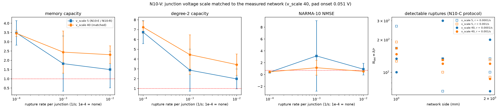

*Figure 26. N10-V vs N10-E / N10-R (v_scale 5) vs rupture rate, and the number of junctions with detectable ruptures in
the N10-C protocol at both voltage scales (open: v_scale 5, filled: 40).*

| v_scale | ruptures /s | MC | degree-2 | NARMA-10 | G1 | twins median (collapsed of 12) |
|---|---|---|---|---|---|---|
| 5 | 0 / $10^{-3}$ / $10^{-2}$ | 3.48 / 1.82 / 1.50 | 6.74 / 2.87 / 1.98 | 0.40 / 3.15 / 0.91 | yes / no / no | — / 0.55 (6) / 0.43 (7) |
| 40 | 0 / $10^{-3}$ / $10^{-2}$ | 3.46 / 2.44 / 2.30 | 7.25 / 4.45 / 3.44 | 0.45 / 1.16 / 0.54 | yes / no / no | — / 0.70 (5) / 0.50 (6) |

Calibration: at the same sides, seeds and threshold, $N_\mathrm{det}$ at $r = 10^{-3}$ /s is 87-167 at `v_scale` 40 and 90-190
at 5 (1-2 mm); at $10^{-4}$ /s both scatter between 70 and 300 (1-8 jumps per run).

### Conclusions

* **Matching the voltage scale changes nothing essential**: the noise-free reservoir is the same (as N10-S found for
  3-8), the rupture tolerance improves slightly (twin medians 0.70 / 0.50 vs 0.55 / 0.43) but G1 still fails at
  $\ge 10^{-3}$ /s, and the number of detectable ruptures, hence the N10-C estimate of 0.005-0.03 /s per junction, is
  unchanged within counting noise.
* The calibration mismatch is therefore not what makes N10 fragile, and the N10-C conclusion does not rest on it.

## 27. N10-L: rupture tolerance vs network size

**Question.** N10-RN located the damage of ruptures inside the network (rerouting at bottleneck junctions), and N10-C
showed that each rupture matters less in a larger network. Does the tolerance grow with size? The N10-E reservoir is
enlarged geometrically: side 1.41, 2 and 2.83 mm at the working wire density (`RunSpec.side`), pads scaled with the
side (layout `pads_scaled`, 50 µm per mm; identical to `pads` at 1 mm, tested), windows 1.05 / 1.25 $\times$ the onset of
each size; 1 mm reference = N10-E / N10-R. Round 1 (2026-10-06/07, 144 runs, 1/3 on ultron): 1.41 and 2 mm at 0,
$10^{-4}$, $10^{-3}$, $10^{-2}$ /s. Round 2 (2026-10-07/08, 90 runs, 24 on ultron): 2.83 mm at 0, $3 \times 10^{-3}$, $10^{-2}$ /s
and $3 \times 10^{-3}$ /s at 1.41 and 2 mm. `scripts/n10l_size.py`, `results/n10l_criteria.json`; tolerance and layouts:
`scripts/n10l_figures.py`, `results/n10l_tolerance.json`.

Onsets (`results/n10l_sweep.json`): 0.345 V (1 mm, = N10-E), 0.585 V (1.41 mm), 0.807 V (2 mm), 1.12 V (2.83 mm),
about proportional to the pad spacing; 5953 / 11 966 / 24 447 / ~49 000 junctions.

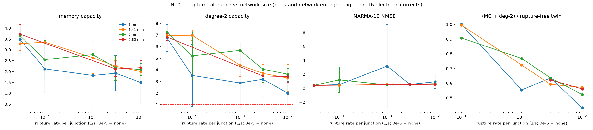

*Figure 28. Scores vs rupture rate per size (mean $\pm$ sd over 3 networks; "none" at $3 \times 10^{-5}$) and the median
(MC + degree-2) relative to the rupture-free twin.*

| side | ruptures /s | MC | degree-2 | NARMA-10 | consistency | G1 | twins median (collapsed of 12) |
|---|---|---|---|---|---|---|---|
| 1 mm | 0 / $10^{-4}$ / $10^{-3}$ / $3 \times 10^{-3}$ / $10^{-2}$ | 3.48 / 2.12 / 1.82 / 1.92 / 1.50 | 6.74 / 3.52 / 2.87 / 3.19 / 1.98 | 0.40 / 0.49 / 3.15 / 0.53 / 0.91 | 1.00 / 1.00 / 0.96 / 0.95 / 0.94 | yes / no / no / no / no | — / 1.00 (4) / 0.55 (6) / 0.64 (4) / 0.43 (7) |
| 1.41 mm | 0 / $10^{-4}$ / $10^{-3}$ / $3 \times 10^{-3}$ / $10^{-2}$ | 3.28 / 3.36 / 2.64 / 2.24 / 2.00 | 6.95 / 6.98 / 4.40 / 3.69 / 3.29 | 0.41 / 0.42 / 0.51 / 0.55 / 0.59 | 1.00 / 1.00 / 0.99 / 0.96 / 0.94 | yes / yes / no / no / no | — / 1.00 (2) / 0.72 (3) / 0.59 (2) / 0.57 (2) |
| 2 mm | 0 / $10^{-4}$ / $10^{-3}$ / $3 \times 10^{-3}$ / $10^{-2}$ | 3.66 / 2.55 / 2.78 / 2.18 / 2.09 | 7.24 / 5.21 / 5.68 / 4.05 / 3.62 | 0.41 / 1.18 / 0.46 / 0.56 / 0.63 | 1.00 / 1.00 / 0.99 / 0.97 / 0.94 | yes / no / **yes** / **yes** / no | — / 0.91 (1) / 0.77 (0) / 0.64 (2) / 0.52 (4) |
| 2.83 mm | 0 / $3 \times 10^{-3}$ / $10^{-2}$ | 3.73 / 2.12 / 2.18 | 6.83 / 3.47 / 3.42 | 0.39 / 0.51 / 0.54 | 1.00 / 0.97 / 0.95 | yes / **yes** / **yes** | — / 0.62 (3) / 0.56 (3) |

At $10^{-2}$ /s, across sizes 1 / 1.41 / 2 / 2.83 mm: MC $1.50 \pm 0.99$ / $2.00 \pm 0.52$ / $2.09 \pm 0.27$ / $2.18 \pm 0.33$, degree-2
$1.98 \pm 1.00$ / $3.29 \pm 1.17$ / $3.62 \pm 0.51$ / $3.42 \pm 0.51$ (mean $\pm$ sd over the 3 networks at the validation-chosen window).

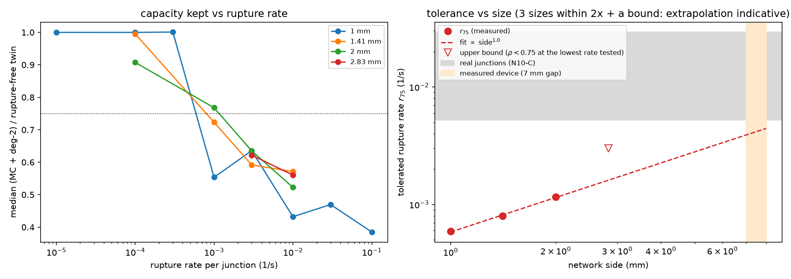

*Figure 30. Left: median capacity kept vs rupture rate per size. Right: $r_{75}$ vs side with the power-law fit (1-2 mm),
the 2.83 mm upper bound, the N10-C range for real junctions (grey) and the measured device size (orange). Device
layouts: figures/fig29_n10l_layouts.png.*

### Conclusions

* *(Corrected by the N10-LS addendum below: with 10 networks 9 of 10 pass, the pooled G1 fails on the NARMA margin.)*
* **A 2.83 mm network computes beyond its input at $10^{-2}$ ruptures /s per junction**, inside the range inferred for
  real junctions (0.005-0.03 /s, N10-C): G1 met with margin (MC $2.18 \pm 0.33$, degree-2 $3.42 \pm 0.51$, NARMA 0.54) on
  all three networks. The 2 mm network meets G1 at $10^{-3}$ and $3 \times 10^{-3}$ /s, the 1 mm network at none of these.
* **What grows with size is reliability, not the fraction of capacity kept.** At $10^{-2}$ /s the median run keeps 43-57 %
  of its rupture-free capacity at every size; the absolute scores rise a little (MC 1.5 $\to$ 2.2) and their spread between
  networks shrinks (MC sd 0.99 $\to$ 0.27-0.33), so every network stays clear of the G1 thresholds. Larger networks lose as
  much per run but less erratically.
* The continuous tolerance $r_{75}$ (median keeps 75 %) grows about in proportion to the side between 1 and 2 mm
  ($5.9 \times 10^{-4}$, $8.0 \times 10^{-4}$, $1.16 \times 10^{-3}$ /s; exponent 0.98); at 2.83 mm the lowest rate tested
  ($3 \times 10^{-3}$) already gives $\rho = 0.62$, so only $r_{75} < 3 \times 10^{-3}$ is known. By this measure real junction
  rates would need ~9-55 mm. (An earlier "tenfold per doubling, 4-6 mm" read the threshold measures and is superseded.)
* **Revised picture:** realistic junction noise costs about half the noise-free capacity (MC $\approx 3.5 \to 2$,
  degree-2 $\approx 7 \to 3.5$) whatever the size, but from about 3 mm on what remains is a reliable reservoir that computes
  beyond its input, and the measured devices (7 mm gap, $\approx 1 \times 1$ cm) are larger still. This reconciles noisy
  junctions with computing networks, at the price of a capacity about half the noise-free one.

### Addendum N10-LS: 10 networks per size (2026-10-09)

**Why.** Each N10-L point rested on 3 networks $\times$ 2 replicates; with 3 devices the sd in the G1 margin
(mean $- 2$ sd) is itself poorly known. N10-LS adds networks 4-10 at 1, 2 and 2.83 mm (0 and $10^{-2}$ ruptures /s),
plus all three noise sources at once at 2.83 mm (ruptures $10^{-2}$ /s, Gaussian junction noise $\sigma = 0.03$, and
scored also with the measured readout noise of N10-RN, $\times 1$), plus a 4 mm size (networks 1-3; networks 4-10 added by N10-LS4, 84 runs, 2026-10-13). Protocol unchanged
from N10-L; analysis and **decision rules fixed in advance** in [PLAN_N10L_SEEDS.md](PLAN_N10L_SEEDS.md). 348 runs on
the CCT-Rosario HPC cluster (2026-10-08/09). 4 mm onset 1.743 V (`results/n10l_sweep.json`). `scripts/n10l_seeds.py`
(run / report), `results/n10l_seeds.json`.

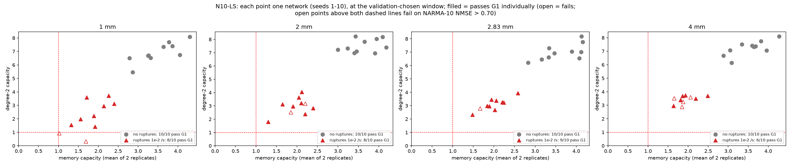

*Figure 31. Each point one network (mean of 2 replicates) at the group's validation-chosen window; filled = passes G1
individually, open = fails; dashed lines = G1 thresholds of MC and degree-2.*

Pooled over 10 networks $\times$ 2 replicates (mean $\pm$ sd; G1 = mean $- 2$ sd past every threshold); networks passing G1
individually with the 95 % Clopper-Pearson interval; spread = sd over networks of the per-network MC + degree-2
(bootstrap 95 %); $\rho$ = median (MC + degree-2) relative to the rupture-free twin (bootstrap 95 %), collapses = runs
with $\rho < 0.5$:

| side | ruptures /s | MC | degree-2 | NARMA-10 | pooled G1 | networks passing | spread | $\rho$ | collapses |
|---|---|---|---|---|---|---|---|---|---|
| 1 mm | 0 | $3.51 \pm 0.48$ | $6.91 \pm 0.72$ | 0.42 | yes | 10/10 | 1.18 [0.64, 1.53] | | |
| 1 mm | $10^{-2}$ | $1.79 \pm 0.49$ | $2.17 \pm 1.27$ | 0.58 | no | 8/10 [0.44, 0.97] | 1.46 [0.92, 1.74] | 0.36 [0.28, 0.49] | 14/20 |
| 2 mm | 0 | $3.63 \pm 0.38$ | $7.52 \pm 0.49$ | 0.45 | yes | 10/10 | 0.73 [0.47, 0.86] | | |
| 2 mm | $10^{-2}$ | $1.98 \pm 0.36$ | $2.96 \pm 0.71$ | 0.63 | no | 8/10 [0.44, 0.97] | 0.84 [0.36, 1.16] | 0.46 [0.42, 0.50] | 14/20 |
| 2.83 mm | 0 | $3.65 \pm 0.47$ | $7.00 \pm 0.59$ | 0.44 | yes | 10/10 | 0.99 [0.53, 1.27] | | |
| 2.83 mm | $10^{-2}$ | $1.99 \pm 0.33$ | $3.09 \pm 0.55$ | 0.56 | no | 9/10 [0.55, 1.00] | 0.74 [0.34, 0.98] | 0.49 [0.42, 0.54] | 10/20 |
| 2.83 mm | $10^{-2}$ + $\sigma = 0.03$ | $1.80 \pm 0.28$ | $2.88 \pm 0.43$ | 0.62 | no | 8/10 [0.44, 0.97] | 0.68 [0.33, 0.91] | 0.44 [0.40, 0.50] | 13/20 |
| 2.83 mm | same + readout noise | $1.79 \pm 0.28$ | $2.87 \pm 0.42$ | 0.62 | no | | | | |
| 4 mm | 0 | $3.54 \pm 0.43$ | $7.23 \pm 0.53$ | 0.45 | yes | 10/10 | 0.93 [0.45, 1.21] | | |
| 4 mm | $10^{-2}$ | $1.94 \pm 0.26$ | $3.41 \pm 0.31$ | 0.66 | no | 6/10 [0.26, 0.88] | 0.48 [0.26, 0.62] | 0.51 [0.47, 0.55] | 8/20 |
| *4 mm, networks 1-3 only (N10-LS)* | $10^{-2}$ | $2.08 \pm 0.34$ | $3.60 \pm 0.18$ | 0.59 | *yes* | 3/3 | 0.49 | 0.55 [0.51, 0.57] | 0/6 |

**Which G1 criterion fails.** With ruptures the memory and degree-2 margins hold from 2 mm on (MC $- 2$ sd 1.25 / 1.34 /
1.24 at 2 / 2.83 mm / combined; degree-2 $- 2$ sd 1.54 / 2.00 / 2.02); the pooled G1 fails on **NARMA-10**: mean $+ 2$ sd =
0.85 / 0.76 / 0.85 against the threshold 0.70; 4 mm with 10 networks: 0.94 (MC $- 2$ sd 1.42, degree-2 $- 2$ sd 2.80, the best
margins of any size). At 1 mm all three margins fail (MC 0.81, degree-2
$-0.37$, NARMA 0.81). The networks that fail individually do so on NARMA ($> 0.70$: 2 mm seeds 5, 7; 2.83 mm seed 8;
combined seeds 6, 10; 4 mm seeds 5, 7, 8, 10 with 0.77 / 0.90 / 0.76 / 0.80), at 1 mm also on degree-2 (seed 5: 0.32; seed 6: MC 1.02 with one lag above the floor).

**Seeds 1-3 vs 4-10.** The three N10-L networks were on the favourable side: at 2.83 mm and $10^{-2}$ /s MC 2.18 vs 1.92,
degree-2 3.42 vs 2.95, NARMA 0.54 vs 0.57 (seeds 1-3 vs 4-10); noise-free the two subsets agree (MC 3.73 vs 3.62).
With 10 networks the median capacity kept at 2.83 mm is 0.49 (N10-L, 3 networks: 0.56).

**Decision rules (PLAN_N10L_SEEDS.md), applied:**

1. Headline "2.83 mm computes beyond its input at $10^{-2}$ /s": needs pooled G1 **and** $\ge 9/10$ networks. Pooled G1
   fails (NARMA margin), 9/10 pass $\to$ **reported as "most devices" (9 of 10)**; not withdrawn (that needs $< 7/10$).
2. "Size reduces the spread between devices": 1 mm / 2.83 mm sd ratio at $10^{-2}$ /s **1.98 [1.15, 4.20]**, excludes 1
   $\to$ **stands** (with ruptures). Noise-free the ratio is 1.19 [0.63, 2.27]: no size effect without ruptures, so the
   reduction is in how erratically ruptures act, not in device-to-device variation as such.
3. "Realistic noise costs about half the capacity at every size": $\rho$ intervals [0.28, 0.49], [0.42, 0.50],
   [0.42, 0.54] overlap $\to$ **stands**. The median rises with size (0.36 $\to$ 0.46 $\to$ 0.49; 4 mm 0.55), but the
   1 mm and 2.83 mm intervals barely touch.

**Update 2026-10-13: 4 mm with 10 networks (N10-LS4).** Rule 1 applied to 4 mm (PLAN_N10L_SEEDS.md, update 2026-10-09):
the pooled G1 fails (NARMA-10 mean $+ 2$ sd 0.94) and only **6/10** networks pass [0.26, 0.88] $\to$ the claim "a 4 mm
network computes beyond its input at $10^{-2}$ /s" is **withdrawn** (below 7/10). All four failures are on NARMA-10 alone;
memory and degree-2 capacity pass in 10/10 networks with the widest margins and the smallest spread of any size, and
$
ho = 0.51$ [0.47, 0.55] overlaps the other sizes (rule 3 stands). The three N10-LS networks (3/3, no collapses) were
again on the favourable side. Over all sizes the G1 pass rate at $10^{-2}$ /s is 8, 8, 9, 6 of 10 (1 / 2 / 2.83 / 4 mm),
31/40 together: the intervals overlap and show no trend with size.

### Conclusions (N10-LS)

* **Corrects the N10-L headline.** With 10 networks a 2.83 mm network at $10^{-2}$ ruptures /s computes beyond its input
  in **9 of 10 devices**, but the pooled G1 does not hold: the spread of NARMA-10 over the 20 runs (sd 0.10) leaves no
  2-sd margin below 0.70. 2 mm: 8 of 10; 1 mm: 8 of 10 but with a pooled failure on every criterion. The N10-L result
  "G1 on all three networks" was partly the luck of seeds 1-3.
* **Size still buys reliability with ruptures** (spread between networks 1 mm $\to$ 2.83 mm halves, interval excludes 1) and
  **about half the capacity is lost at every size** (median $\rho$ 0.36-0.49). Both N10-L conclusions survive.
* **All three noise sources together** cost little more than ruptures alone at 2.83 mm (MC 1.80 vs 1.99, NARMA 0.62 vs
  0.56; 8/10 networks); the measured readout noise on top changes nothing (scores identical within 0.01). Ruptures
  dominate.
* **4 mm with 10 networks (N10-LS4)**: the 3-network pass does not survive. 6/10 networks pass G1, the pooled G1 fails
  on NARMA-10; memory and degree-2 margins are the best of all sizes and the spread the smallest (0.48). The 4 mm claim is
  withdrawn (rule 1).
* **Revised headline (2026-10-13):** at realistic junction noise ($10^{-2}$ ruptures /s per junction), networks of 1-4 mm
  compute beyond their input in about 3 of 4 devices (31 of 40, no trend with size), at about half the noise-free
  capacity. From 2 mm on the memory and degree-2 criteria hold in every network; **NARMA-10 is the binding criterion**
  (network means 0.56-0.66 with sd $\approx$ 0.1-0.14 against the threshold 0.70). Size reduces the spread of the capacity
  between devices, not the share of devices that fail NARMA-10. Earlier statement "a reliable pooled pass needs about
  4 mm or more" withdrawn.

## 28. N10-SB: split-band edge layout (b) against the pads (a)

**Question.** Every noise and size result above (N10-E to N10-LS) uses one layout, the $4 \times 4$ checkerboard of
pads inside the network (a). Edge contacts are much easier to fabricate, and the measured networks we calibrate against
(Milano 2025) are contacted at the edges. Is the split-band layout (b), the framework's two 5 % edge bands cut into 8
driven segments (left) and 8 grounded segments (right), as good and as robust as the pads? Plan and **decision rules
fixed before the runs**: [PLAN_SPLIT_BANDS.md](PLAN_SPLIT_BANDS.md). Protocol of N10-LS unchanged (windows 1.05 / 1.25
$\times$ the onset, 10 networks, 2 i.i.d. replicates + 1 sine/square, operating point chosen on validation data).
Onsets 2.08 / 3.95 / 5.51 V at 1 / 2 / 2.83 mm (`results/n10sb_sweep.json`). B1 (noise-free) and B2 (rupture ladder)
at 1 mm and B5 (bias) here, B3 (2 and 2.83 mm, 240 runs) on the CCT-Rosario cluster; 606 runs in total, all finished by
2026-10-13. Split bands run about 4 times slower than pads. `scripts/n10sb_layout.py`, `results/n10sb.json`,
`results/n10sb_bias.json`, `results/n10sb_win15.json`.

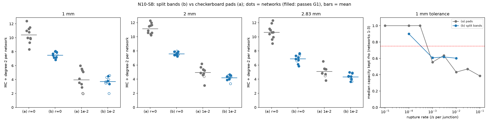

*Figure 32. MC + degree-2 per network (filled: passes G1) for pads (a, grey) and split bands (b, blue) without and with
$10^{-2}$ ruptures /s, at 1, 2 and 2.83 mm; right: median capacity kept $\rho$ vs rupture rate at 1 mm (networks 1-3).*

Split bands (b), pooled over 10 networks $\times$ 2 replicates (as the N10-LS table), and against the pads (a) at the
same size and rate: difference of the network means of MC + degree-2, (b) $-$ (a), with bootstrap 95 % interval:

| side | ruptures /s | MC | degree-2 | NARMA-10 | networks passing G1 (b) / (a) | $\rho$ (b) | $\rho$ (a) | collapses (b) / (a) | MC + degree-2, (b) $-$ (a) |
|---|---|---|---|---|---|---|---|---|---|
| 1 mm | 0 | $2.30 \pm 0.30$ | $5.20 \pm 0.23$ | 0.60 | 7/10 / 10/10 | | | | $-2.92$ [$-3.67$, $-2.17$] worse |
| 1 mm | $10^{-2}$ | $1.12 \pm 0.41$ | $2.59 \pm 0.46$ | 0.73 | 3/10 / 8/10 | 0.49 [0.46, 0.56] | 0.36 [0.28, 0.49] | 12/20 / 14/20 | $-0.26$ [$-1.22$, $+0.68$] on par |
| 2 mm | 0 | $2.33 \pm 0.25$ | $5.26 \pm 0.19$ | 0.61 | 7/10 / 10/10 | | | | $-3.56$ [$-4.00$, $-3.11$] worse |
| 2 mm | $10^{-2}$ | $1.31 \pm 0.23$ | $2.89 \pm 0.37$ | 0.74 | 5/10 / 8/10 | 0.57 [0.52, 0.60] | 0.46 [0.42, 0.50] | 3/20 / 14/20 | $-0.74$ [$-1.26$, $-0.17$] worse |
| 2.83 mm | 0 | $2.13 \pm 0.20$ | $4.76 \pm 0.50$ | 0.63 | 7/10 / 10/10 | | | | $-3.76$ [$-4.46$, $-3.09$] worse |
| 2.83 mm | $10^{-2}$ | $1.31 \pm 0.25$ | $3.01 \pm 0.36$ | 0.70 | 7/10 / 9/10 | 0.63 [0.59, 0.67] | 0.49 [0.42, 0.54] | 1/20 / 10/20 | $-0.77$ [$-1.30$, $-0.26$] worse |

The pooled G1 of (b) fails in every group, also without ruptures (NARMA-10 mean $+ 2$ sd 0.81-0.85); the networks that
fail individually do so on NARMA-10 (at $10^{-2}$ /s some also on MC). **Rupture ladder (B2, 1 mm, networks 1-3):** median
$\rho$ 0.90 / 0.61 / 0.62 / 0.60 at $10^{-4}$ / $10^{-3}$ / $3 \times 10^{-3}$ / $10^{-2}$ /s; tolerance $r_{75} = 3.2 \times 10^{-4}$ /s
(pads $5.9 \times 10^{-4}$). Beyond $10^{-3}$ /s (b) loses about 40 %, the pads 35-55 %.

**Decision rules (PLAN_SPLIT_BANDS.md), applied:**

1. Capacity: (b) is **worse** than (a) at every size without ruptures (by 28-35 %) and at 2 and 2.83 mm with ruptures (by
   15 %), **on par** at 1 mm with ruptures.
2. Noise tolerance at $10^{-2}$ /s: (b) is **more robust** at 2 mm and 2.83 mm (its $\rho$ interval lies above the pads'),
   on par at 1 mm. It collapses much less often from 2 mm on (3/20 and 1/20 vs 14/20 and 10/20).
3. Size claims on (b): headline at 2.83 mm and $10^{-2}$ /s: pooled G1 fails, 7/10 networks $\to$ "most devices" (at the
   edge of withdrawal). Spread ratio 1 / 2.83 mm at $10^{-2}$ /s 1.55 [0.67, 2.83], includes 1 $\to$ **not shown** for (b).
   $\rho$ intervals 1 mm [0.46, 0.56] and 2.83 mm [0.59, 0.67] do not overlap $\to$ for (b) "about half lost at every size"
   **does not hold**: the fraction kept grows with size (0.49 $\to$ 0.57 $\to$ 0.63).

**B5: bias + small input on (b)** (N10-B grid: bias 1.5 / 2 / 3 $\times$ the onset = 3.12 / 4.16 / 6.24 V, full input
width 3 % or 15 % of the bias; 1 mm, networks 1-3, 162 runs; `report_bias`). Operating point chosen on validation:

| ruptures /s | bias | MC | degree-2 | NARMA-10 | networks passing G1 | $\rho$ (collapses) | pads, N10-B (MC / degree-2 / NARMA) |
|---|---|---|---|---|---|---|---|
| 0 | 3.12 V | $3.20 \pm 0.25$ | $7.20 \pm 1.32$ | 0.58 | 3/3 (pooled no) | | 5.81 / 10.93 / 0.36 |
| $10^{-3}$ | 3.12 V | $1.10 \pm 0.56$ | $1.93 \pm 1.03$ | 1.01 | 1/3 | 0.29 (10/12) | 2.00 / 3.27 / 0.71 |
| $10^{-2}$ | 4.16 V | $0.89 \pm 0.16$ | $1.37 \pm 0.50$ | 0.77 | 0/3 | 0.24 (12/12) | 1.90 / 1.94 / 0.64 |

Bias raises the noise-free capacity of (b) by about 40 % (MC + degree-2 10.4 vs 7.5 near onset), still well below biased
pads, and the biased (b) collapses under ruptures as the biased pads do: the expected protection by many parallel edge-to-edge
paths does not appear.

**Window check (1 mm, networks 1-3, 36 runs; `report_win15`).** Validation picked the upper protocol window (1.25 $\times$
onset) for both layouts, so a third window at 1.5 $\times$ onset (same width) was added. Pads: 0.54 V is better than both
protocol windows, without ruptures (MC 3.78 / degree-2 7.91 vs 3.48 / 6.74) and with $10^{-2}$ /s (2.05 / 3.36 / NARMA 0.61,
3/3 networks, vs 1.50 / 1.98 / 0.91 at the validation choice among the two windows). Split bands: 1.5 $\times$ onset adds
little noise-free (2.26 / 5.43, NARMA 0.69 worse) and nothing with ruptures (validation keeps 1.25 $\times$). The pad
capacities of N10-E to N10-LS are therefore conservative (the window grid stopped below the optimum), and the gap between
(b) and (a) would widen, not close, with a finer grid. Indicative only (3 networks).

### Conclusions

* **Split bands are a weaker reservoir than the pads**: about 30 % less MC + degree-2 without noise and 15 % less at
  realistic noise (2-2.83 mm), and fewer networks pass G1 (5-7 of 10 vs 8-10); NARMA-10 fails even without noise in 3 of
  10 networks.
* **But they are more robust to ruptures, increasingly so with size**: the fraction of capacity kept at $10^{-2}$ /s rises
  from 0.49 (1 mm) to 0.63 (2.83 mm), against 0.36-0.49 for the pads, and collapses nearly vanish from 2 mm on (1/20 at
  2.83 mm). Current between the edge bands spreads over many long paths, so one rupture matters less; the pads' short
  pad-to-pad paths are few and easy to cut. The robustness does not make up for the lower starting capacity.
* For (b) the size effect is in the fraction kept ($\rho$ grows with size), not in the spread between devices; for (a) it
  was the reverse.
* **Bias + small input does not rescue (b)** under ruptures; at a small input the network is fragile with either layout.
* Pads near 1.5 $\times$ onset may hold more capacity than the protocol windows found (3 networks), a cheap re-check for the
  pads.
* Per the plan the alternating-edge layouts (c) mirrored / (d) staggered come next: they keep edge contacts but shorten
  the input-output distance.

## 29. N11 stage 0: measured statistics for the junction calibration

**What.** First step of N11 (docs/PLAN_N11_CALIBRATION.md): the measured records of Milano et al. 2025 (Figs. 1e, 2a,
2b points and inset, 5a; open dataset) reduced to the statistics that stages 1-2 will fit. The estimators
(`agnw_rc/series_stats.py`) were validated on synthetic series first. The same functions will be applied to simulated
conductance. Code changes in the same step, not yet used in any run:
* random-rupture laws (constant / power / thermal) in `agnw_rc/volatile.py`, with defaults that are bit-for-bit the
  N10 model;
* the strip geometry `agnw_rc/strip.py`, where a square strip is bit-for-bit the framework network.

**Estimator validation** (synthetic series sampled every 0.6 s, 20 000 s, Gaussian sd $4.8 \times 10^{-4}$ per sample,
0.08 jumps /s):

* Gaussian sd: recovered within 3 % (ratio 1.03).
* Rate of clear jumps ($\ge 5$ sd): ratio 0.89.

Both are inside the spec tolerances (10 % and 15 %). Near the threshold, detection is partial:

| jump size (sd) | 2 | 2.6 | 3 | 4 | 5 | 8 |
|---|---|---|---|---|---|---|
| detected share | 0.16 | 0.41 | 0.54 | 0.87 | 0.94 | 0.95 |

For this reason simulated series must go through the same estimator. A plain MAD sd read 6-25 % high, and Gaussian false
jumps are about 20 % of the measured rate, so the estimator uses a sigma-clipped sd and subtracts the expected false
positives (spec section 12).

**Measured statistics** (`results/n11_data.json`, `figures/fig33_n11_data.png`):

* **Onset** 2.48 V: the conductance reaches $10^{-3}\,G_\mathrm{sat}$, with $G_\mathrm{sat} = 6.5 \times 10^{-5}$ S (median at
  $V \ge 5$ V). The grid resolution is $\pm 0.05$ V. Below the onset the device sits at the instrument floor
  ($10^{-13}$-$10^{-10}$ S).
* **Steady state and stationarity:** the Fig. 2b points equal the inset means within 10 % at every voltage above the
  onset except 2.6 V (ratio 0.40) and 2.7 V (0.76). Those two records still drift and are excluded from the jump and noise
  statistics. The fit target for the steady-state shape is the Fig. 2b points (spec section 5), normalised by
  $G_\mathrm{sat}$; their bootstrap uncertainty comes from the inset. Above the onset, $G$ rises a further factor of
  about 6, from $1 \times 10^{-5}$ to $7 \times 10^{-5}$ S.
* **Sampling:** the inset is sampled every 0.1, 0.3 or 0.6 s depending on the voltage. No record is interpolated
  (interpolation index $< 0.5$ everywhere). All voltages are analysed on a 0.6 s grid.
* **Jumps:** the rate $\lambda$ is 0.006-0.15 /s at the stationary voltages above the onset, with no trend. The
  log-log slope of $\lambda$ against $G/G_\mathrm{sat}$ is $-0.05 \pm 0.09$ (standard error), and no rate is $\le 0$.
  Up-jumps make up 46-69 % of jumps, and 38 voltages have at least 20 events (the stage-2 candidates).
* **Gaussian noise** falls with voltage: from $4 \times 10^{-3}$ per sample at 2.5 V to $3 \times 10^{-4}$ above 4.5 V.
* **Jump sizes:** 1433 events pooled. The median $\lvert \Delta G/G \rvert$ is 0.0016, the 90 % quantile 0.0073 and
  the 99 % quantile 0.017.
* **3.6 V anchor** (Fig. 5a, 18 500-35 600 s, same estimator): 0.070 jumps /s, sd $5.1 \times 10^{-4}$, 1441 events.
  N10-C found 0.080 /s from Fig. 3g with a different threshold.
* **Potentiation rate** $\theta$ (Fig. 2a, 80 s transients): 0.03-0.9 /s with no clear voltage trend. Their model
  fit is U-shaped, 0.1-2.6 /s. Seven of 42 transients are flagged unresolved: $R^2 < 0.5$, or no plateau within the
  80 s record (4.6 and 5.6 V drift instead of approaching a plateau). This makes $\theta$ a weak fit target: stage 1 should weight it by its bootstrap
  intervals, as the spec's loss already does.
* **Relaxation at 10 mV** (Fig. 1e, 250 s, about 1 % drop): two exponentials beat one by $\Delta\mathrm{AIC} = 598$. The
  times are 27 s and about $7 \times 10^4$ s, the second effectively a linear drift over the record. A single
  exponential gives 56 s. Either way, the measured network relaxes on tens of seconds, not the 0.3 s $\tau_s$ of N10.
  This network-level time need not equal the junction $\tau_s$, and stage 1 tests that.

**Conclusions.**

* Clear jumps are measured about 5-10 % low even at 5-8 sd (detection 0.89-0.95), because the clipped sd reads about
  3 % high and so the subtracted false-positive count is slightly too large. Simulated series share the bias.
* The estimators are validated, and the measured targets of stages 1-2 are fixed: onset, shape, $\theta(V)$,
  relaxation, $\lambda(V)$, sd($V$), jump sizes.
* **First hint on the rupture law: none** (slope $-0.05 \pm 0.09$). The jump rate does not grow with voltage or conductance above the onset,
  which is what a constant law predicts in a network whose conducting backbone is already formed. A power-law or
  thermal law would need $\lambda$ to rise with drive. The decision stays with stage 2 (AIC), which simulates
  the network.
* The measured relaxation (tens of s) is far slower than the N10 $\tau_s$ = 0.3 s. Stage 1's grid ($\tau_s$ 0.3 / 3 / 30 s)
  covers it. If the fit lands at 30 s, washouts and run times grow about 100-fold, and part 2 re-estimates the budget
  before any cluster run.

## 30. Reproduction

```bash
.venv/bin/python scripts/pilot.py                       # Fig. 1b,c data     -> results/pilot.npz   (~10 min)
.venv/bin/python scripts/run_sims.py e1 --procs 14      # 81 runs            -> results/raw/        (~25 min)
.venv/bin/python scripts/run_sims.py e2 --hold 100 --v-center 1.75   # 27 new runs (~100 min, p_relax 1e-2 is slow)
.venv/bin/python scripts/run_sims.py e3 --v-center 1.75 # 12 runs            (~60 min)
.venv/bin/python scripts/meanfield_pilot.py             # Fig. S1 data (~3 min)
.venv/bin/python scripts/run_sims.py m1 --procs 14      # 81 mean-field runs (~160 min)
.venv/bin/python scripts/run_sims.py n2 --procs 14      # 90 mean-field runs, N2 (~110 min)
.venv/bin/python scripts/effective_dimension.py         # -> results/effective_dimension.json (after the runs)
.venv/bin/python scripts/leaky_bank_reference.py        # -> results/leaky_bank_reference.json (~1 min)
.venv/bin/python scripts/run_sims.py n7a --procs 14     # 18 extra noise replicates (~6 min)
.venv/bin/python scripts/noise_averaging.py             # -> results/noise_averaging.json (~2 min)
.venv/bin/python scripts/run_sims.py n7b --procs 14     # stochastic model at the mean-field windows
.venv/bin/python scripts/multi_pilot.py                 # N5 layout staircases (~15 min)
.venv/bin/python scripts/run_sims.py n5a --procs 14     # 108 multi-electrode runs (~70 min)
.venv/bin/python scripts/n4_calibrate.py grid; .venv/bin/python scripts/n4_calibrate.py grid2   # N4 calibration
scripts/n4_refine_validate.sh                           # refine + validate (N = 2000/3000, 4 seeds)
.venv/bin/python scripts/run_sims.py n4_1 --procs 14    # 81 N4 runs (~50 min)
.venv/bin/python scripts/n4_bipolar_check.py            # zero-mean drive check (~4 min)
.venv/bin/python scripts/review_checks.py               # review checks -> results/review_checks.json (~1 min)
.venv/bin/python scripts/n4_stride_check.py             # N4 step validation -> results/n4_stride_check.json (~40 min)
.venv/bin/python scripts/n4_substep_check.py            # Euler-substep test -> results/n4_substep_check.json (~15 min)
.venv/bin/python scripts/run_sims.py e4 --model stochastic --procs 12   # E4 binary, 54 runs (~6 h)
.venv/bin/python scripts/run_sims.py e4 --model filament --procs 16     # E4 N4 (2 ms step), 54 runs (~5 h)
.venv/bin/python scripts/evaluate_all.py --procs 14     # -> results/metrics.json, results/summary.csv (~2 min)
.venv/bin/python scripts/make_figures.py                # -> figures/*.pdf|png
.venv/bin/python scripts/e4_report.py                   # E4 go/no-go -> results/e4_criteria.json, figures/fig12_e4.png
.venv/bin/python scripts/n8_short.py run --procs 12     # N8 short scan (40 simulations, ~3 h on 12 cores)
.venv/bin/python scripts/n8_short.py report             # -> results/n8_short.json, figures/fig13_n8_short.png
.venv/bin/python scripts/n10_phenomenology.py vscale    # N10 onset vs v_scale -> results/n10_vscale.json
.venv/bin/python scripts/n10_kmax_check.py              # growth-rate cap vs step -> results/n10_kmax_check.json
.venv/bin/python scripts/n10_stride_check.py            # N10 step check -> results/n10_stride_check.json
.venv/bin/python scripts/n10_power_gate.py              # consolidation gate -> results/n10_power_gate.json
.venv/bin/python scripts/n10_phenomenology.py all; .venv/bin/python scripts/n10_phenomenology.py figure   # fig14
.venv/bin/python scripts/run_sims.py n10_1 --procs 16   # N10-1, 216 runs (~12 h on 16 cores; 3 s holds ~7 h each)
.venv/bin/python scripts/n10_report.py                  # -> results/n10_1_criteria.json, figures/fig15_n10_1.png
.venv/bin/python scripts/n10e_pilot.py sweep; .venv/bin/python scripts/n10e_pilot.py run; .venv/bin/python scripts/n10e_pilot.py report   # N10-E0, fig16
.venv/bin/python scripts/n10e_channels.py               # space vs virtual nodes -> results/n10e_channels.json
.venv/bin/python scripts/esn16_baseline.py              # ESN-16/32 on 800-sample streams -> results/esn16_baseline.json
.venv/bin/python scripts/n10e_pilot.py full --procs 18; .venv/bin/python scripts/n10e_pilot.py full_report   # N10-E, fig17
.venv/bin/python scripts/run_sims.py n10m --procs 18    # N10-M, 144 runs (tau3 block ~2.5 h per run)
.venv/bin/python scripts/n10m_report.py                 # -> results/n10m_criteria.json, figures/fig18_n10m.png
.venv/bin/python scripts/n10s_sensitivity.py sweep; ... run --part a; ... run --part b; ... report   # N10-S, fig19
.venv/bin/python scripts/n10r_noise.py sweep; .venv/bin/python scripts/n10r_noise.py run; .venv/bin/python scripts/n10r_noise.py report   # N10-R, fig20
.venv/bin/python scripts/n10r_noise.py twins              # each low-rate rupture run vs its rupture-free twin -> results/n10r_twins.json
.venv/bin/python scripts/n10c_data.py                   # N10-C stage A (data in data/milano2025/) -> results/n10c_data.json, fig21
.venv/bin/python scripts/n10c_sim.py sweep; .venv/bin/python scripts/n10c_sim.py run --procs 18   # N10-C stage B (2.83 mm runs ~12 h each)
.venv/bin/python scripts/n10c_sim.py report             # -> results/n10c_sim.json, figures/fig22_n10c_sim.png
.venv/bin/python scripts/n10e_readout_noise.py          # N10-RN (no simulations, ~5 min) -> results/n10e_readout_noise.json, fig23
.venv/bin/python scripts/n10k_consolidation.py pilot    # N10-K pilot -> results/n10k_pilot.json
.venv/bin/python scripts/n10k_consolidation.py run --procs 17; .venv/bin/python scripts/n10k_consolidation.py report   # N10-K, fig24
.venv/bin/python scripts/n10r_retrain.py --procs 4      # N10-OR (no simulations) -> results/n10r_retrain.json, fig27
.venv/bin/python scripts/n10b_bias.py run --procs 14; .venv/bin/python scripts/n10b_bias.py report   # N10-B, fig25
.venv/bin/python scripts/n10l_size.py sweep; .venv/bin/python scripts/n10l_size.py run --procs 15 [--share 1,2/3]; ... report   # N10-L, fig28
.venv/bin/python scripts/n10l_seeds.py run --procs 15 [--only SIZE:RATE[:SIGMA],...]; .venv/bin/python scripts/n10l_seeds.py report   # N10-LS, fig31 (cluster: cluster/run_seeds.sh)
.venv/bin/python scripts/n10sb_layout.py sweep; .venv/bin/python scripts/n10sb_layout.py run --procs 12 [--only SIDE:RATE,... | bias | win15]   # N10-SB (cluster: cluster/run_n10sb.sh)
.venv/bin/python scripts/n10sb_layout.py report; ... report_bias; ... report_win15   # fig32, results/n10sb*.json
.venv/bin/python scripts/n11_data.py                     # N11 stage 0 -> results/n11_data.json, fig33 (~2 min)
.venv/bin/python scripts/n11_fit.py bench                # N11: ms per step of the 15.6 mm strip -> results/n11_budget.json
# N11 stages 1-2 (cluster: cluster/run_n11.sh <stage> <phase>, about 2000 core-h; order in docs/NEXT_STEPS.md START HERE):
.venv/bin/python scripts/n11_fit.py stage1 vscale|grid|refine|checks|report --procs N   # -> results/n11_fit_stage1.json, fig34
.venv/bin/python scripts/n11_fit.py stage2 plan|run [--refine]|refine|report --procs N  # -> results/n11_fit_stage2.json, fig35
.venv/bin/python scripts/n10v_vscale.py sweep; ... check; ... run --procs 11; ... csweep --procs 5; ... crun --procs 4; ... report   # N10-V, fig26
```

Every simulation is seeded by its run name (`agnw_rc.drive.dynamics_seed`). Network geometry depends only on the
network seed, and the input streams depend only on the stream and the network seed.
